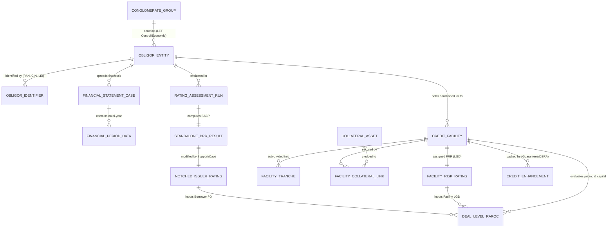

# DOC-00: EXECUTIVE SUMMARY, PLATFORM VISION & ENTERPRISE ARCHITECTURE BLUEPRINT

**Document Reference:** `DOC-00`  
**System Name:** Next-Generation Internal Ratings Platform (IRP - Project ICON)  
**Target Environment:** Indian Tier-1 Scheduled Commercial Banks (Public & Private Sector)  
**Standard Release:** 2026 Enterprise Edition  
**Classification:** Confidential / System Architecture Specification  

---

## 1.0 Executive Summary & Strategic Platform Vision

### 1.1 Context & Strategic Impetus
For over two decades, Indian Tier-1 Scheduled Commercial Banks (SCBs)—including State Bank of India, HDFC Bank, ICICI Bank, Axis Bank, Bank of Baroda, and Punjab National Bank—have relied heavily on legacy risk assessment suites such as Moody’s Analytics CreditLens (and its predecessor RiskCalc/Financial Analyst), CRISIL RAM, or fragmented in-house spreadsheet utilities. While these systems established foundational credit risk scoring, they present fundamental structural bottlenecks when deployed in the modern Indian regulatory and corporate finance environment:

1. **Rigid Financial Spreading & Chart of Accounts:** Inability to fluidly reconcile Ministry of Corporate Affairs (MCA) Ind-AS filings with Indian GAAP (I-GAAP), audited versus provisional financials, GSTN GSTR-3B/GSTR-1 multi-state reconciliations, and Reserve Bank of India (RBI) Scale-Based Regulation (SBR) formats for NBFCs.
2. **Disconnected Rating Modalities:** Credit decisions often decouple standalone borrower risk (Borrower Risk Rating - BRR) from specific facility collateral structures (Facility Risk Rating - FRR), legal entity seniority (Issuer vs. Issue), credit enhancements (partial corporate guarantees, SBLCs, DSRA escrows), and dynamic risk-adjusted pricing (RAROC).
3. **Monolithic Model Release Cycles:** Scoring models are hard-coded in proprietary engines, requiring 6 to 12 months vendor professional services cycles to adjust a single industry quartile spline or regulatory cap.
4. **Absence of Native Bi-Temporality:** Existing platforms overwrite financial statements or retrospective audit corrections, destroying the bank's ability to run true "As-of" Point-In-Time (PIT) back-testing required under RBI Master Directions on Internal Ratings Based (IRB) approaches.
5. **Data Sovereignty & Scalability Bottlenecks:** High TCO, closed schemas, and reliance on overseas vendor roadmaps that fail to prioritize Indian statutory mandates (such as CRILC reporting, LEF limits, wilful defaulter registries, and IRACP provisioning).

### 1.2 Platform Mission: Project ICON (Internal Credit Origin & Notching)
The **Internal Ratings Platform (IRP / Project ICON)** is an institutional-grade, microservices-native credit risk underwriting, scoring, and regulatory capital platform engineered specifically for Indian wholesale banking. ICON delivers:
- **Low-Code Model Studio & Sandbox:** Complete independence for Bank Risk Modelers to design, calibrate, back-test (Gini, ROC-AUC, KS, PSI), and deploy scorecards without vendor code intervention `[REF: DOC-04 §2.0]`.
- **Comprehensive Dualities:** Full mathematical alignment of Standalone Credit Profile (SACP) $\rightarrow$ Parental/GRE Notched Rating $\rightarrow$ Facility Risk Rating (FRR) $\rightarrow$ Issue Rating $\rightarrow$ Deal-level RAROC pricing `[REF: DOC-04 §1.0]`, `[REF: DOC-05 §1.0]`, `[REF: DOC-06 §1.0]`, `[REF: DOC-08 §3.0]`.
- **Bi-Temporal Audit Fabric:** Every entity, balance sheet item, qualitative score, collateral valuation, and model parameter is stamped with both Valid Time (Business Time) and System Time (Transaction Time), providing uncompromised time-travel analytics and regulatory reproducibility `[REF: DOC-10 §1.0]`.
- **Regulatory-Grade Indian Banking Compliance:** Native implementation of RBI Large Exposures Framework (LEF), Prudential Framework for Resolution of Stressed Assets (June 7, 2019 Circular), Master Direction on Income Recognition, Asset Classification and Provisioning (IRACP), and Basel III / IRB Advanced requirements `[REF: DOC-01 §2.0]`, `[REF: DOC-02 §9.0]`.

---

## 2.0 Scope Across Target Lending Segments

The platform provides end-to-end coverage across the bank's non-retail borrowing portfolio:

| Segment Code | Segment Name | Turnover / Asset Threshold | Primary Financial Template `[REF: DOC-03]` | Risk Methodology |
| :--- | :--- | :--- | :--- | :--- |
| **SEG-LC** | Large Corporate | Turnover > ₹500 Cr | Ind-AS Manufacturing / Services | Comprehensive Quantitative + Industry/Biz + Governance + EWS + Parental Support |
| **SEG-MC** | Mid-Corporate | Turnover ₹100 Cr to ₹500 Cr | Ind-AS / I-GAAP Commercial | Standard Corporate Scorecard + Bank Conduct & Working Capital Strains |
| **SEG-SME** | SME / MSME | Turnover ₹5 Cr to ₹100 Cr | MSME Simplified (GSTN + ITR + Banking) | Automated Banking Analyzer + Tax Spreading + Scorecard with Promoter Net Worth |
| **SEG-NBFC**| NBFCs & HFCs | Asset Size > ₹50 Cr | RBI Scale-Based Regulation (NBFC-ND-SI, NBFC-D, HFC) | ALM Bucketing, Collection Efficiency, Capital Adequacy (CRAR), NPA / Stressed Book |
| **SEG-CRE** | Commercial Real Estate | Total Project Cost > ₹50 Cr | CRE Project Cashflow & Escrow Template | Escrow Waterfall, Approval Milestones, Velocity of Sales, Construction Progress vs Drawdown |
| **SEG-INFRA**| Infra & Project Finance | Project Debt > ₹100 Cr | Concession / Project Finance DCF Model | Pre-COD Execution Risk, Concession Covenants, Debt Sculpturing, LLCR & Project DSCR |
| **SEG-FI** | Financial Institutions | Scheduled Banks & Primary Dealers | Statutory Bank Template (Basel III Disclosures) | CAMELS Framework (Capital, Asset Quality, Management, Earnings, Liquidity, Sensitivity) |

---

## 3.0 Enterprise Architecture Blueprint (Mermaid.js)

The platform is designed as an event-driven, cloud-native / on-premises microservices architecture operating inside the bank’s secure perimeter (Demilitarized Zone - DMZ and Core Banking Secure LAN).

```mermaid
graph TB
    subgraph Client_Layer ["Stakeholder Presentation & Consoles [REF: DOC-12 §1.0]"]
        RM["Relationship Manager Console (Web/React)"]
        UW["Underwriter & Risk Analyst Studio"]
        CRO["CRO Portfolio & Stress Testing Dashboard"]
        COMM["Credit Committee / CAC iPad/Web Dossier"]
        AUD["Internal Audit & Regulatory Gateway"]
    end

    subgraph API_Gateway_Layer ["API Management & Zero-Trust Perimeter"]
        GW["API Gateway (Kong Enterprise / Envoy)"]
        IAM["IAM & Auth (OAuth2 / OIDC / SAML 2.0 / Active Directory / MFA)"]
    end

    subgraph Core_Microservices ["Core Microservices Domain Engine"]
        OHS["DOC-01: Obligor & Hierarchy Service<br/>(Graph Engine: Neo4j / PostgreSQL AGE)"]
        MDS["DOC-02: Master Data & Lookup Service<br/>(PostgreSQL + Redis Cache)"]
        FSS["DOC-03: Financial Spreading & COA Engine<br/>(Golang High-Performance Matrix)"]
        BRS["DOC-04: Borrower Risk Rating (BRR) Engine<br/>(CEL & Python Worker Nodes)"]
        NMS["DOC-05: Support & External Notch Service<br/>(Deterministic Decision Tables)"]
        FRS["DOC-06: Facility Risk & Collateral Engine<br/>(LGD Haircut & Recovery Estimator)"]
        IES["DOC-07: Issuer/Issue & Enhancement Engine<br/>(Credit Substitution & Escrow Verifier)"]
        LCS["DOC-08: Limit, Exposure & RAROC Engine<br/>(Monte Carlo & Vasicek EC Engine)"]
        MSS["DOC-09: Model Studio & Sandbox Service<br/>(Wasm / Isolated Python Execution)"]
        WFS["DOC-11: Maker-Checker Workflow Engine<br/>(BPMN 2.0 / Temporal.io)"]
    end

    subgraph Data_Storage_Layer ["Bi-Temporal Persistence & Event Streams"]
        EVENT_BUS["Apache Kafka Enterprise Event Bus (Transactional Topics)"]
        BITEMP_DB["DOC-10: Bi-Temporal Data Store<br/>(PostgreSQL with pg_bitemporal / YugabyteDB)"]
        AUDIT_WORM["DOC-11: Immutable Audit Store<br/>(WORM Compliant Object Storage / SHA-256 Chains)"]
        CACHE["In-Memory Lookup Cache<br/>(Redis Cluster)"]
    end

    subgraph External_Integration_Layer ["External FinTech & Regulatory Gateways"]
        MCA["MCA21 (Company Filings & Charges)"]
        GSTN["GSTN API (GSTR-1, 3B, 2B Reconciliation)"]
        CIC["Credit Bureaus (CIBIL Commercial, CRIF HighMark)"]
        CRILC["RBI CRILC & Wilful Defaulter Database"]
        CBS["Core Banking System (Finacle / BaNCS / Flexcube)"]
        LMS["Loan Management System (LOS / LMS)"]
    end

    %% Client to Gateway
    RM --> GW
    UW --> GW
    CRO --> GW
    COMM --> GW
    AUD --> GW
    GW --- IAM

    %% Gateway to Services
    GW --> OHS
    GW --> FSS
    GW --> BRS
    GW --> FRS
    GW --> LCS
    GW --> MSS
    GW --> WFS

    %% Inter-service Orchestration via Event Bus & gRPC
    OHS <-->|gRPC| FSS
    FSS <-->|gRPC| BRS
    BRS <-->|gRPC| NMS
    NMS <-->|gRPC| FRS
    FRS <-->|gRPC| IES
    IES <-->|gRPC| LCS
    
    Core_Microservices --> EVENT_BUS
    Core_Microservices --> BITEMP_DB
    Core_Microservices --> AUDIT_WORM
    MDS --> CACHE

    %% External Gateways
    Core_Microservices <--> MCA
    Core_Microservices <--> GSTN
    Core_Microservices <--> CIC
    Core_Microservices <--> CRILC
    Core_Microservices <--> CBS
    Core_Microservices <--> LMS
```

---

## 4.0 Obligor-to-Group & Facility Entity Relationship Data Model (ERD)

The platform enforces a rigorous structural separation between legal obligor identity, corporate group aggregation, financial reporting entities, credit rating runs, credit facilities, collateral charges, and credit enhancements.

---

## 5.0 Traceability & Inter-Module Dependency Matrix

To ensure flawless end-to-end integrity and engineering traceability, all dependencies across the 12 functional modules are mapped in the following matrix:

| Module Identifier | Module Title | Primary Upstream Dependencies | Primary Downstream Consuming Modules | Core Data Artifacts Produced |
| :--- | :--- | :--- | :--- | :--- |
| **`DOC-00`** | Executive Summary & Blueprint | Platform Strategic Mandate | All Modules (`DOC-01` to `DOC-12`) | System Vision, NFR SLA Baseline, Architecture Schemas |
| **`DOC-01`** | Obligor & Corporate Hierarchy Engine | Core Banking (CBS), MCA21, CIBIL | `DOC-05`, `DOC-08`, `DOC-10`, `DOC-12` | Ultimate Parent Mapping, LEF Connected Groups, Headroom Limits |
| **`DOC-02`** | Master Data Architecture & Dictionaries | RBI Regulations, Basel III, Internal Risk Policy | All Modules (`DOC-01` to `DOC-12`) | 20-Grade Master Scale, NIC Codes, Haircut Matrix, COA Taxonomy |
| **`DOC-03`** | Financial Spreading & COA Engine | `DOC-02` (COA Master), GSTN, MCA21 | `DOC-04`, `DOC-08`, `DOC-10` | Standardized Financial Ratios, EBITDA, Adjusted Net Worth, DSCR |
| **`DOC-04`** | Borrower Risk Rating (BRR) & Model Studio | `DOC-02` (Scales), `DOC-03` (Ratios), `DOC-09` (Active Model) | `DOC-05`, `DOC-08`, `DOC-10`, `DOC-11` | Standalone Credit Profile (SACP Grade 1-20), PD, Score Breakdown |
| **`DOC-05`** | Support & External Notch Modifiers | `DOC-01` (Parent Mapping), `DOC-04` (SACP), `DOC-02` (Overrides) | `DOC-07`, `DOC-08`, `DOC-11` | Notched Issuer Rating, Government Uplift, Auditor/SMA Ceilings |
| **`DOC-06`** | Facility Risk Rating (FRR) & Haircuts | `DOC-02` (Haircuts), `DOC-08` (Facility Limits), Valuer Reports | `DOC-07`, `DOC-08`, `DOC-11` | Facility LGD (%), FRR Grades (FRR-1 to FRR-5), Realizable Value |
| **`DOC-07`** | Issuer vs. Issue & Credit Enhancement | `DOC-05` (Issuer Rating), `DOC-06` (FRR/LGD), Legal Contracts | `DOC-08`, `DOC-11`, `DOC-12` | Issue Rating, Guaranteed Exposure Tranches, Structured TRA Waterfall |
| **`DOC-08`** | Limits, CCF & RAROC Engine | `DOC-01` (Group Cap), `DOC-04` (PD), `DOC-06` (LGD), `DOC-07` (Issue) | `DOC-11`, `DOC-12` | EAD ($), Expected Loss ($), Economic Capital ($), RAROC (%), Hurdle Spread |
| **`DOC-09`** | Model Versioning & CI/CD Pipeline | Model Risk Governance, `DOC-04` (Scorecards) | `DOC-04`, `DOC-10`, `DOC-11` | Immutable Sealed Artifact Bundles (ZIP/YAML), Dual-Key Approvals |
| **`DOC-10`** | Bi-Temporal Architecture & Analytics | Transaction Events from all engines | `DOC-11`, `DOC-12`, Backtesting Engines | Valid-Time & System-Time Slices, Markov Migration Matrices, Default Curves |
| **`DOC-11`** | Audit Trail, Lineage & Governance | User Actions & Workflow Events across platform | `DOC-12`, Statutory Audit, RBI Inspection | Event-Sourced Audit Logs, Step-by-Step Derivation Proofs, DOA Approvals |
| **`DOC-12`** | Stakeholder Portals & Banking NFRs | Outputs from all engines (`DOC-01` to `DOC-11`) | Bank Users (RM, Underwriter, CRO, Committee, Regulators) | Executive Dossiers, CRILC Gateway, AES-256 Storage, 99.99% SLA Platform |

---

## 6.0 Cross-Reference & Linkage Guide
Every subsequent module in this suite explicitly adheres to the cross-referencing syntax `[REF: DOC-XX §Y.Z]`. Software engineers and risk modelers must treat these cross-references as strict architectural contracts.
