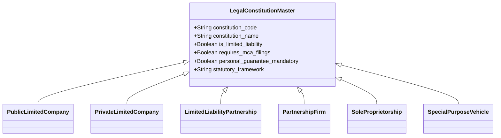
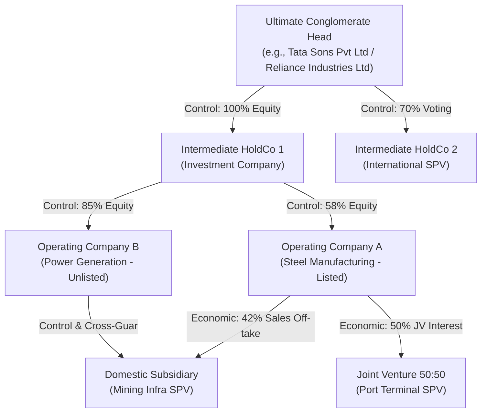

# DOC-01: OBLIGOR, CONGLOMERATE GROUP & CORPORATE HIERARCHY ENGINE

**Document Reference:** `DOC-01`  
**System Name:** Next-Generation Internal Ratings Platform (IRP - Project ICON)  
**Parent Document:** `[REF: DOC-00 §3.0]`  
**Module Type:** Core Domain Microservice Specification  
**Classification:** Confidential / System Architecture Specification  

---

## 1.0 Single Obligor Entity Structure

### 1.1 Multi-Identifier Resolution & Master Entity Registry
In the Indian banking landscape, an obligor cannot be identified solely by a Core Banking Customer ID (CIF) or a single PAN. A robust corporate ratings platform requires an authoritative master identity resolution engine capable of handling legal, tax, commercial, and regulatory identifiers across jurisdictions.

The Obligor Hierarchy Service maintains a dedicated `ObligorMaster` entity with strict validation algorithms for Indian statutory identifiers:

| Identifier Type | Issuing Authority | Format / Regex Pattern | Validation Rule & Regulatory Mandate | System Usage |
| :--- | :--- | :--- | :--- | :--- |
| **PAN** | Income Tax Department | `^[A-Z]{5}[0-9]{4}[A-Z]{1}$` | 4th char verifies entity type (`C`=Company, `P`=Individual, `F`=Firm, `A`=AOP, `T`=Trust). Modulo-check validation. | Primary Tax Deduplication Key across all accounts. |
| **CIN / LLPIN** | Ministry of Corporate Affairs (MCA) | `^[LU]{1}[0-9]{5}[A-Z]{2}[0-9]{4}[A-Z]{3}[0-9]{6}$` or `^[A-Z]{3}-[0-9]{4}$` | 21-digit alphanumeric. 1st char: Listed(`L`)/Unlisted(`U`). 2-6: NIC code. 7-8: State. 9-12: Year. 13-15: Ownership (`PTC`,`PLC`,`GOI`). | MCA21 Direct Integration for annual filings, charges, and DINs. |
| **LEI** | Global LEI Foundation (GLEIF) / CCIL | `^[0-9A-Z]{18}[0-9]{2}$` | 20-character alphanumeric. ISO 17442 compliant. Modulo 97 checksum. | **Mandatory per RBI for total credit exposure $\ge$ ₹50 Cr**. System blocks rating approval if missing for eligible obligors. |
| **GSTIN** | Goods and Services Tax Network | `^[0-9]{2}[A-Z]{5}[0-9]{4}[A-Z]{1}[1-9A-Z]{1}Z[0-9A-Z]{1}$` | 15-character alphanumeric. First 2 digits match State Code. 3-12 match Entity PAN. | Multiple GSTINs map to single PAN. Feeds sales reconciliation engine `[REF: DOC-03 §1.5]`. |
| **Udyam Reg.** | Ministry of MSME | `^UDYAM-[A-Z]{2}-[0-9]{2}-[0-9]{7}$` | Validated against MSME National Portal. Verified against investment in plant & turnover. | PSL eligibility determination `[REF: DOC-02 §1.2]` and MSME template routing. |
| **CKYC / KIN** | CERSAI | `^[0-9]{14}$` | 14-digit numeric Central KYC Identifier. | AML / CFT and Ultimate Beneficial Owner (UBO) compliance. |

### 1.2 Entity Legal Constitutions & Governance Implications
The platform supports explicit legal constitution archetypes. Each constitution defines whether financial spreading requires standalone or consolidated analysis, whether personal guarantees are mandatory, and the legal recourse in insolvency:



1. **Public Limited Company (PUB_LTD):** Governed by Companies Act 2013. Board oversight, mandatory independent directors, quarterly MCA/SEBI disclosures. Limited liability.
2. **Private Limited Company (PVT_LTD):** Governed by Companies Act 2013. Minimum 2 directors. Limited liability. Promoter share pledging checks enforced `[REF: DOC-04 §1.3]`.
3. **Limited Liability Partnership (LLP):** Governed by LLP Act 2008. Hybrid between partnership and company. Partners' liability limited to agreed contribution.
4. **Partnership Firm (PART_FIRM):** Governed by Indian Partnership Act 1932. Unlimited joint and several liability of partners. Net worth of partners must be aggregated.
5. **Sole Proprietorship (SOLE_PROP):** Unlimited personal liability. Spreading relies heavily on ITR, Capital Account accretion, and bank statement analytics `[REF: DOC-03 §1.5]`.
6. **Special Purpose Vehicle (SPV_PROJECT):** Ring-fenced entity for infrastructure or real estate projects. Recourse limited to project escrow and assets `[REF: DOC-07 §3.0]`.

---

## 2.0 Conglomerate & Group of Connected Counterparties (GCC) Architecture (RBI LEF Compliant)

### 2.1 Visual Tree & Directed Graph Data Model
In corporate banking, evaluating an obligor in isolation creates blind spots. An obligor may appear financially solvent, but upstream dividend stripping by an over-leveraged parent or downstream cross-guarantees can trigger sudden default contagion.

The platform implements a **Directed Acyclic Graph (DAG)** model storing relationship topologies between corporate entities:



### 2.2 Dual Connection Criteria per RBI Large Exposures Framework (LEF)
Per RBI Master Directions on Large Exposures Framework (LEF), two or more natural or legal persons constitute a "Group of Connected Counterparties" (GCC) if at least one of the following conditions is satisfied:

#### Criterion A: Control Relationship
A counterparty controls another counterparty if it possesses:
1. Ownership of more than 50% of the voting rights of the other entity.
2. The right to appoint or remove a majority of the members of the board of directors, management committee, or governing body.
3. Power to direct the management and policies of the entity under a shareholders' agreement, articles of association, or statutory authority.
4. Substantial de facto control (e.g., controlling 30-50% with dispersed minority holdings and majority board representation).

#### Criterion B: Economic Interdependence Relationship
Even where no direct legal or equity control exists, two obligors MUST be aggregated into a connected group if the financial failure of one counterparty would lead to the funding or solvency failure of the other. The system evaluates five statutory triggers:
1. **Sales / Offtake Dependency:** When 25% or more of an obligor's annual gross sales or revenues are derived from transactions with a single counterparty.
2. **Procurement Dependency:** When 25% or more of an obligor's annual raw materials or operating inputs are sourced exclusively from a single counterparty and cannot be substituted in the short term.
3. **Cross-Guarantees & Financial Backstops:** Full or partial credit guarantees provided by one obligor for another's debts that exceed 20% of the guarantor's Tangible Net Worth (TNW) `[REF: DOC-07 §2.0]`.
4. **Common Source of Repayment:** Both counterparties rely on the same primary revenue stream or project cash escrow to service bank debt (e.g., two SPVs servicing debt from the same toll highway concession).
5. **Funding Contagion:** Obligor A relies on direct loans, inter-corporate deposits (ICDs), or equity support from Obligor B to avoid liquidity default.

---

## 3.0 Group Limit & Capital Headroom Tracking Engine

### 3.1 Regulatory Exposure Ceilings per RBI Mandate
The Limit Engine maintains dynamic exposure limits calculated against the Bank's actively published **Tier-1 Eligible Capital Base**:

$$\text{Single Obligor Exposure Ceiling} = 20\% \times \text{Bank Tier-1 Capital}$$

$$\text{Single Obligor Infrastructure Leeway} = +5\% \text{ (Subject to prior Board approval for eligible infra projects)}$$

$$\text{Group of Connected Counterparties (GCC) Ceiling} = 25\% \times \text{Bank Tier-1 Capital}$$

$$\text{GCC Infrastructure Additional Headroom} = +10\% \text{ (If incremental exposure is solely deployed in National Infra Pipeline)}$$

*Example Benchmark (Tier-1 Bank with ₹1,00,000 Crore Eligible Tier-1 Capital):*
- Single Obligor Standard Limit: ₹20,000 Cr.
- Single Obligor Infra Maximum: ₹25,000 Cr.
- Economic Group Standard Limit: ₹25,000 Cr.
- Economic Group Infra Maximum: ₹35,000 Cr.

### 3.2 Real-Time Headroom Calculation Algorithm
Prior to sanctioning or re-rating any credit facility, the system executes an automated headroom verification:

$$\text{Available Headroom}_{\text{Group}} = \text{LEF Exposure Ceiling}_{\text{Group}} - \sum_{i \in \text{Entities}} \left( \text{Drawn Exposure}_i + (\text{Sanctioned Undrawn}_i \times \text{CCF}_i) + \text{Proposed Limit}_i \right)$$

If $\text{Available Headroom} < 0$, the system issues a **Hard System Breach Warning (BLOCK_CODE: LEF_BREACH_001)** preventing credit memo finalization without explicit Board of Directors approval and capital allocation sign-off `[REF: DOC-08 §1.0]`.

---

## 4.0 Database Schema & Graph Data Model Specification

### 4.1 Relational DDL (PostgreSQL)

```sql
-- Schema: obligor_hierarchy
CREATE TABLE obligor_entity (
    entity_id UUID PRIMARY KEY DEFAULT gen_random_uuid(),
    legal_name VARCHAR(255) NOT NULL,
    trade_name VARCHAR(255),
    constitution_code VARCHAR(30) NOT NULL REFERENCES master_constitution(code),
    pan VARCHAR(10) UNIQUE NOT NULL,
    cin_llpin VARCHAR(21) UNIQUE,
    lei VARCHAR(20) UNIQUE,
    incorporation_date DATE NOT NULL,
    registered_state VARCHAR(2) NOT NULL,
    status VARCHAR(20) DEFAULT 'ACTIVE',
    valid_from TIMESTAMPTZ NOT NULL,
    valid_to TIMESTAMPTZ NOT NULL,
    system_from TIMESTAMPTZ NOT NULL DEFAULT CURRENT_TIMESTAMP,
    system_to TIMESTAMPTZ NOT NULL DEFAULT '9999-12-31 23:59:59+00'
);

CREATE TABLE conglomerate_group (
    group_id UUID PRIMARY KEY DEFAULT gen_random_uuid(),
    group_code VARCHAR(50) UNIQUE NOT NULL,
    group_name VARCHAR(255) NOT NULL,
    ultimate_parent_entity_id UUID REFERENCES obligor_entity(entity_id),
    lef_classification VARCHAR(30) NOT NULL DEFAULT 'CONNECTED_COUNTERPARTIES',
    board_approved_limit_inr NUMERIC(18,2) NOT NULL,
    valid_from TIMESTAMPTZ NOT NULL,
    valid_to TIMESTAMPTZ NOT NULL,
    system_from TIMESTAMPTZ NOT NULL DEFAULT CURRENT_TIMESTAMP,
    system_to TIMESTAMPTZ NOT NULL DEFAULT '9999-12-31 23:59:59+00'
);

CREATE TABLE entity_relationship_edge (
    edge_id UUID PRIMARY KEY DEFAULT gen_random_uuid(),
    parent_entity_id UUID NOT NULL REFERENCES obligor_entity(entity_id),
    child_entity_id UUID NOT NULL REFERENCES obligor_entity(entity_id),
    relationship_type VARCHAR(50) NOT NULL, -- 'EQUITY_CONTROL', 'BOARD_CONTROL', 'ECONOMIC_OFFTAKE', 'CROSS_GUARANTEE'
    connection_basis VARCHAR(30) NOT NULL, -- 'LEF_CONTROL', 'LEF_ECONOMIC_DEPENDENCE'
    equity_holding_pct NUMERIC(5,2),
    voting_power_pct NUMERIC(5,2),
    annual_sales_offtake_pct NUMERIC(5,2),
    guarantee_amount_inr NUMERIC(18,2),
    effective_from DATE NOT NULL,
    effective_to DATE,
    created_by VARCHAR(100) NOT NULL,
    created_at TIMESTAMPTZ DEFAULT CURRENT_TIMESTAMP
);
```

### 4.2 Graph Topology Model (Cypher / Graph Query)
For high-performance transitive group closure and contagion detection, relationship edges are synced to Neo4j / PostgreSQL Apache AGE:

```cypher
// Query: Compute entire Economic Group for an Obligor including indirect holdings
MATCH (o:Obligor {pan: "AAACT1234F"})
MATCH path = (root:Obligor)-[:CONTROLS|ECONOMICALLY_DEPENDS_ON*0..5]-(o)
RETURN path;

// Query: Detect circular cross-guarantees or financial contagion rings
MATCH (a:Obligor)-[g1:CROSS_GUARANTEE]->(b:Obligor)-[g2:CROSS_GUARANTEE]->(a:Obligor)
RETURN a.legal_name, b.legal_name, g1.guarantee_amount_inr, g2.guarantee_amount_inr;
```

---

## 5.0 API Specifications & Payload Contracts

### 5.1 Endpoint: Check LEF Headroom & Validate Hierarchy
- **Method:** `POST`
- **Route:** `/api/v1/hierarchy/lef-headroom-check`
- **Headers:** `Authorization: Bearer <JWT>`, `X-Request-Id: <UUID>`

#### Request Payload
```json
{
  "obligor_pan": "AABCS1234K",
  "proposed_facility_amount_inr": 2500000000.00,
  "facility_type": "FB_TERM_LOAN",
  "is_infrastructure_project": true,
  "currency": "INR"
}
```

#### Response Payload
```json
{
  "status": "SUCCESS",
  "data": {
    "obligor_id": "8f1a23e4-5678-4b90-bcde-123456789abc",
    "obligor_name": "STEEL FABRICATORS BHARAT LIMITED",
    "conglomerate_group": {
      "group_id": "c92d34f5-6789-4a01-cdef-234567890def",
      "group_name": "BHARAT INDUSTRIAL CONGLOMERATE",
      "connection_basis": ["LEF_CONTROL_EQUITY_65PCT", "LEF_ECONOMIC_OFFTAKE_40PCT"]
    },
    "bank_tier1_capital_inr": 1000000000000.00,
    "group_limit_metrics": {
      "max_group_ceiling_pct": 35.0,
      "max_group_ceiling_inr": 350000000000.00,
      "current_group_exposure_inr": 295000000000.00,
      "proposed_exposure_inr": 2500000000.00,
      "post_sanction_group_exposure_inr": 297500000000.00,
      "remaining_group_headroom_inr": 52500000000.00,
      "headroom_status": "APPROVED_WITHIN_CEILING"
    },
    "single_obligor_metrics": {
      "max_obligor_ceiling_pct": 25.0,
      "max_obligor_ceiling_inr": 250000000000.00,
      "current_obligor_exposure_inr": 18000000000.00,
      "post_sanction_obligor_exposure_inr": 20500000000.00,
      "remaining_obligor_headroom_inr": 229500000000.00,
      "headroom_status": "APPROVED_WITHIN_CEILING"
    },
    "compliance_flags": {
      "is_lei_mandatory": true,
      "lei_provided": "335800QXYZ1234567890",
      "lei_status": "VALID_GLEIF_VERIFIED"
    }
  }
}
```
