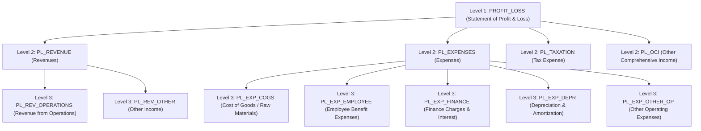
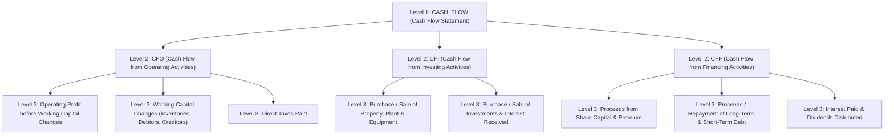
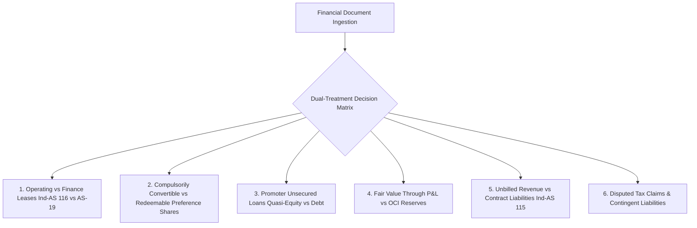

# DOC-03A: MASTER CHART OF ACCOUNTS (COA) TAXONOMY & CROSS-GAAP (Ind-AS, I-GAAP, IFRS) MAPPING MATRIX

**Document Reference:** `DOC-03A`  
**System Name:** Next-Generation Internal Ratings Platform (IRP - Project ICON)  
**Parent Document:** `[REF: DOC-00 §3.0]`, `[REF: DOC-02 §5.0]`, `[REF: DOC-03 §1.0]`  
**Module Type:** Comprehensive Accounting Taxonomy & Canonical Data Dictionary  
**Classification:** Confidential / System Architecture Specification  

---

## 1.0 Executive Framework & 4-Level Hierarchical Tree Architecture

### 1.1 Objective & Structural Rationale
In corporate credit underwriting across Indian Tier-1 Scheduled Commercial Banks, financial spreading errors primarily stem from accounting standard divergence:
- **Ministry of Corporate Affairs (MCA) Ind-AS (Indian Accounting Standards):** Mandatory for all listed companies and unlisted companies with net worth $\ge$ ₹250 Crore, aligned with IFRS (Schedule III, Division II of Companies Act 2013).
- **Indian GAAP (I-GAAP / AS):** Still applicable to thousands of Mid-Corporate, SME, and unlisted entities with net worth $<$ ₹250 Crore (Schedule III, Division I of Companies Act 2013).
- **International Financial Reporting Standards (IFRS):** Used by foreign parents, cross-border joint ventures, and international corporate borrowing facilities.

To eradicate ambiguity where financial values should be populated, Project ICON establishes a strict **4-Level Hierarchical Tree Structure**:

```
Level 1: Financial Statement Segment (Root Node)
 │
 ├── Level 2: Financial Classification / Nature of Balance (Major Category)
 │    │
 │    ├── Level 3: Sub-Classification / Grouping Line (Summary Group)
 │    │    │
 │    │    └── Level 4: Canonical Leaf Accounting Item (Terminal Operational Node)
```

Every Level 4 node possesses an immutable canonical code (`CANON_...`), a normal debit/credit balance indicator, and precise mapping anchors across Ind-AS, I-GAAP, and IFRS.

---

## 2.0 Native Chart of Accounts: Balance Sheet - Equity & Liabilities Tree

The following exhaustive tree defines every terminal line item across the liabilities and equity side of the balance sheet:

```mermaid
graph TD
    ROOT_LIAB["Level 1: BS_LIAB_EQUITY (Equity & Liabilities)"]
    
    ROOT_LIAB --> C2_EQ["Level 2: EQ_SHAREHOLDERS_FUNDS (Equity / Capital)"]
    ROOT_LIAB --> C2_NCL["Level 2: NCL_NON_CURRENT_LIAB (Non-Current Liabilities)"]
    ROOT_LIAB --> C2_CL["Level 2: CL_CURRENT_LIAB (Current Liabilities)"]

    C2_EQ --> G3_EQ_CAP["Level 3: EQ_CAPITAL (Share Capital)"]
    C2_EQ --> G3_EQ_RES["Level 3: EQ_RESERVES (Other Equity & Reserves)"]
    C2_EQ --> G3_EQ_NCI["Level 3: EQ_NCI (Non-Controlling Interests)"]

    C2_NCL --> G3_NCL_BORR["Level 3: NCL_BORROWINGS (Long-Term Debt)"]
    C2_NCL --> G3_NCL_LEASE["Level 3: NCL_LEASE_LIAB (Long-Term Lease Liabilities)"]
    C2_NCL --> G3_NCL_PROV["Level 3: NCL_PROVISIONS (Long-Term Provisions)"]
    C2_NCL --> G3_NCL_DTL["Level 3: NCL_TAX (Deferred Tax Liabilities - DTL)"]

    C2_CL --> G3_CL_BORR["Level 3: CL_BORROWINGS (Short-Term Debt)"]
    C2_CL --> G3_CL_PAYABLE["Level 3: CL_TRADE_PAYABLES (Trade & Operating Payables)"]
    C2_CL --> G3_CL_LEASE["Level 3: CL_LEASE_LIAB (Current Lease Liabilities)"]
    C2_CL --> G3_CL_CMLTD["Level 3: CL_CMLTD (Current Maturities of Long-Term Debt)"]
    C2_CL --> G3_CL_PROV["Level 3: CL_PROVISIONS (Short-Term Provisions)"]
```



### 2.1 Detailed Specification: Equity & Liabilities Terminal Nodes
The table below specifies every single terminal node in the Equity and Liabilities hierarchy, complete with cross-GAAP references and spreading populating rules:

| Canonical Node Code | Canonical Line Item Name | Normal Balance | Ind-AS Sch III Div II Line Ref | I-GAAP Sch III Div I Line Ref | IFRS (IAS 1) Reference | Populating Instruction & Ambiguity Resolution |
| :--- | :--- | :--- | :--- | :--- | :--- | :--- |
| `CANON_BS_EQ_EQUITY_CAP` | Paid-up Equity Share Capital | Credit | Equity -> Equity Share Capital | Shareholders' Funds -> Share Capital -> Equity | Equity -> Issued Capital | Include only fully paid and partly paid equity capital. Excludes share application money pending allotment. |
| `CANON_BS_EQ_PREF_CAP_PERP`| Irredeemable / Perpetual Pref Capital | Credit | Equity -> Other Equity -> Instruments entirely equity in nature | Shareholders' Funds -> Share Capital -> Preference | Equity -> Equity Components of Compound Instruments | Mandatory condition: No fixed redemption date or dividend coupon commitment. If redeemable, map to `CANON_BS_NCL_BORR_PREF`. |
| `CANON_BS_EQ_CAP_RES` | Capital Reserve | Credit | Equity -> Other Equity -> Capital Reserve | Reserves & Surplus -> Capital Reserve | Equity -> Capital Reserves | Created out of capital transactions (e.g. forfeiture of shares, amalgamation surplus). Non-distributable. |
| `CANON_BS_EQ_SEC_PREM` | Securities Premium | Credit | Equity -> Other Equity -> Securities Premium | Reserves & Surplus -> Securities Premium Account | Equity -> Share Premium | Premium received on issuance of shares over face value. Non-distributable except under §52 Companies Act. |
| `CANON_BS_EQ_GEN_RES` | General Reserve | Credit | Equity -> Other Equity -> General Reserve | Reserves & Surplus -> General Reserve | Equity -> Retained Earnings (General) | Free reserves transferred out of profits. Fully available for dividend distribution. Included in Tangible Net Worth. |
| `CANON_BS_EQ_RET_EARN` | Retained Earnings / Surplus in P&L | Credit | Equity -> Other Equity -> Retained Earnings | Reserves & Surplus -> Surplus in Statement of P&L | Equity -> Retained Earnings | Cumulative unallocated profits/losses. If negative (debit balance), entered as negative credit reducing Net Worth. |
| `CANON_BS_EQ_REVAL_RES` | Revaluation Reserve | Credit | Equity -> Other Equity -> Revaluation Surplus | Reserves & Surplus -> Revaluation Reserve | Equity -> Revaluation Surplus | **Deducted from Tangible Net Worth (ATNW)** in all credit scorecards `[REF: DOC-03 §3.1]`. Represents unrealized asset markup. |
| `CANON_BS_EQ_FVTOCI_RES` | Other Comprehensive Income (OCI) Reserve | Cr / Dr | Equity -> Other Equity -> Debt/Equity instruments through OCI | Not Applicable (I-GAAP lacks OCI framework) | Equity -> Other Reserves (OCI Accumulated) | Unrealized mark-to-market gains/losses on equity/debt investments held at FVTOCI and cash flow hedge reserves. |
| `CANON_BS_EQ_SH_APPL_MON` | Share Application Money Pending Allotment | Credit | Equity -> Share application money pending allotment | Share application money pending allotment | Equity -> Share Application Monies | Counted in Quasi-Equity ONLY if application money is non-refundable and shares are allotted within 60 days. |
| `CANON_BS_EQ_NCI` | Non-Controlling Interest (Minority Interest)| Credit | Non-Controlling Interests | Minority Interest | Non-Controlling Interests | Applicable only in Consolidated financial statements. Excluded from standalone borrower net worth. |
| `CANON_BS_NCL_BORR_TERM_BK`| Long-Term Secured Rupee Term Loans (Banks)| Credit | Non-Current Liab -> Fin Liab -> Borrowings -> Term Loans | Non-Current Liab -> Long-Term Borrowings -> Term Loans from Banks | Non-Current Liabilities -> Long-Term Borrowings | Term borrowings from Scheduled Commercial Banks with original maturity $> 12$ months. Excludes current maturities. |
| `CANON_BS_NCL_BORR_TERM_FI`| Long-Term Secured Term Loans (FIs/NBFCs) | Credit | Non-Current Liab -> Fin Liab -> Borrowings -> Term Loans | Non-Current Liab -> Long-Term Borrowings -> From Other Parties | Non-Current Liabilities -> Long-Term Borrowings | Term borrowings from financial institutions (NABARD, SIDBI, PFC, REC) or NBFCs. |
| `CANON_BS_NCL_BORR_DEB_SEC`| Secured Non-Convertible Debentures (NCDs)| Credit | Non-Current Liab -> Fin Liab -> Borrowings -> Bonds/Debentures | Non-Current Liab -> Long-Term Borrowings -> Debentures | Non-Current Liabilities -> Bonds / Notes Issued | Listed/unlisted secured NCDs. Mapped to Long-Term Debt. |
| `CANON_BS_NCL_BORR_DEB_UNS`| Unsecured Debentures / Commercial Paper | Credit | Non-Current Liab -> Fin Liab -> Borrowings -> Bonds/Debentures | Non-Current Liab -> Long-Term Borrowings -> Unsecured Debentures | Non-Current Liabilities -> Unsecured Bonds | Unsecured corporate debentures. |
| `CANON_BS_NCL_BORR_ECB` | External Commercial Borrowings (ECB / FX) | Credit | Non-Current Liab -> Fin Liab -> Borrowings -> Foreign Currency Loans | Non-Current Liab -> Long-Term Borrowings -> Foreign Currency Loans | Non-Current Liabilities -> Foreign Currency Borrowings | Foreign currency loans subject to RBI ECB guidelines. System flags if unhedged. |
| `CANON_BS_NCL_BORR_PROMOT` | Promoter / Director Unsecured Loans | Credit | Non-Current Liab -> Fin Liab -> Borrowings -> Loans from Related Parties | Non-Current Liab -> Long-Term Borrowings -> Loans from Directors | Non-Current Liabilities -> Loans from Related Parties | **Critical Spreading Node:** Evaluated for Quasi-Equity treatment under `[REF: DOC-03 §3.1]`. If subordinated and non-withdrawable, reclassified to Quasi-Equity. |
| `CANON_BS_NCL_BORR_PREF` | Redeemable Preference Shares (Debt Nature)| Credit | Non-Current Liab -> Fin Liab -> Borrowings -> Redeemable Pref Shares | Non-Current Liab -> Long-Term Borrowings -> Preference Shares | Non-Current Liabilities -> Preference Shares (Liability) | Under Ind-AS/IFRS, redeemable preference shares are categorized as Financial Liabilities (Debt), NOT Equity. |
| `CANON_BS_NCL_LEASE_LIAB` | Non-Current Lease Liabilities (Ind-AS 116)| Credit | Non-Current Liab -> Fin Liab -> Lease Liabilities | Not Applicable (I-GAAP AS-19 treats operating lease off-balance sheet) | Non-Current Liabilities -> Lease Liabilities (IFRS 16) | Long-term discounted present value of lease liabilities. Under I-GAAP, enter 0.00. |
| `CANON_BS_NCL_PROV_EMP` | Long-Term Provisions for Employee Benefits | Credit | Non-Current Liab -> Provisions -> Employee Benefits | Non-Current Liab -> Long-Term Provisions -> Employee Benefits | Non-Current Liabilities -> Long-Term Employee Provisions | Actuarial valuation of gratuity, earned leave encashment, pension obligations. |
| `CANON_BS_NCL_DTL` | Deferred Tax Liabilities (Net) | Credit | Non-Current Liab -> Deferred Tax Liabilities (Net) | Non-Current Liab -> Deferred Tax Liabilities (Net) | Non-Current Liabilities -> Deferred Tax Liabilities | Net timing difference liability. Excluded from debt calculation. |
| `CANON_BS_CL_BORR_WC_CC_OD`| Working Capital Cash Credit / Overdraft Lines| Credit | Current Liab -> Fin Liab -> Borrowings -> Repayable on Demand | Current Liab -> Short-Term Borrowings -> Loans Repayable on Demand | Current Liabilities -> Short-Term Bank Borrowings | Bank CC/OD limits hypothecated against stocks/debtors. Classified as Current Debt in TOL/ATNW. |
| `CANON_BS_CL_BORR_WCDL` | Working Capital Demand Loans (WCDL) | Credit | Current Liab -> Fin Liab -> Borrowings -> Loans from Banks | Current Liab -> Short-Term Borrowings -> Working Capital Loans | Current Liabilities -> Short-Term Bank Borrowings | Short-term sub-limit carve-out from fund-based working capital. |
| `CANON_BS_CL_BORR_CP` | Commercial Paper (CP) Short-Term | Credit | Current Liab -> Fin Liab -> Borrowings -> Commercial Paper | Current Liab -> Short-Term Borrowings -> Other Loans | Current Liabilities -> Commercial Paper | Unsecured money market instruments maturity $< 12$ months. |
| `CANON_BS_CL_BORR_BUY_CR` | Buyers' Credit / Suppliers' Credit Lines | Credit | Current Liab -> Fin Liab -> Borrowings -> Trade Credits | Current Liab -> Short-Term Borrowings -> Buyers Credit | Current Liabilities -> Trade Loans / Buyers Credit | Short-term trade finance for imports. |
| `CANON_BS_CL_CMLTD` | Current Maturities of Long-Term Debt (CMLTD)| Credit | Current Liab -> Fin Liab -> Other Financial Liab -> Current Maturities | Current Liab -> Other Current Liabilities -> Current Maturities of Long Term Debt | Current Liabilities -> Current Portion of Long-Term Debt | **Critical Ratio Driver:** Principal repayments falling due within next 12 months. Mandatory component of DSCR denominator `[REF: DOC-03 §3.3]`. |
| `CANON_BS_CL_LEASE_CURR` | Current Lease Liabilities (Ind-AS 116) | Credit | Current Liab -> Fin Liab -> Lease Liabilities | Not Applicable | Current Liabilities -> Lease Liabilities (Current) | Lease payments falling due in next 12 months. |
| `CANON_BS_CL_INT_ACCRUED`| Interest Accrued but Not Due on Borrowings | Credit | Current Liab -> Fin Liab -> Other Fin Liab -> Interest Accrued | Current Liab -> Other Current Liabilities -> Interest Accrued but not due | Current Liabilities -> Interest Payable | Interest accrued on loans. |
| `CANON_BS_CL_INT_OVERDUE`| Interest Accrued and Due (Overdue) | Credit | Current Liab -> Fin Liab -> Other Fin Liab -> Interest Overdue | Current Liab -> Other Current Liabilities -> Interest Accrued and due | Current Liabilities -> Overdue Interest | **EWS Warning Node:** If $> 0$, triggers account conduct delinquency flag `[REF: DOC-04 §1.4]`. |
| `CANON_BS_CL_TRADE_MSME` | Trade Payables: Micro and Small Enterprises | Credit | Current Liab -> Trade Payables -> Total outstanding dues of MSME | Current Liab -> Trade Payables -> Total outstanding dues of Micro & Small | Current Liabilities -> Trade Payables - MSME | Disclosed under MSMED Act 2006. Subject to 45-day payment statutory rule. |
| `CANON_BS_CL_TRADE_OTHER`| Trade Payables: Other than MSME | Credit | Current Liab -> Trade Payables -> Dues of creditors other than MSME | Current Liab -> Trade Payables -> Dues of creditors other than Micro & Small | Current Liabilities -> Trade Payables - General | General supplier trade payables. Used for Creditor Days calculation. |
| `CANON_BS_CL_ADV_CUST` | Advance from Customers / Contract Liabilities| Credit | Current Liab -> Other Current Liab -> Advances from Customers | Current Liab -> Other Current Liabilities -> Advances from Customers | Current Liabilities -> Contract Liabilities (IFRS 15) | Advances received for goods/services. Reconciled under Ind-AS 115. Excluded from debt. |
| `CANON_BS_CL_STAT_DUES` | Statutory Dues Payable (GST, TDS, PF, ESIC) | Credit | Current Liab -> Other Current Liab -> Statutory Dues Payable | Current Liab -> Other Current Liabilities -> Statutory Remittances | Current Liabilities -> Taxes and Social Security Payable | Overdue statutory dues $> 90$ days trigger governance deduction. |
| `CANON_BS_CL_PROV_TAX` | Provision for Current Tax (Net) | Credit | Current Liab -> Current Tax Liabilities (Net) | Current Liab -> Short-Term Provisions -> Provision for Taxation | Current Liabilities -> Current Tax Liabilities | Net income tax payable for the year. |

---

## 3.0 Native Chart of Accounts: Balance Sheet - Assets Tree

The assets hierarchy defines all non-current and current asset classifications:

```mermaid
graph TD
    ROOT_ASSET["Level 1: BS_ASSETS (Total Assets)"]
    
    ROOT_ASSET --> C2_NCA["Level 2: NCA_NON_CURRENT_ASSETS (Non-Current Assets)"]
    ROOT_ASSET --> C2_CA["Level 2: CA_CURRENT_ASSETS (Current Assets)"]

    C2_NCA --> G3_NCA_PPE["Level 3: NCA_PPE (Property, Plant & Equipment)"]
    C2_NCA --> G3_NCA_CWIP["Level 3: NCA_CWIP (Capital Work-in-Progress)"]
    C2_NCA --> G3_NCA_ROU["Level 3: NCA_ROU (Right-of-Use Assets - Ind-AS 116)"]
    C2_NCA --> G3_NCA_INTANG["Level 3: NCA_INTANG (Intangible Assets & Goodwill)"]
    C2_NCA --> G3_NCA_INV["Level 3: NCA_INVESTMENTS (Non-Current Investments)"]
    C2_NCA --> G3_NCA_LOANS["Level 3: NCA_LOANS (Long-Term Loans & Advances)"]
    C2_NCA --> G3_NCA_DTA["Level 3: NCA_DTA (Deferred Tax Assets - DTA)"]

    C2_CA --> G3_CA_INV["Level 3: CA_INVENTORIES (Inventories)"]
    C2_CA --> G3_CA_REC["Level 3: CA_TRADE_REC (Trade Receivables)"]
    C2_CA --> G3_CA_CASH["Level 3: CA_CASH_BANK (Cash & Cash Equivalents)"]
    C2_CA --> G3_CA_BANK_BAL["Level 3: CA_BANK_BALANCES (Other Bank Balances / Escrow)"]
    C2_CA --> G3_CA_LOANS["Level 3: CA_LOANS (Short-Term Loans & Advances)"]
    C2_CA --> G3_CA_OTHER["Level 3: CA_OTHER (Other Current Assets / GST Balances)"]
```



### 3.1 Detailed Specification: Assets Terminal Nodes

| Canonical Node Code | Canonical Line Item Name | Normal Balance | Ind-AS Sch III Div II Line Ref | I-GAAP Sch III Div I Line Ref | IFRS (IAS 1) Reference | Populating Instruction & Ambiguity Resolution |
| :--- | :--- | :--- | :--- | :--- | :--- | :--- |
| `CANON_BS_NCA_PPE_GROSS` | Property, Plant & Equipment (Gross Block) | Debit | Non-Current Assets -> PPE -> Gross Carrying Amount | Non-Current Assets -> Fixed Assets -> Tangible Assets (Gross) | Non-Current Assets -> Property, Plant and Equipment | Tangible physical fixed assets at historical cost or deemed cost. |
| `CANON_BS_NCA_PPE_ACC_DEP`| Accumulated Depreciation on PPE | Credit (Contra) | Non-Current Assets -> PPE -> Accumulated Depreciation | Non-Current Assets -> Fixed Assets -> Tangible Assets (Accum Depr) | Non-Current Assets -> Accumulated Depreciation (Contra) | Deducted from Gross Block to arrive at Net Block. |
| `CANON_BS_NCA_PPE_NET` | Property, Plant & Equipment (Net Block) | Debit | Non-Current Assets -> PPE -> Net Carrying Amount | Non-Current Assets -> Fixed Assets -> Tangible Assets (Net Block) | Non-Current Assets -> PPE (Net Carrying Value) | Core collateral base evaluated under FRR `[REF: DOC-06 §2.0]`. |
| `CANON_BS_NCA_CWIP` | Capital Work-in-Progress (CWIP) | Debit | Non-Current Assets -> Capital Work-in-Progress | Non-Current Assets -> Fixed Assets -> Capital Work-in-Progress | Non-Current Assets -> Construction Work in Progress | Fixed assets under construction. Evaluated for cost/time overruns in Project Finance. |
| `CANON_BS_NCA_ROU_ASSET` | Right-of-Use (ROU) Assets (Ind-AS 116) | Debit | Non-Current Assets -> Right-of-Use Assets | Not Applicable (I-GAAP treats off-balance sheet) | Non-Current Assets -> Right-of-Use Assets (IFRS 16) | Capitalized operating leases. Populated as 0.00 under I-GAAP. |
| `CANON_BS_NCA_GOODWILL` | Goodwill on Consolidation | Debit | Non-Current Assets -> Goodwill | Non-Current Assets -> Fixed Assets -> Goodwill on Consolidation | Non-Current Assets -> Goodwill | **Deducted from ATNW** in all rating models. |
| `CANON_BS_NCA_INTANGIBLES`| Other Intangible Assets (Patents/Software) | Debit | Non-Current Assets -> Other Intangible Assets | Non-Current Assets -> Fixed Assets -> Intangible Assets | Non-Current Assets -> Intangible Assets | **Deducted from ATNW** in all rating models. |
| `CANON_BS_NCA_INTANG_DEV` | Intangible Assets Under Development | Debit | Non-Current Assets -> Intangible Assets Under Development | Non-Current Assets -> Fixed Assets -> Intangible Under Development | Non-Current Assets -> Capitalized Development Costs | R&D capitalized costs. Deducted from Tangible Net Worth. |
| `CANON_BS_NCA_INV_SUBS` | Investments in Subsidiaries, JVs, Associates | Debit | Non-Current Assets -> Fin Assets -> Investments in Subsidiaries | Non-Current Assets -> Non-Current Investments -> In Subsidiaries | Non-Current Assets -> Investments in Subsidiaries/Associates | **Deducted from ATNW** to reflect capital tied in external legal vehicles `[REF: DOC-03 §3.1]`. |
| `CANON_BS_NCA_INV_QUOTED`| Quoted Equity / Debt Investments (Long-Term) | Debit | Non-Current Assets -> Fin Assets -> Investments -> Quoted | Non-Current Assets -> Non-Current Investments -> Quoted | Non-Current Assets -> Financial Assets at FVOCI / Amortized Cost | Valued at market value / FVTOCI. Evaluated for liquidity buffer. |
| `CANON_BS_NCA_INV_UNQUOT`| Unquoted Equity / Debt Investments | Debit | Non-Current Assets -> Fin Assets -> Investments -> Unquoted | Non-Current Assets -> Non-Current Investments -> Unquoted | Non-Current Assets -> Financial Assets at FVTPL (Unquoted) | Highly illiquid. Deducted from Net Worth if unverified. |
| `CANON_BS_NCA_LOANS_GROUP`| Long-Term Loans to Group Companies (ICDs) | Debit | Non-Current Assets -> Fin Assets -> Loans -> Related Parties | Non-Current Assets -> Long-Term Loans & Advances -> To Related Parties | Non-Current Assets -> Loans to Related Parties | **Deducted from ATNW**. Siphoning of funds warning node `[REF: DOC-04 §1.4]`. |
| `CANON_BS_NCA_DTA` | Deferred Tax Assets (Net) | Debit | Non-Current Assets -> Deferred Tax Assets (Net) | Non-Current Assets -> Deferred Tax Assets (Net) | Non-Current Assets -> Deferred Tax Assets | **Deducted from ATNW** because DTA cannot be liquidated to service senior bank debt. |
| `CANON_BS_CA_INV_RAW_MAT` | Inventories: Raw Materials | Debit | Current Assets -> Inventories -> Raw Materials | Current Assets -> Inventories -> Raw Materials | Current Assets -> Inventories -> Raw Materials | Primary working capital security `[REF: DOC-06 §2.1]`. |
| `CANON_BS_CA_INV_WIP` | Inventories: Work-in-Progress | Debit | Current Assets -> Inventories -> Work-in-Progress | Current Assets -> Inventories -> Work-in-Progress | Current Assets -> Inventories -> Work in Progress | Evaluated with higher haircut (40-50%) due to realization friction. |
| `CANON_BS_CA_INV_FIN_GDS` | Inventories: Finished Goods | Debit | Current Assets -> Inventories -> Finished Goods | Current Assets -> Inventories -> Finished Goods | Current Assets -> Inventories -> Finished Goods | Core inventory. Evaluated against Monthly Stock Statements. |
| `CANON_BS_CA_INV_STORES` | Inventories: Stores, Spares, Consumables | Debit | Current Assets -> Inventories -> Stores and Spares | Current Assets -> Inventories -> Stores and Spares | Current Assets -> Inventories -> Consumables | Low secondary realization. Haircut 60%. |
| `CANON_BS_CA_REC_UNDISPUT`| Trade Receivables: Undisputed Considered Good | Debit | Current Assets -> Fin Assets -> Trade Rec -> Undisputed Good | Current Assets -> Trade Receivables -> Undisputed Good | Current Assets -> Trade Receivables -> Current | Ageing analyzed: $< 6 months vs $> 6$ months. Receivables $> 90$ days excluded from Drawing Power. |
| `CANON_BS_CA_REC_DISPUTED`| Trade Receivables: Disputed / Doubtful | Debit | Current Assets -> Fin Assets -> Trade Rec -> Disputed | Current Assets -> Trade Receivables -> Doubtful | Current Assets -> Trade Receivables -> Impaired | Disputed receivables. Excluded from Current Assets in adjusted liquidity ratios. |
| `CANON_BS_CA_REC_PROV_ECL`| Provision for Expected Credit Losses on Debtors| Credit (Contra) | Current Assets -> Fin Assets -> Trade Rec -> Less: Impairment Loss | Current Assets -> Trade Receivables -> Less: Provision for Bad Debts | Current Assets -> Allowance for Expected Credit Losses | Contra asset deducting from gross trade receivables. |
| `CANON_BS_CA_CASH_IN_HAND`| Cash on Hand | Debit | Current Assets -> Fin Assets -> Cash & Cash Eq -> Cash on hand | Current Assets -> Cash & Bank Balances -> Cash in Hand | Current Assets -> Cash on Hand | Physical cash in branch/vault. |
| `CANON_BS_CA_BANK_CURRENT`| Balances with Banks in Current Accounts | Debit | Current Assets -> Fin Assets -> Cash & Cash Eq -> Current Accounts | Current Assets -> Cash & Bank Balances -> In Current Accounts | Current Assets -> Bank Balances (Unrestricted) | Freely available liquidity. Direct credit to Quick Assets. |
| `CANON_BS_CA_BANK_FD_FREE`| Short-Term Fixed Deposits (Unencumbered) | Debit | Current Assets -> Fin Assets -> Cash & Cash Eq -> Term Deposits | Current Assets -> Cash & Bank Balances -> Short-Term Deposits | Current Assets -> Short-Term Bank Deposits | Unencumbered FDs with maturity $< 12$ months. |
| `CANON_BS_CA_BANK_ESCROW` | Earmarked / Escrow Balances / DSRA Accounts | Debit | Current Assets -> Fin Assets -> Bank Balances -> Earmarked Balances | Current Assets -> Cash & Bank Balances -> Earmarked Balances | Current Assets -> Restricted Cash / Escrow Accounts | **Restricted Cash:** Dedicated to project debt service `[REF: DOC-07 §4.0]`. Excluded from general working capital liquidity. |
| `CANON_BS_CA_BANK_FD_LIEN` | Fixed Deposits under Lien to Banks (LC/BG Margin)| Debit | Current Assets -> Fin Assets -> Bank Balances -> Margin Money Deposits | Current Assets -> Cash & Bank Balances -> Margin Money | Current Assets -> Restricted Bank Deposits | Pledged as margin for Bank Guarantees / LCs. Excluded from free cash. |
| `CANON_BS_CA_LOANS_ADV` | Short-Term Loans & Advances to Suppliers | Debit | Current Assets -> Fin Assets -> Loans -> To Suppliers | Current Assets -> Short-Term Loans & Advances -> To Suppliers | Current Assets -> Advances to Suppliers | Operating advances. Checked for recovery history. |
| `CANON_BS_CA_BAL_STAT_GST`| Balances with Government Authorities (GST ITC) | Debit | Current Assets -> Other Current Assets -> GST ITC Receivable | Current Assets -> Other Current Assets -> Balances with Govt | Current Assets -> Other Receivables (Tax ITC) | Input Tax Credit (ITC) balance. Checked against GSTN GSTR-2B filing. |

---

## 4.0 Native Chart of Accounts: Statement of Profit & Loss Tree



### 4.1 Detailed Specification: P&L Terminal Nodes

| Canonical Node Code | Canonical Line Item Name | Normal Balance | Ind-AS Sch III Div II Line Ref | I-GAAP Sch III Div I Line Ref | IFRS (IAS 1) Reference | Populating Instruction & Ambiguity Resolution |
| :--- | :--- | :--- | :--- | :--- | :--- | :--- |
| `CANON_PL_REV_SALE_PROD` | Sale of Products / Manufactured Goods | Credit | Revenue from Operations -> Sale of Products | Revenue from Operations -> Sale of Products (Gross) | Revenue -> Revenue from Contracts with Customers | Net of GST and trade discounts. Reconciled with GSTR-1/3B. |
| `CANON_PL_REV_SALE_SERV` | Sale of Services / Professional Fees | Credit | Revenue from Operations -> Sale of Services | Revenue from Operations -> Sale of Services | Revenue -> Revenue from Services | Services billing. Reconciled under Ind-AS 115. |
| `CANON_PL_REV_OTHER_OP` | Other Operating Revenue (Export Incentives/Scrap)| Credit | Revenue from Operations -> Other Operating Revenues | Revenue from Operations -> Other Operating Revenues | Revenue -> Other Operating Income | Export duty drawback, MEIS/RoDTEP, scrap sales. Included in Operating Topline. |
| `CANON_PL_INC_INTEREST` | Interest Income on Bank FDs / Loans | Credit | Other Income -> Interest Income | Other Income -> Interest Income | Other Income -> Finance Income | **Excluded from Analytical EBITDA** `[REF: DOC-03 §3.3]`. Treated as non-operating finance income. |
| `CANON_PL_INC_DIVIDEND` | Dividend Income from Investments | Credit | Other Income -> Dividend Income | Other Income -> Dividend Income | Other Income -> Dividend Income | Excluded from Analytical EBITDA. |
| `CANON_PL_INC_FOREX_GAIN`| Net Foreign Exchange Gain (Realized/MTM) | Credit | Other Income -> Net Gain on Foreign Currency Transaction | Other Income -> Net Foreign Exchange Gain | Other Income -> Foreign Exchange Gain | Segregated: MTM unrealized gains are excluded from EBITDA; realized trade gains retained. |
| `CANON_PL_INC_ASSET_SALE`| Profit on Sale of Fixed Assets / Investments | Credit | Other Income -> Net Gain on Sale of Investments/PPE | Other Income -> Net Gain on Sale of Assets | Other Income -> Gain on Disposal of Assets | **Excluded from EBITDA**. Non-recurring capital gain. |
| `CANON_PL_EXP_MAT_CONSUM`| Cost of Materials Consumed | Debit | Expenses -> Cost of Materials Consumed | Expenses -> Cost of Materials Consumed | Cost of Sales -> Raw Materials Consumed | Direct raw materials consumed. Core operating cost. |
| `CANON_PL_EXP_PURCH_STK` | Purchases of Stock-in-Trade | Debit | Expenses -> Purchases of Stock-in-Trade | Expenses -> Purchases of Stock-in-Trade | Cost of Sales -> Purchases for Resale | Trading goods purchases. |
| `CANON_PL_EXP_CHG_INV` | Changes in Inventories of WIP & Finished Goods | Dr / Cr | Expenses -> Changes in Inventories of FG, WIP | Expenses -> Changes in Inventories of FG, WIP | Cost of Sales -> Changes in Inventories | Positive if inventory declined; negative if inventory accumulated. |
| `CANON_PL_EXP_EMP_SALARY`| Salaries, Wages, Bonus and Allowances | Debit | Expenses -> Employee Benefits -> Salaries & Wages | Expenses -> Employee Benefits -> Salaries and Wages | Operating Expenses -> Employee Compensation | Direct staff compensation. |
| `CANON_PL_EXP_EMP_PF_ESI`| Contribution to Provident Fund & Other Funds | Debit | Expenses -> Employee Benefits -> Contribution to PF | Expenses -> Employee Benefits -> Contribution to PF | Operating Expenses -> Social Security & Pension | Statutory employee contributions. |
| `CANON_PL_EXP_EMP_GRAT` | Gratuity & Post-Employment Benefit Expenses | Debit | Expenses -> Employee Benefits -> Staff Welfare & Gratuity | Expenses -> Employee Benefits -> Gratuity Expense | Operating Expenses -> Defined Benefit Costs | Actuarial valuation expenses. |
| `CANON_PL_EXP_FIN_INT_BK`| Interest Expense on Bank Term Loans / CC | Debit | Expenses -> Finance Costs -> Interest Expense | Expenses -> Finance Costs -> Interest Expense (Banks) | Finance Costs -> Interest on Bank Borrowings | **Core Interest Charge:** Mandatory component of ISCR and DSCR denominator `[REF: DOC-03 §3.3]`. |
| `CANON_PL_EXP_FIN_INT_NCD`| Interest on Debentures & Bonds | Debit | Expenses -> Finance Costs -> Interest on Debentures | Expenses -> Finance Costs -> Interest on Debentures | Finance Costs -> Interest on Bonds | Coupon servicing costs. Included in gross finance charges. |
| `CANON_PL_EXP_FIN_LEASE` | Interest Expense on Lease Liabilities (Ind-AS 116)| Debit | Expenses -> Finance Costs -> Interest on Lease Liabilities | Not Applicable | Finance Costs -> Interest on Leases (IFRS 16) | Lease financing component. Populated as 0.00 in I-GAAP. |
| `CANON_PL_EXP_FIN_BK_CHG`| Other Borrowing Costs / Bank Guarantee Commission| Debit | Expenses -> Finance Costs -> Other Borrowing Costs | Expenses -> Finance Costs -> Other Borrowing Costs | Finance Costs -> Loan Commitment & Bank Fees | Bank charges, LC/BG commission, loan syndication processing fees. |
| `CANON_PL_EXP_DEP_PPE` | Depreciation Expense on PPE | Debit | Expenses -> Depreciation and Amortisation -> PPE | Expenses -> Depreciation and Amortisation -> Tangible | Operating Expenses -> Depreciation on PPE | Non-cash expense. **Added back to EBITDA and Cash Accruals**. |
| `CANON_PL_EXP_DEP_ROU` | Amortization Expense on ROU Assets (Ind-AS 116)| Debit | Expenses -> Depreciation and Amortisation -> ROU | Not Applicable | Operating Expenses -> Depreciation on ROU Assets | Non-cash operating lease amortization. Added back to EBITDA. |
| `CANON_PL_EXP_DEP_INTANG`| Amortization of Intangible Assets | Debit | Expenses -> Depreciation and Amortisation -> Intangibles | Expenses -> Depreciation and Amortisation -> Intangibles | Operating Expenses -> Amortization of Intangibles | Software/patent amortization. Added back to EBITDA. |
| `CANON_PL_EXP_POWER_FUEL`| Power and Fuel Expenses | Debit | Expenses -> Other Expenses -> Power and Fuel | Expenses -> Other Expenses -> Power and Fuel | Operating Expenses -> Energy and Utilities | Core manufacturing utility cost. |
| `CANON_PL_EXP_RENT_RATES`| Rent, Rates and Taxes | Debit | Expenses -> Other Expenses -> Rent | Expenses -> Other Expenses -> Rent, Rates and Taxes | Operating Expenses -> Short-term & Low-value Leases | Under Ind-AS 116, contains only short-term/low-value leases. Under I-GAAP, contains all operating rent. |
| `CANON_PL_EXP_REP_MAINT` | Repairs and Maintenance (Plant & Machinery) | Debit | Expenses -> Other Expenses -> Repairs to Machinery | Expenses -> Other Expenses -> Repairs to Machinery | Operating Expenses -> Maintenance | Plant upkeep. |
| `CANON_PL_EXP_FREIGHT` | Freight & Outward Distribution Expenses | Debit | Expenses -> Other Expenses -> Freight & Forwarding | Expenses -> Other Expenses -> Freight Outward | Operating Expenses -> Logistics & Freight | Distribution expenses. |
| `CANON_PL_EXP_LEGAL_PROF`| Legal, Auditing & Professional Charges | Debit | Expenses -> Other Expenses -> Legal & Professional | Expenses -> Other Expenses -> Legal and Professional | Operating Expenses -> Professional Fees | Includes statutory auditor fees. |
| `CANON_PL_EXP_CSR` | Corporate Social Responsibility (CSR) Expense | Debit | Expenses -> Other Expenses -> CSR Expenditure | Expenses -> Other Expenses -> CSR Expenses | Operating Expenses -> CSR & Community Expense | Mandatory CSR under §135 Companies Act 2013. |
| `CANON_PL_EXP_PROV_BAD` | Provision for Bad & Doubtful Debts | Debit | Expenses -> Other Expenses -> Bad Debts Written Off | Expenses -> Other Expenses -> Provision for Bad Debts | Operating Expenses -> Impairment of Receivables | Credit loss provisions. |
| `CANON_PL_TAX_CURRENT` | Current Income Tax Expense | Debit | Tax Expense -> Current Tax | Tax Expense -> Current Tax | Income Tax Expense -> Current Tax | Current year tax liability. |
| `CANON_PL_TAX_DEFERRED` | Deferred Tax Charge / (Credit) | Dr / Cr | Tax Expense -> Deferred Tax | Tax Expense -> Deferred Tax | Income Tax Expense -> Deferred Tax | Non-cash tax timing difference. Added back for Cash Accruals. |
| `CANON_OCI_ITEMS_NO_RECL`| OCI Items that will not be reclassified to P&L | Dr / Cr | Other Comprehensive Income -> Items not reclassified | Not Applicable | Other Comprehensive Income -> Not reclassified | Remeasurements of defined benefit pension plans; gains/losses on equity investments at FVOCI. |
| `CANON_OCI_ITEMS_RECLASS`| OCI Items that will be reclassified to P&L | Dr / Cr | Other Comprehensive Income -> Items reclassified | Not Applicable | Other Comprehensive Income -> Reclassified | Effective portion of cash flow hedges; foreign currency translation of foreign operations. |

---

## 5.0 Native Chart of Accounts: Cash Flow Statement Tree (AS-3 / Ind-AS 7 / IAS 7)



### 5.1 Detailed Specification: Cash Flow Terminal Nodes

| Canonical Node Code | Canonical Line Item Name | Normal Balance | Ind-AS 7 Reference | I-GAAP AS-3 Reference | IFRS (IAS 7) Reference | Populating Instruction & Ambiguity Resolution |
| :--- | :--- | :--- | :--- | :--- | :--- | :--- |
| `CANON_CF_CFO_PBITDA` | Operating Profit before Working Capital Changes | Debit (Inflow) | Cash Flow from Ops -> Op Profit before WC | Cash Flow from Ops -> Op Profit before WC | CFO -> Operating Profit before WC Changes | Base cash operating flow. Verified against P&L EBITDA. |
| `CANON_CF_CFO_CHG_INV` | (Increase) / Decrease in Inventories | Inflow / Outflow| CFO -> Working Capital Changes -> Inventories | CFO -> Working Capital Changes -> Inventories | CFO -> (Increase)/Decrease in Inventories | Cash absorbed in raw materials and finished goods inventory. |
| `CANON_CF_CFO_CHG_REC` | (Increase) / Decrease in Trade Receivables | Inflow / Outflow| CFO -> Working Capital Changes -> Trade Rec | CFO -> Working Capital Changes -> Debtors | CFO -> (Increase)/Decrease in Receivables | Cash tied up in customer trade credit. |
| `CANON_CF_CFO_CHG_PAY` | Increase / (Decrease) in Trade Payables | Inflow / Outflow| CFO -> Working Capital Changes -> Trade Payables | CFO -> Working Capital Changes -> Creditors | CFO -> Increase/(Decrease) in Payables | Supplier trade credit contribution to operating cash. |
| `CANON_CF_CFO_TAX_PAID` | Direct Taxes Paid / Refund Received | Outflow (Debit) | CFO -> Direct Taxes Paid (Net) | CFO -> Direct Taxes Paid (Net) | CFO -> Income Taxes Paid | Actual cash tax paid to Income Tax Department. |
| `CANON_CF_CFO_NET` | Net Cash Generated from Operating Activities | Inflow (Debit) | Net Cash Flow from Operating Activities | Net Cash Flow from Operating Activities | Net Cash Flow from Operating Activities | **Primary Cash Debt Service Metric:** Must comfortably cover CMLTD. |
| `CANON_CF_CFI_CAPEX_PPE`| Purchase of PPE, CWIP & Intangibles | Outflow (Credit) | CFI -> Purchase of PPE & Intangibles | CFI -> Purchase of Fixed Assets | CFI -> Capital Expenditures (Capex) | Core capex cash outflow. Reconciled with Gross Block expansion. |
| `CANON_CF_CFI_SALE_PPE` | Proceeds from Sale of Fixed Assets | Inflow (Debit) | CFI -> Proceeds from Disposal of PPE | CFI -> Proceeds from Sale of Fixed Assets | CFI -> Disposal of Fixed Assets | Cash generated from asset liquidations. |
| `CANON_CF_CFI_INV_OUT` | Purchase of Investments (Subsidiaries/Mutual Funds)| Outflow (Credit) | CFI -> Purchase of Investments | CFI -> Purchase of Investments | CFI -> Acquisitions & Investments | Funds deployed outside core operations. |
| `CANON_CF_CFI_INT_REC` | Interest & Dividend Received | Inflow (Debit) | CFI -> Interest & Dividend Received | CFI -> Interest & Dividend Received | CFI -> Finance Income Received | Treasury cash income. |
| `CANON_CF_CFI_NET` | Net Cash Used in Investing Activities | Outflow / Inflow | Net Cash Flow from Investing Activities | Net Cash Flow from Investing Activities | Net Cash Flow from Investing Activities | Net capex and capital allocation burn rate. |
| `CANON_CF_CFF_EQ_PROCEED`| Proceeds from Issue of Shares / Share Premium | Inflow (Debit) | CFF -> Proceeds from Issue of Equity | CFF -> Proceeds from Issue of Shares | CFF -> Proceeds from Share Issuance | Equity capital raised from shareholders. |
| `CANON_CF_CFF_BORR_IN` | Proceeds from Long-Term & Short-Term Borrowings | Inflow (Debit) | CFF -> Proceeds from Borrowings | CFF -> Proceeds from Long-Term Borrowings | CFF -> Drawdown of Borrowings | Gross debt disbursements during fiscal year. |
| `CANON_CF_CFF_BORR_OUT`| Repayment of Borrowings | Outflow (Credit) | CFF -> Repayment of Borrowings | CFF -> Repayment of Borrowings | CFF -> Repayment of Borrowings | Actual debt principal serviced during the year. |
| `CANON_CF_CFF_LEASE_OUT`| Principal Payment of Lease Liabilities | Outflow (Credit) | CFF -> Payment of Lease Liabilities | Not Applicable (included in CFO under I-GAAP) | CFF -> Lease Principal Repayments | Principal portion of Ind-AS 116 / IFRS 16 lease rents. |
| `CANON_CF_CFF_INT_PAID` | Interest and Finance Charges Paid | Outflow (Credit) | CFF / CFO -> Interest Paid | CFF -> Interest Paid | CFF / CFO -> Interest Paid | Actual cash interest serviced. |
| `CANON_CF_CFF_DIV_PAID` | Dividends Paid to Shareholders (including DDT) | Outflow (Credit) | CFF -> Dividends Paid | CFF -> Dividend Paid | CFF -> Dividends Paid | Cash distributed out of net profit. |
| `CANON_CF_CFF_NET` | Net Cash Used in Financing Activities | Outflow / Inflow | Net Cash Flow from Financing Activities | Net Cash Flow from Financing Activities | Net Cash Flow from Financing Activities | Net debt/equity financing flow. |
| `CANON_CF_NET_CHANGE` | Net Increase / (Decrease) in Cash & Cash Eq | Inflow / Outflow| Net Increase/(Decrease) in Cash & Cash Eq | Net Increase/(Decrease) in Cash | Net Change in Cash & Cash Equivalents | Validated: $\text{CFO} + \text{CFI} + \text{CFF} = \Delta(\text{Cash Balance})$. |

---

## 6.0 Master Canonical Cross-GAAP Mapping & Spreading Engine Matrix

The following master matrix provides the definitive, machine-readable mapping connecting every canonical node to its exact GAAP source line, normalization trigger, and downstream financial ratio impact:

| Canonical Node Code | Canonical Node Name | Ind-AS Sch III Div II Source Line | I-GAAP Sch III Div I Source Line | IFRS (IAS 1 / IAS 7) Source Line | Normalization / Analytical Reclassification Rule `[REF: DOC-03 §3.0]` | Downstream Analytical Ratio Impact `[REF: DOC-03 §3.3]` |
| :--- | :--- | :--- | :--- | :--- | :--- | :--- |
| `CANON_BS_EQ_EQUITY_CAP` | Paid-up Equity Capital | Balance Sheet -> Equity -> Equity Share Capital | Balance Sheet -> Shareholders' Funds -> Share Capital | Statement of Financial Position -> Equity -> Issued Capital | None. Direct pass-through. | Positive Net Worth (`ATNW`) |
| `CANON_BS_EQ_GEN_RES` | General Reserve | Balance Sheet -> Other Equity -> General Reserve | Balance Sheet -> Reserves and Surplus -> General Reserve | Statement of Financial Position -> Equity -> Retained Earnings | None. Direct pass-through. | Positive Net Worth (`ATNW`) |
| `CANON_BS_EQ_RET_EARN` | Retained Earnings | Balance Sheet -> Other Equity -> Retained Earnings | Balance Sheet -> Reserves and Surplus -> P&L Balance | Statement of Financial Position -> Equity -> Retained Earnings | None. Direct pass-through. | Positive/Negative Net Worth (`ATNW`) |
| `CANON_BS_EQ_REVAL_RES` | Revaluation Reserve | Balance Sheet -> Other Equity -> Revaluation Surplus | Balance Sheet -> Reserves and Surplus -> Revaluation Reserve | Statement of Financial Position -> Equity -> Revaluation Surplus | **Mandatory Deduction:** Deducted 100% from Reported Equity to prevent artificial leverage masking. | **Subtracted from ATNW** |
| `CANON_BS_NCL_BORR_PROMOT`| Promoter Unsecured Loans | Balance Sheet -> Non-Current Liab -> Borrowings (Related Party) | Balance Sheet -> Long-Term Borrowings -> Loans from Directors | Statement of Financial Position -> Non-Current Liab -> Related Party Loans | **Quasi-Equity Test:** If subordinated to Bank debt and non-withdrawable during facility tenure $\rightarrow$ Reclassified from Debt to Equity. | **Added to ATNW; Deducted from Total Debt** |
| `CANON_BS_NCL_BORR_PREF` | Redeemable Preference Shares | Balance Sheet -> Non-Current Liab -> Borrowings -> Pref Shares | Balance Sheet -> Shareholders' Funds -> Share Capital -> Preference | Statement of Financial Position -> Non-Current Liab -> Preference Debt | **Debt Reclassification:** Under I-GAAP, if presented in Share Capital, must be manually reclassified to Non-Current Debt. | **Added to Total Debt; Deducted from Equity** |
| `CANON_BS_NCL_LEASE_LIAB` | Long-Term Lease Liabilities | Balance Sheet -> Non-Current Liab -> Lease Liabilities | Not Available (Off-Balance Sheet under AS-19) | Statement of Financial Position -> Non-Current Liab -> Lease Liabilities | **Lease Debt Recognition:** Under I-GAAP, discounted present value of non-cancellable operating leases must be capitalized into Debt. | **Added to Total Outside Liabilities (TOL)** |
| `CANON_BS_NCL_BORR_TERM_BK`| Long-Term Bank Borrowings | Balance Sheet -> Non-Current Liab -> Borrowings -> Term Loans | Balance Sheet -> Long-Term Borrowings -> From Banks | Statement of Financial Position -> Non-Current Liab -> Bank Borrowings | Excludes Current Maturities of Long Term Debt. | Core Debt (`Total Debt`, `TOL/ATNW`) |
| `CANON_BS_CL_CMLTD` | Current Maturities of Long-Term Debt | Balance Sheet -> Current Liab -> Other Fin Liab -> Current Maturities | Balance Sheet -> Other Current Liabilities -> Current Maturities | Statement of Financial Position -> Current Liab -> Current Portion of Debt | Mandatory inclusion in debt service obligations. | **Denominator of DSCR** |
| `CANON_BS_CL_BORR_WC_CC_OD`| Cash Credit / Overdraft Lines | Balance Sheet -> Current Liab -> Borrowings -> Repayable on demand | Balance Sheet -> Short-Term Borrowings -> Loans on Demand | Statement of Financial Position -> Current Liab -> Short-Term Bank Debt | Working capital revolving debt. | Total Debt & Current Liabilities |
| `CANON_BS_CL_ADV_CUST` | Advance from Customers | Balance Sheet -> Current Liab -> Other Current Liab -> Customer Advances | Balance Sheet -> Other Current Liabilities -> Advances from Customers | Statement of Financial Position -> Current Liab -> Contract Liabilities | Operating liability. Excluded from Debt. | Current Liabilities (`Current Ratio`) |
| `CANON_BS_NCA_GOODWILL` | Goodwill on Consolidation | Balance Sheet -> Non-Current Assets -> Goodwill | Balance Sheet -> Fixed Assets -> Goodwill | Statement of Financial Position -> Non-Current Assets -> Goodwill | **Mandatory Deduction:** Deducted 100% from Net Worth. Non-realizable in insolvency liquidation. | **Subtracted from ATNW** |
| `CANON_BS_NCA_INTANGIBLES`| Other Intangible Assets | Balance Sheet -> Non-Current Assets -> Other Intangibles | Balance Sheet -> Fixed Assets -> Intangible Assets | Statement of Financial Position -> Non-Current Assets -> Intangibles | **Mandatory Deduction:** Deducted 100% from Net Worth. | **Subtracted from ATNW** |
| `CANON_BS_NCA_DTA` | Deferred Tax Assets (Net) | Balance Sheet -> Non-Current Assets -> Deferred Tax Assets (Net) | Balance Sheet -> Non-Current Assets -> Deferred Tax Assets (Net) | Statement of Financial Position -> Non-Current Assets -> Deferred Tax Assets | **Mandatory Deduction:** Deducted from Net Worth. Cannot service bank obligations. | **Subtracted from ATNW** |
| `CANON_BS_NCA_INV_SUBS` | Investments in Subsidiaries & JVs | Balance Sheet -> Non-Current Assets -> Investments in Subsidiaries | Balance Sheet -> Non-Current Investments -> In Subsidiaries | Statement of Financial Position -> Non-Current Assets -> In Subsidiaries | **Capital Ring-fencing:** Deducted from standalone Net Worth to reflect illiquid committed capital. | **Subtracted from ATNW** |
| `CANON_BS_NCA_LOANS_GROUP`| Loans to Group Companies (ICDs) | Balance Sheet -> Non-Current Assets -> Loans to Related Parties | Balance Sheet -> Long-Term Loans & Advances -> To Related Parties | Statement of Financial Position -> Non-Current Assets -> Related Party Loans | **Siphoning Penalty:** Deducted from Net Worth. If $> 20\%$ of TNW, triggers -2 notches downward override. | **Subtracted from ATNW; EWS Trigger** |
| `CANON_BS_CA_BANK_ESCROW` | Escrow Balances / DSRA Accounts | Balance Sheet -> Current Assets -> Bank Balances -> Earmarked | Balance Sheet -> Cash & Bank Balances -> Earmarked Balances | Statement of Financial Position -> Current Assets -> Restricted Cash | **Restricted Cash Treatment:** Excluded from Quick Assets for general working capital, but credited to DSRA cover. | `DSRA Quarters Funded` `[REF: DOC-07 §4.2]` |
| `CANON_PL_REV_SALE_PROD` | Sale of Products | Statement of P&L -> Revenue from Operations -> Sale of Products | Statement of P&L -> Revenue from Operations -> Sale of Products | Statement of Profit or Loss -> Revenue -> Sale of Goods | Reconciled against GSTN GSTR-3B filings. | Core Operating Topline (`Net Sales`) |
| `CANON_PL_INC_FOREX_GAIN`| Forex MTM Gains | Statement of P&L -> Other Income -> Foreign Currency Gain | Statement of P&L -> Other Income -> Net Forex Gain | Statement of Profit or Loss -> Other Income -> Exchange Gain | **MTM Exclusion:** Unrealized foreign currency gains are backed out of Operating EBITDA. | **Excluded from Analytical EBITDA** |
| `CANON_PL_INC_ASSET_SALE`| Profit on Sale of Assets | Statement of P&L -> Other Income -> Gain on Sale of PPE/Inv | Statement of P&L -> Other Income -> Profit on Sale of Assets | Statement of Profit or Loss -> Other Income -> Gain on Asset Sale | **Non-Recurring Exclusion:** Backed out of Operating EBITDA. | **Excluded from Analytical EBITDA** |
| `CANON_PL_EXP_FIN_INT_BK`| Bank Interest Charges | Statement of P&L -> Expenses -> Finance Costs -> Interest Expense | Statement of P&L -> Expenses -> Finance Costs -> Interest (Banks) | Statement of Profit or Loss -> Finance Costs -> Bank Interest | Core interest expense servicing. | **Denominator of ISCR and DSCR** |
| `CANON_PL_EXP_DEP_PPE` | Depreciation Expense | Statement of P&L -> Expenses -> Depreciation & Amortization | Statement of P&L -> Expenses -> Depreciation & Amortization | Statement of Profit or Loss -> Operating Expenses -> Depreciation | Non-cash expense. Added back to EBITDA and Cash Accruals. | **Added back to EBITDA & Cash Accruals** |
| `CANON_CF_CFO_NET` | Net Cash Flow from Operations | Cash Flow Statement -> Net Cash Flow from Operating Activities | Cash Flow Statement -> Net Cash Flow from Operating Activities | Statement of Cash Flows -> Net Cash from Operating Activities | Core operating liquidity flow before capex and financing. | Liquidity and Debt Repayment Capacity |

---

## 7.0 Ambiguity Resolution Decision Rules & Dual-Treatment Protocols

To eliminate analyst discretion or divergent interpretations during financial spreading, the platform enforces 6 deterministic resolution protocols:



### 7.1 Protocol 1: Operating Leases (Ind-AS 116 / IFRS 16 vs. I-GAAP AS-19)
- **Problem:** Ind-AS / IFRS obligors present Right-of-Use (ROU) assets on the asset side and Lease Liabilities on the liability side, inflating both Gross Assets and Total Outside Liabilities. Operating rent expense is removed from operating costs and split into Depreciation and Finance Costs, artificially inflating EBITDA. I-GAAP obligors expense rent directly under Other Operating Expenses.
- **Automated Resolution Rule:**
  - For Ind-AS / IFRS: The spreading engine extracts `CANON_BS_NCL_LEASE_LIAB` and `CANON_BS_CL_LEASE_CURR`, segregates lease liabilities from bank financial debt, and allows the analyst to run **Pre-Ind-AS 116 vs Post-Ind-AS 116 Adjusted Ratios**.
  - For I-GAAP: If non-cancellable operating lease commitments $> 3$ years are disclosed in Notes to Accounts, the engine calculates the present value using the bank's marginal lending rate ($k = 9.0\%$) and populates synthetic lease liabilities into `CANON_BS_NCL_LEASE_LIAB` for parity benchmarking.

### 7.2 Protocol 2: Preference Shares (Equity vs. Financial Debt)
- **Problem:** Many borrowers show Preference Share Capital under "Shareholders' Funds" to artificially depress Total Debt.
- **Automated Resolution Rule:**
  - If the preference shares are **Redeemable** (fixed tenor, mandatory redemption, cumulative coupon): The system automatically routes the value to `CANON_BS_NCL_BORR_PREF` (Non-Current Debt), regardless of how it is shown on the balance sheet.
  - If the preference shares are **Compulsorily Convertible Preference Shares (CCPS)** with mandatory conversion into equity at a fixed conversion ratio: The value is mapped to `CANON_BS_EQ_PREF_CAP_PERP` (Equity).

### 7.3 Protocol 3: Promoter Unsecured Loans (Quasi-Equity vs. Debt)
- **Problem:** Promoters inject unsecured loans to support working capital. Underwriters often disagree whether this constitutes Net Worth or Borrowings.
- **Automated Resolution Rule:**
  - The line item defaults to `CANON_BS_NCL_BORR_PROMOT` (Borrowings / Debt).
  - It can be reclassified to `CANON_BS_EQ_QUASI_EQUITY` **if and only if** the underwriter verifies three mandatory system toggles backed by legal documentation `[REF: DOC-03 §3.1]`:
    1. `is_subordinated_to_bank_debt == true` (Deed of Subordination verified).
    2. `is_non_withdrawable_during_tenure == true` (Promoter undertaking on stamp paper verified).
    3. `interest_rate <= bank_lending_rate` (No aggressive interest siphon).

### 7.4 Protocol 4: Fair Value Gains / OCI Reserves
- **Problem:** Under Ind-AS / IFRS, investments in listed securities are marked to market, creating large swings in Other Comprehensive Income (OCI) and Equity.
- **Automated Resolution Rule:**
  - Unrealized mark-to-market gains in `CANON_BS_EQ_FVTOCI_RES` are excluded from Tangible Net Worth (`ATNW`) for leverage calculations.
  - Unrealized losses are deducted in full from Tangible Net Worth (`ATNW`) to maintain risk conservatism.

### 7.5 Protocol 5: Unbilled Revenue & Customer Advances (Ind-AS 115)
- **Problem:** EPC and construction contractors record substantial Unbilled Revenue (Contract Assets) and Advances from Customers (Contract Liabilities).
- **Automated Resolution Rule:**
  - Unbilled revenue $> 25\%$ of annual turnover is flagged as **Working Capital Stagnation Risk**.
  - Customer advances are strictly mapped to `CANON_BS_CL_ADV_CUST` (Operating Liabilities). Under no circumstance may customer advances be counted as Debt.

### 7.6 Protocol 6: Contingent Liabilities & Disputed Taxes
- **Problem:** Notes to Accounts contain off-balance sheet demands (GST notices, disputed income tax, corporate guarantees).
- **Automated Resolution Rule:**
  - If the statutory auditor classifies the outflow as **Probable ($> 50\%$)**: 100% of the demand is deducted from Tangible Net Worth.
  - Corporate guarantees issued to subsidiaries: 50% to 100% is added to Total Debt based on subsidiary financial health `[REF: DOC-03 §3.2]`.

---

## 8.0 Machine-Readable JSON Taxonomy Contract

The complete Chart of Accounts taxonomy is exposed as a machine-readable JSON schema defining field attributes, validation bounds, debit/credit polarity, and multi-GAAP mapping anchors:

```json
{
  "$schema": "https://json-schema.bank.internal/irp/v1/coa-taxonomy.json",
  "taxonomy_id": "TAXONOMY_MASTER_CROSS_GAAP_2026",
  "version": "1.0.0",
  "regimes_supported": ["IND_AS", "IGAAP", "IFRS"],
  "root_segments": [
    {
      "segment_code": "BS_LIAB_EQUITY",
      "name": "Equity and Liabilities",
      "statement": "BALANCE_SHEET",
      "categories": [
        {
          "category_code": "EQ_SHAREHOLDERS_FUNDS",
          "name": "Shareholders' Funds / Equity",
          "terminal_nodes": [
            {
              "node_code": "CANON_BS_EQ_EQUITY_CAP",
              "name": "Paid-up Equity Share Capital",
              "normal_balance": "CREDIT",
              "mapping": {
                "ind_as": {
                  "schedule": "SCH_III_DIV_II",
                  "line_path": "Equity.EquityShareCapital",
                  "xbrl_tag": "ind-as:EquityShareCapital"
                },
                "igaap": {
                  "schedule": "SCH_III_DIV_I",
                  "line_path": "ShareholdersFunds.ShareCapital.Equity",
                  "xbrl_tag": "in-gaap:EquityShareCapital"
                },
                "ifrs": {
                  "standard": "IAS_1",
                  "line_path": "Equity.IssuedCapital",
                  "xbrl_tag": "ifrs-full:IssuedCapital"
                }
              },
              "normalization_rules": {
                "deduct_from_net_worth": false,
                "add_to_total_debt": false,
                "is_quasi_equity_candidate": false
              }
            },
            {
              "node_code": "CANON_BS_EQ_REVAL_RES",
              "name": "Revaluation Reserve",
              "normal_balance": "CREDIT",
              "mapping": {
                "ind_as": {
                  "schedule": "SCH_III_DIV_II",
                  "line_path": "Equity.OtherEquity.RevaluationSurplus",
                  "xbrl_tag": "ind-as:RevaluationSurplus"
                },
                "igaap": {
                  "schedule": "SCH_III_DIV_I",
                  "line_path": "ShareholdersFunds.ReservesAndSurplus.RevaluationReserve",
                  "xbrl_tag": "in-gaap:RevaluationReserves"
                },
                "ifrs": {
                  "standard": "IAS_1",
                  "line_path": "Equity.RevaluationSurplus",
                  "xbrl_tag": "ifrs-full:RevaluationSurplus"
                }
              },
              "normalization_rules": {
                "deduct_from_net_worth": true,
                "deduction_rationale": "Unrealized asset revaluation markup excluded from Tangible Net Worth.",
                "add_to_total_debt": false,
                "is_quasi_equity_candidate": false
              }
            }
          ]
        },
        {
          "category_code": "NCL_NON_CURRENT_LIAB",
          "name": "Non-Current Liabilities",
          "terminal_nodes": [
            {
              "node_code": "CANON_BS_NCL_BORR_PROMOT",
              "name": "Promoter / Director Unsecured Loans",
              "normal_balance": "CREDIT",
              "mapping": {
                "ind_as": {
                  "schedule": "SCH_III_DIV_II",
                  "line_path": "NonCurrentLiabilities.FinancialLiabilities.Borrowings.RelatedParties",
                  "xbrl_tag": "ind-as:BorrowingsFromRelatedPartiesNonCurrent"
                },
                "igaap": {
                  "schedule": "SCH_III_DIV_I",
                  "line_path": "NonCurrentLiabilities.LongTermBorrowings.LoansFromDirectors",
                  "xbrl_tag": "in-gaap:LoansFromDirectorsLongTerm"
                },
                "ifrs": {
                  "standard": "IAS_1",
                  "line_path": "NonCurrentLiabilities.LoansFromRelatedParties",
                  "xbrl_tag": "ifrs-full:NonCurrentPayablesToRelatedParties"
                }
              },
              "normalization_rules": {
                "deduct_from_net_worth": false,
                "add_to_total_debt": true,
                "is_quasi_equity_candidate": true,
                "quasi_equity_conditions": [
                  "SUBORDINATION_DEED_REGISTERED",
                  "NON_WITHDRAWAL_COVENANT_ACTIVE",
                  "INTEREST_RATE_NOT_EXCEEDING_BANK_LENDING_RATE"
                ]
              }
            }
          ]
        }
      ]
    }
  ]
}
```
