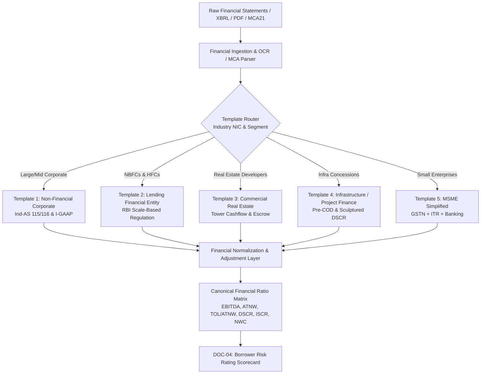
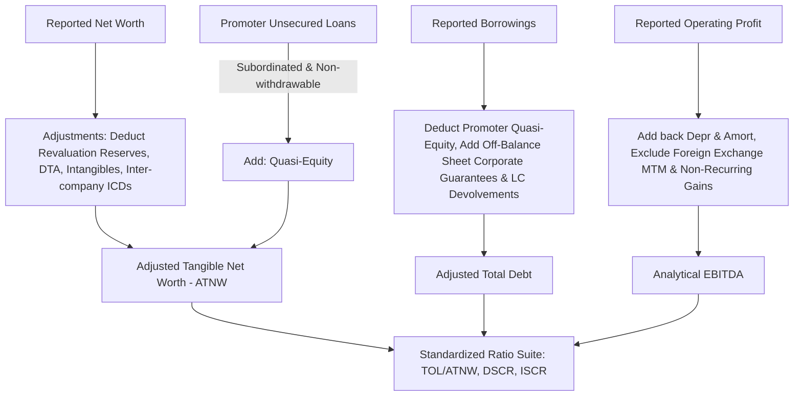

# DOC-03: FINANCIAL SPREADING, CHART OF ACCOUNTS & NORMALIZATION TEMPLATE ENGINE

**Document Reference:** `DOC-03`  
**System Name:** Next-Generation Internal Ratings Platform (IRP - Project ICON)  
**Parent Document:** `[REF: DOC-00 §3.0]`  
**Module Type:** Core Financial Analytics & Spreading Service  
**Classification:** Confidential / System Architecture Specification  

---

## 1.0 Multi-Template Spreading Architecture

Financial statements in Indian corporate banking exhibit profound structural divergence across legal industries and accounting regimes. Project ICON replaces static spreading grids with a dynamic, metadata-driven multi-template engine capable of rendering tailored Charts of Accounts (COA) while producing a normalized canonical ratio output for the rating scorecards `[REF: DOC-04 §1.1]`. *(For the comprehensive 4-level leaf-node Chart of Accounts taxonomy and complete Ind-AS, I-GAAP, and IFRS mapping matrix, refer to [DOC-03A: Master Chart of Accounts Taxonomy & Cross-GAAP Mapping](file:///c:/Users/user/icon-ba/icon-documentation/DOC-03A_Master_Chart_of_Accounts_IndAS_IGAAP_IFRS_Taxonomy.md)).*



---

### 1.1 Template 1: Standard Non-Financial Corporate (Ind-AS & I-GAAP)
Designed for manufacturing, EPC, consumer goods, pharmaceuticals, and commercial service enterprises.
- **Ind-AS 115 (Revenue from Contracts with Customers):** Segregates unbilled revenue, contract liabilities (advance from customers), and disaggregated revenue streams.
- **Ind-AS 116 (Leases):** Explicit capitalization of operating leases into Right-of-Use (ROU) Assets and corresponding Lease Liabilities (Current & Non-Current). Standardizes lease finance costs into interest and depreciation to prevent EBITDA distortion.
- **Ind-AS vs. I-GAAP Toggle:** Supports dual reporting formats. Automatically flags GAAP differences (e.g., mark-to-market derivative accounting, actuarial gains in OCI).

---

### 1.2 Template 2: NBFC & Lending Entity (RBI Scale-Based Regulation Format)
Engineered for Non-Banking Financial Companies (Base, Middle, Upper, and Top Layer) and Housing Finance Companies (HFCs):
- **Asset Quality & Provisioning:** Spread sheets segregate Gross Stage 1, Stage 2 (SMA-equivalent), and Stage 3 (GNPA) assets along with Expected Credit Loss (ECL) provisions.
- **Asset-Liability Management (ALM) Structural Liquidity Buckets:** Captures cumulative mismatches across standard RBI buckets:
  - 1 to 7 Days, 8 to 14 Days, 15 to 30 Days, 31 Days to 2 Months, > 2 to 3 Months, > 3 to 6 Months, > 6 Months to 1 Year, > 1 to 3 Years, > 3 to 5 Years, Over 5 Years.
  - Automatically flags negative mismatches exceeding RBI prudential limits (e.g., > 10% mismatch in 1-30 day buckets).
- **Capital Adequacy & Leverage:** Computes Capital to Risk-Weighted Assets Ratio (CRAR), Tier-1 Capital, and Total Borrowings / Owned Funds ratio.

---

### 1.3 Template 3: Commercial Real Estate (CRE) Project Cashflow Template
Tailored for residential townships, commercial IT parks, and mixed-use developments:
- **Phase-wise / Tower-wise Cost & Construction Metrics:** Total Project Cost, Land Cost, Construction Spend incurred till date, Pending Cost to Complete.
- **RERA Escrow Account Waterfall:** Tracks sanctioned escrow accounts, percentage of customer receivables deposited, bank debt retention, and surplus release.
- **Sales Velocity & Unsold Inventory Run-rate:** Sold Area (sq ft), Realized Sales Value (₹/sq ft), Unsold Inventory Value, Booking Advances.

---

### 1.4 Template 4: Infrastructure & Project Finance Spreading Template
Engineered for National Highways (HAM / BOT Toll), Solar & Wind IPPs, Thermal Power, Transmission, and Port Concessions:
- **Pre-Commercial Operation Date (Pre-COD) Tracking:** Milestone schedule, Scheduled COD (SCOD), revised SCOD, cost-overrun approvals, equity infusion schedule.
- **Post-COD Sculptured Debt Metrics:**
  - **Loan Life Coverage Ratio (LLCR):**
    $$\text{LLCR} = \frac{\sum_{t=1}^{N} \frac{\text{CFADS}_t}{(1 + k)^t}}{\text{Outstanding Debt at Evaluation Date}}$$
  - **Project Life Coverage Ratio (PLCR):** Extends CFADS over entire concession period.
  - **Debt Service Reserve Account (DSRA) Funded Status:** 1 or 2 quarters of principal and interest backed by Bank Guarantee or Fixed Deposit.

---

### 1.5 Template 5: MSME Simplified Spreading Template
For enterprises with turnover < ₹50 Cr where audited balance sheets lack granular disclosures:
- **GSTN Ingestion:** Direct API sync of GSTR-3B (monthly eligible ITC and turnover) and GSTR-1 (inter-state vs intra-state sales). Computes GST sales variance against reported ITR topline.
- **ITR-V Extraction:** Net taxable income, partners' capital balance, depreciation schedule per IT Act.
- **Bank Statement Banking Metrics:** Ingestion of Account Aggregator (AA) data: Average Bank Balance (ABB), Credit Summation, Inward Cheque Bounces, Counter-party concentration.

---

## 2.0 Spreading Multi-Period Capabilities & Currency Handling

### 2.1 Multi-Period Architecture
The spreading engine enforces a minimum temporal depth for corporate obligors:
- **Historical Periods (Minimum 5 Years):**
  - Audited Actuals ($FY_{-4}, FY_{-3}, FY_{-2}, FY_{-1}$).
  - Latest Audited / Provisional ($FY_{0}$).
  - Half-Yearly / Quarterly Reviewed Financials (Stub Periods with automated annualization options).
- **Projected / CMA Periods (3 to 10 Years):**
  - Credit Monitoring Arrangement (CMA) projections prepared by borrower.
  - Bank In-house Sensitivity Adjustments (Haircut projections).
- **Variance Tracking Engine:** Computes compound annual growth rate (CAGR) and year-over-year deviations:
  $$\Delta_{\text{abs}} = \text{Value}_t - \text{Value}_{t-1}$$
  $$\Delta_{\%} = \frac{\text{Value}_t - \text{Value}_{t-1}}{|\text{Value}_{t-1}|} \times 100$$
  Automated alerts trigger if Projected Sales Growth > 2.5x Historical 3-Yr CAGR.

### 2.2 Dual Currency & FX Translation Engine
For foreign subsidiaries or multinational obligors, balance sheet items can be entered in foreign denominations (USD, EUR, GBP, JPY):
- Integrated with RBI Daily Reference Exchange Rates.
- Balance sheet line items translated at Closing Spot Rate as of financial statement date.
- P&L line items translated at Weighted Average Exchange Rate for the fiscal period.
- Foreign Currency Monetary Item Translation Difference Account (FCMITDA) tracked under Other Comprehensive Income (OCI).

---

## 3.0 Financial Normalizations & Derived Analytical Items

The true value of an institutional credit spreading engine lies in its analytical adjustments. Raw statutory accounting values are normalized to compute the real debt-servicing capacity of the borrower:



---

### 3.1 Normalization Rule 1: Promoter Loans as Quasi-Equity
Unsecured loans introduced by promoters, directors, or group entities may be reclassified from Debt to **Quasi-Equity** if and only if all three covenants are verified:
1. **Subordination Agreement:** Legally enforceable deed confirming subordination to Bank debt in liquidation.
2. **Non-Withdrawal Covenant:** Written undertaking that principal cannot be repaid during the currency of the Bank facility without prior written NOC from the bank.
3. **Interest Cap:** Interest rate is either zero or capped below the Bank's lending rate, payable only out of surplus post bank debt servicing.

*Mathematical Formulation:*
$$\text{Adjusted Tangible Net Worth (ATNW)} = \text{Reported Equity} + \text{Eligible Quasi-Equity} - \text{Revaluation Reserves} - \text{Deferred Tax Assets (DTA)} - \text{Intangible Assets \& Goodwill} - \text{Investments in Group Companies}$$

---

### 3.2 Normalization Rule 2: Contingent Liabilities & Off-Balance Sheet Commitments
Credit underwriters frequently underestimate systemic risk by ignoring contingent liabilities:
- **Corporate Guarantees Issued:** The engine factors external corporate guarantees issued to subsidiaries or sister concerns:
  $$\text{Debt Equivalent of Guarantees} = 50\% \text{ to } 100\% \times \text{Guarantee Amount (based on subsidiary credit risk)}$$
- **Disputed Statutory Liabilities:** Income tax, GST, excise, and customs disputes where demand notices have been served and appeals are pending:
  - If probability of outflow is deemed $>50\%$ by bank risk policy, 100% of the disputed demand is deducted from Tangible Net Worth.
- **LC / BG Devolvement History:** Devolvements in the past 24 months immediately trigger a downward qualitative rating flag `[REF: DOC-04 §1.4]`.

---

### 3.3 Analytical Derivations & Mathematical Ratio Engine

#### Analytical EBITDA
$$\text{Analytical EBITDA} = \text{Revenue from Operations} - \text{Cost of Materials} - \text{Employee Expenses} - \text{Other Operating Expenses} + \text{Realized Operating Other Income}$$
*(Excludes non-operating income, profit on sale of assets, revaluation gains, and MTM forex gains).*

#### Debt Service Coverage Ratio (DSCR)
$$\text{DSCR} = \frac{\text{PAT} + \text{Depreciation} + \text{Gross Finance Charges}}{\text{Gross Finance Charges} + \text{Current Maturities of Long Term Debt (CMLTD)}}$$

#### Interest Service Coverage Ratio (ISCR)
$$\text{ISCR} = \frac{\text{Analytical EBITDA}}{\text{Gross Finance Charges}}$$

#### Total Outside Liabilities to Adjusted Net Worth (TOL / ATNW)
$$\text{TOL / ATNW} = \frac{\text{Total Borrowings} + \text{Current Liabilities} - \text{Eligible Quasi-Equity}}{\text{Adjusted Tangible Net Worth (ATNW)}}$$

#### Net Working Capital (NWC)
$$\text{NWC} = \text{Current Assets} - \text{Current Liabilities}$$

---

## 4.0 Financial Spreading JSON Data Contract

### 4.1 Ingestion & Spreading State Payload
- **Endpoint:** `POST /api/v1/spreading/cases/{case_id}/normalize`

```json
{
  "case_id": "sp-2026-ind-9871",
  "obligor_pan": "AABCS1234K",
  "template_code": "TMPL_CORP_INDAS",
  "reporting_currency": "INR",
  "scale_unit": "CRORES",
  "periods": [
    {
      "fiscal_year": "2024",
      "period_type": "AUDITED_ACTUAL",
      "period_end_date": "2024-03-31",
      "statement_standard": "IND_AS",
      "line_items": {
        "BS_EQ_SHARE_CAP": 50.00,
        "BS_EQ_RES_SURP": 450.00,
        "BS_ASSET_REVAL_RES": 30.00,
        "BS_ASSET_DTA": 15.00,
        "BS_ASSET_INTANGIBLES": 20.00,
        "BS_INV_GROUP_COS": 65.00,
        "BS_DT_PROMOTER_SUB": 80.00,
        "BS_NCL_BORR_TERM": 320.00,
        "BS_CL_ST_BORR_WC": 210.00,
        "BS_CL_CURR_MAT_LTD": 45.00,
        "BS_CL_TRADE_PAYABLES": 110.00,
        "BS_CA_CURRENT_ASSETS": 480.00,
        "PL_REV_OPS": 1250.00,
        "PL_EXP_RAW_MAT": 710.00,
        "PL_EXP_EMP_BEN": 115.00,
        "PL_EXP_OTHER_OP": 180.00,
        "PL_EXP_FIN_COST": 58.00,
        "PL_EXP_DEP_AMORT": 42.00,
        "PL_TAX_EXPENSE": 36.00,
        "OFF_BS_CORP_GUARANTEES": 75.00,
        "OFF_BS_DISPUTED_TAX": 12.00
      },
      "adjustments": {
        "allow_promoter_quasi_equity": true,
        "quasi_equity_covenants_verified": true,
        "deduct_group_investments": true,
        "contingent_guarantee_haircut_pct": 50.0
      }
    }
  ]
}
```

#### Output Calculated Ratios
```json
{
  "status": "NORMALIZATION_COMPLETE",
  "case_id": "sp-2026-ind-9871",
  "fiscal_year": "2024",
  "normalized_metrics": {
    "reported_net_worth_inr_cr": 500.00,
    "adjusted_tangible_net_worth_inr_cr": 400.00,
    "eligible_quasi_equity_inr_cr": 80.00,
    "final_atnw_with_quasi_inr_cr": 480.00,
    "adjusted_total_debt_inr_cr": 612.50,
    "analytical_ebitda_inr_cr": 245.00,
    "pat_inr_cr": 104.00,
    "cash_accruals_inr_cr": 146.00,
    "ratios": {
      "TOL_ATNW": 1.52,
      "TOTAL_DEBT_EBITDA": 2.50,
      "ISCR": 4.22,
      "DSCR": 1.98,
      "CURRENT_RATIO": 1.31,
      "OPERATING_MARGIN_PCT": 19.60,
      "ROCE_PCT": 18.59
    }
  }
}
```
