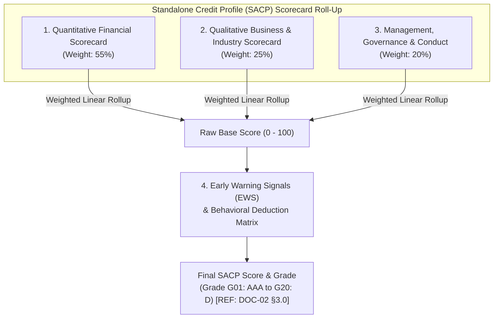
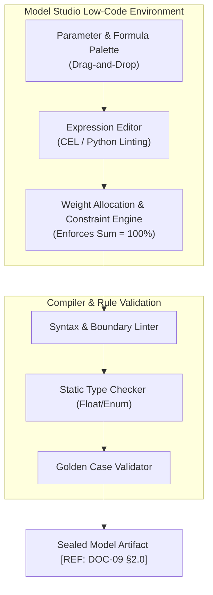
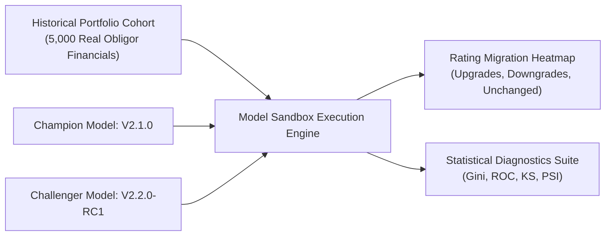

# DOC-04: BORROWER RISK RATING (BRR) & MODEL STUDIO (LOW-CODE SCORECARD BUILDER & SANDBOX)

**Document Reference:** `DOC-04`  
**System Name:** Next-Generation Internal Ratings Platform (IRP - Project ICON)  
**Parent Document:** `[REF: DOC-00 §3.0]`  
**Module Type:** Core Rating Engine & Low-Code Model Studio  
**Classification:** Confidential / System Architecture Specification  

---

## 1.0 Borrower Standalone Credit Profile (SACP) Model Anatomy

The Borrower Risk Rating (BRR) evaluates the standalone probability of default (PD) of the legal obligor over a 1-year forward-looking horizon, completely unassisted by external parental, sovereign, or guarantor support `[REF: DOC-05 §1.0]`.



---

### 1.1 Dimension 1: Quantitative Financial Scorecard (Weight: 55%)
Quantitative ratios derived in `DOC-03 §3.3` are evaluated against industry-specific statistical splines `[REF: DOC-02 §6.0]`. The scoring engine avoids binary step-jumps by using continuous piecewise linear spline interpolation:

$$S_i = \text{Score}(x) = S_{\text{lower}} + \frac{x - x_{\text{lower}}}{x_{\text{upper}} - x_{\text{lower}}} \times (S_{\text{upper}} - S_{\text{lower}})$$

| Ratio Parameter | Formula Ref `[REF: DOC-03]` | Weight | Spline Floor (Score: 0) | Spline Neutral (Score: 50) | Spline Cap (Score: 100) | Direction |
| :--- | :--- | :--- | :--- | :--- | :--- | :--- |
| **TOL / ATNW** | `RATIO_TOL_ATNW` | `25%` | $\ge 4.5\text{x}$ | $2.0\text{x}$ | $\le 0.75\text{x}$ | Lower is Better |
| **DSCR** | `RATIO_DSCR` | `20%` | $\le 1.0\text{x}$ | $1.6\text{x}$ | $\ge 2.5\text{x}$ | Higher is Better |
| **ISCR** | `RATIO_ISCR` | `15%` | $\le 1.2\text{x}$ | $3.0\text{x}$ | $\ge 6.0\text{x}$ | Higher is Better |
| **EBITDA Margin**| `RATIO_OP_MARGIN` | `15%` | $\le 4.0\%$ | $14.0\%$ | $\ge 25.0\%$ | Higher is Better |
| **Current Ratio**| `RATIO_CURR_RATIO` | `15%` | $\le 0.90\text{x}$ | $1.25\text{x}$ | $\ge 1.75\text{x}$ | Higher is Better |
| **ROCE** | `RATIO_ROCE` | `10%` | $\le 4.0\%$ | $12.0\%$ | $\ge 22.0\%$ | Higher is Better |

---

### 1.2 Dimension 2: Qualitative Business & Industry Scorecard (Weight: 25%)
Captures non-financial and macroeconomic drivers through weighted Likert-scale questions. Every answer requires mandatory analyst justification and audit document attachments `[REF: DOC-11 §1.0]`:

| Parameter Key | Parameter Description | Weight | Permitted Domain Options & Raw Scores |
| :--- | :--- | :--- | :--- |
| `BIZ_MKT_POSITION` | Market Position & Pricing Power | `30%` | Dominant Market Leader (100) / Top 3 Player (75) / Tier-2 Player (50) / Marginal Price-Taker (20) |
| `BIZ_REV_DIVERS` | Revenue & Client Concentration | `25%` | Top 5 clients $< 20\%$ (100) / Top 5 clients $20-40\%$ (70) / Top 5 clients $40-60\%$ (40) / Single client $> 60\%$ (10) |
| `BIZ_IND_OUTLOOK` | Sector Cyclicality & 12M Outlook | `25%` | Strong Secular Tailwinds (100) / Stable Medium-term (70) / Moderate Headwinds (40) / High Distress/Severe Downcycle (10) |
| `BIZ_SUPPLY_CHAIN`| Raw Material Supply Security | `20%` | Multi-source long-term hedged contracts (100) / Domestic competitive supply (70) / Import dependent / Volatile spot (35) |

---

### 1.3 Dimension 3: Management, Conduct & Corporate Governance Scorecard (Weight: 20%)
Assesses promoter integrity, transparency, and operational governance:

| Parameter Key | Governance Factor | Weight | Scoring Rules & Regulatory Flags |
| :--- | :--- | :--- | :--- |
| `GOV_PROMOTER_TRACK`| Promoter Integrity & Track Record | `35%` | Pristine 20-year repayment history (100) / Satisfactory without defaults (75) / Past one-time restructuring (30) / History of default/OTS (0) |
| `GOV_PROMOTER_PLEDGE`| Promoter Share Pledging (Listed) | `25%` | Zero Pledging (100) / Pledged $< 20\%$ (75) / Pledged $20-50\%$ (40) / **Pledged $> 50\%$ (0 + Warning Flag)** |
| `GOV_AUDITOR_REP` | Auditor Quality & Qualifications | `25%` | Top-10 Audit Firm, Clean Opinion (100) / Tier-2 Firm, Clean (75) / Qualified Opinion without material impact (40) / **Disclaimer or Adverse Opinion (0)** |
| `GOV_STATUTORY_DISP`| Legal Disputes & Tax Litigation | `15%` | No significant litigation (100) / Routine commercial disputes (70) / Disputed claims $10-25\%$ of TNW (30) / Material NCLT / Serious claims (0) |

---

### 1.4 Early Warning Signal (EWS) Modifiers & Conduct Deduction Matrix
Prior to finalizing the SACP, the engine applies behavioral deductions based on real-time internal account conduct and external credit registries:

```mermaid
graph LR
    SUB_TOTAL["Base Score (0 - 100)"] --> DEDUCT{"EWS Penalty Evaluator"}
    DEDUCT -->|-5 to -15 pts| INT_CONDUCT["Internal Conduct Penalty<br/>(DPD, CC Util > 90%, Bounces)"]
    DEDUCT -->|-10 to -30 pts| EXT_BUREAU["External Bureau Penalty<br/>(CIBIL Score < 650, CRIF)"]
    DEDUCT -->|Immediate Override to G20 (D)| HARD_FAIL["Hard Disqualification<br/>(Wilful Defaulter / NCLT IBC)"]
    DEDUCT --> SACP_OUTPUT["Constrained SACP Grade"]
```

| EWS Trigger Key | Behavioral Source | Detection Condition | Score Penalty / Regulatory Override |
| :--- | :--- | :--- | :--- |
| `EWS_DPD_HISTORY` | Core Banking (CBS) | 30 to 60 DPD within last 6 months | `-10 Points` deduction from Base Score |
| `EWS_CC_OVERDRAW` | CBS Working Capital | CC/OD limit utilization $> 95\%$ continuously for 90 days | `-8 Points` deduction from Base Score |
| `EWS_CHEQUE_BOUNCE`| Inward Clearing | $\ge 3$ inward clearing returns due to insufficient funds in 90 days | `-12 Points` deduction from Base Score |
| `EWS_CIBIL_COMM` | CIBIL Commercial CMR | CIBIL Commercial Rank CMR-7 to CMR-10 (High Risk) | `-15 Points` deduction from Base Score |
| `EWS_GST_FILING_GAP`| GSTN Portal API | Delay $> 60$ days in filing GSTR-3B for 2 consecutive periods | `-10 Points` deduction from Base Score |
| `EWS_MCA_CHARGE_DELAY`| MCA21 Portal | Failure to register bank charge within 30 days of loan sanction | `-5 Points` deduction |
| **`EWS_WILFUL_DEF`** | **RBI / CIBIL Registry** | **Listed in RBI Wilful Defaulter or Salaried Fraud Database** | **Hard Floor: Immediate assignment to G20 (`D`)** |
| **`EWS_NCLT_PETITION`**| **NCLT Cause List** | **Corporate Insolvency Resolution Process (CIRP) admitted** | **Hard Floor: Immediate assignment to G20 (`D`)** |

---

## 2.0 Model Studio Low-Code / No-Code Architecture

Model Studio empowers Bank Risk Modelers to design and modify credit scorecards without engineering deployments or vendor release dependencies.



### 2.1 Expression Engine & Common Expression Language (CEL)
Model Studio evaluates dynamic formulas using Google Common Expression Language (CEL), providing deterministic, millisecond-grade execution with zero risk of memory leaks or arbitrary code injection:

```cel
// Example CEL Parameter Definition: Dynamic Working Capital Stagnation Score
let current_ratio = ratios.RATIO_CURR_RATIO;
let nwc_days = ratios.RATIO_NWC_DAYS;

if (current_ratio < 1.0 || nwc_days > 180) {
    0.0
} else if (current_ratio >= 1.5 && nwc_days <= 75) {
    100.0
} else {
    50.0 + ((current_ratio - 1.0) / 0.5) * 25.0 - ((nwc_days - 75.0) / 105.0) * 25.0
}
```

---

## 3.0 Interactive Testing Sandbox & Simulation Environment

### 3.1 Live Sandbox Recalculation Engine
Risk modelers can clone any active or candidate model, ingest a batch cohort of real bank obligors (e.g., 5,000 corporate obligors from the FY24 audit cohort), run batch recalculations in under 60 seconds, and visualize portfolio rating migration:



---

### 3.2 Statistical Diagnostics & Model Performance Metrics
Before any scorecard can be submitted for CRO Dual-Key approval `[REF: DOC-09 §3.0]`, the sandbox computes four mandatory statistical validation metrics:

#### 1. Gini Coefficient & Area Under ROC Curve (ROC-AUC)
Measures the discriminatory power of the model to separate defaulting obligors from non-defaulting obligors:
$$\text{ROC-AUC} = \int_{0}^{1} \text{TPR}(\text{FPR}) \, d(\text{FPR})$$
$$\text{Gini} = 2 \times \text{ROC-AUC} - 1$$
*Regulatory Standard:* Model Studio requires $\text{Gini} \ge 0.60$ for production approval.

#### 2. Kolmogorov-Smirnov (KS) Statistic
Computes the maximum separation distance between cumulative default and non-default distributions:
$$\text{KS} = \max_s |F_{\text{Defaulters}}(s) - F_{\text{Non-Defaulters}}(s)|$$
*Regulatory Standard:* $\text{KS}$ must exceed $35\%$ and occur between internal grades `G11` (`BB+`) and `G14` (`B+`).

#### 3. Population Stability Index (PSI)
Tests whether the distribution of ratings in the validation sample has shifted significantly from the development sample:
$$\text{PSI} = \sum_{j=1}^{K} \left( \text{Actual}_j - \text{Expected}_j \right) \times \ln\left(\frac{\text{Actual}_j}{\text{Expected}_j}\right)$$
- $\text{PSI} < 0.10$: Stable distribution (Approved).
- $0.10 \le \text{PSI} < 0.25$: Moderate shift; triggers warning.
- $\text{PSI} \ge 0.25$: Significant population shift; **Model promotion blocked**.

---

## 4.0 Scorecard Definition JSON Schema Contract

```json
{
  "$schema": "https://json-schema.bank.internal/irp/v1/scorecard-spec.json",
  "scorecard_id": "SC_CORP_INDAS_2026",
  "version": "2.2.0",
  "name": "Standard Large Corporate Ind-AS Scorecard",
  "target_segment": "SEG-LC",
  "applicable_templates": ["TMPL_CORP_INDAS"],
  "dimensions": [
    {
      "dimension_id": "DIM_QUANTITATIVE",
      "name": "Quantitative Financial Profile",
      "weight": 0.55,
      "parameters": [
        {
          "param_id": "QNT_TOL_ATNW",
          "ratio_code": "RATIO_TOL_ATNW",
          "weight": 0.25,
          "spline_type": "PIECEWISE_LINEAR",
          "spline_points": [
            {"val": 0.75, "score": 100.0},
            {"val": 1.50, "score": 75.0},
            {"val": 2.50, "score": 40.0},
            {"val": 4.50, "score": 0.0}
          ]
        },
        {
          "param_id": "QNT_DSCR",
          "ratio_code": "RATIO_DSCR",
          "weight": 0.20,
          "spline_type": "PIECEWISE_LINEAR",
          "spline_points": [
            {"val": 1.00, "score": 0.0},
            {"val": 1.35, "score": 40.0},
            {"val": 1.80, "score": 75.0},
            {"val": 2.50, "score": 100.0}
          ]
        }
      ]
    },
    {
      "dimension_id": "DIM_QUALITATIVE_BIZ",
      "name": "Business & Industry Risk",
      "weight": 0.25,
      "parameters": [
        {
          "param_id": "BIZ_MKT_POSITION",
          "weight": 0.30,
          "options": [
            {"code": "MKT_LEADER", "score": 100.0, "label": "Dominant Market Leader"},
            {"code": "TOP_3", "score": 75.0, "label": "Top 3 Industry Player"},
            {"code": "TIER_2", "score": 50.0, "label": "Mid-tier Player"},
            {"code": "MARGINAL", "score": 20.0, "label": "Marginal Player"}
          ]
        }
      ]
    }
  ],
  "score_to_grade_mapping": [
    {"min_score": 92.0, "grade": "G01", "alpha": "AAA"},
    {"min_score": 86.0, "grade": "G02", "alpha": "AA+"},
    {"min_score": 80.0, "grade": "G03", "alpha": "AA"},
    {"min_score": 74.0, "grade": "G04", "alpha": "AA-"},
    {"min_score": 68.0, "grade": "G05", "alpha": "A+"},
    {"min_score": 62.0, "grade": "G06", "alpha": "A"},
    {"min_score": 56.0, "grade": "G07", "alpha": "A-"},
    {"min_score": 50.0, "grade": "G08", "alpha": "BBB+"},
    {"min_score": 44.0, "grade": "G09", "alpha": "BBB"},
    {"min_score": 38.0, "grade": "G10", "alpha": "BBB-"},
    {"min_score": 32.0, "grade": "G11", "alpha": "BB+"},
    {"min_score": 26.0, "grade": "G12", "alpha": "BB"},
    {"min_score": 20.0, "grade": "G13", "alpha": "BB-"},
    {"min_score": 14.0, "grade": "G14", "alpha": "B+"},
    {"min_score": 8.0,  "grade": "G15", "alpha": "B"},
    {"min_score": 0.0,  "grade": "G16", "alpha": "B-"}
  ]
}
```
