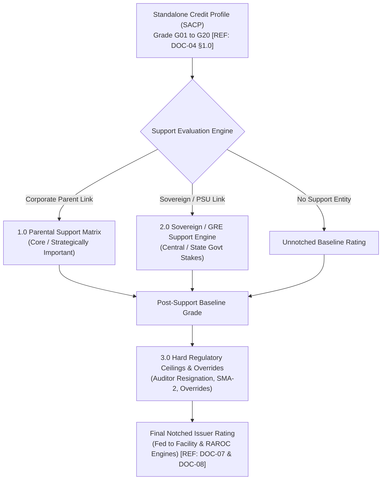
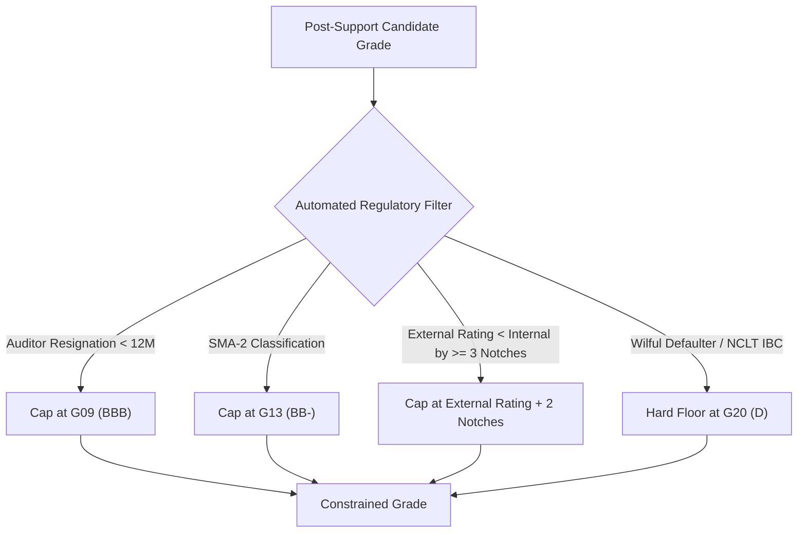

# DOC-05: PARENTAL SUPPORT, GOVERNMENT/GRE SUPPORT & EXTERNAL NOTCH MODIFIERS

**Document Reference:** `DOC-05`  
**System Name:** Next-Generation Internal Ratings Platform (IRP - Project ICON)  
**Parent Document:** `[REF: DOC-00 §3.0]`  
**Module Type:** Notching & Credit Support Microservice Specification  
**Classification:** Confidential / System Architecture Specification  

---

## 1.0 Notching Architecture Overview

Once the Standalone Credit Profile (SACP) is calculated by the BRR Engine `[REF: DOC-04 §1.0]`, the obligor rating is evaluated through the Notch Modifier Engine. This engine accounts for structural support from higher-rated corporate parents or sovereign governments, contagion risks, and hard regulatory ceilings.



---

## 2.0 Parental Support Framework

### 2.1 Strategic Importance Classification
Parental support assesses the willingness and capacity of a parent conglomerate `[REF: DOC-01 §2.0]` to provide timely financial assistance to an obligor. The support engine evaluates the relationship across four strategic classifications:

| Strategic Classification | Criteria & Operational Integration | Brand Association | Maximum Uplift Permitted | Default Notch Uplift Formula |
| :--- | :--- | :--- | :--- | :--- |
| **Core Entity** | $\ge 75\%$ equity ownership; common treasury; shared name; integrated operations; critical profit contributor. | Shared corporate brand (e.g., Tata, Reliance, Aditya Birla). | Equated to Parent Rating (0 to -1 notch below parent) | Equalize to Parent Rating |
| **Strategically Important** | $51\%$ to $74\%$ equity; board control; substantial operational synergy; high reputational contagion risk. | Brand shared or explicitly sponsored. | Up to 75% of notch gap between SACP and Parent | Uplift = $\text{round}(0.75 \times \Delta_{\text{Notches}})$ |
| **Satisfactory / Moderate** | $26\%$ to $50\%$ equity; partial board representation; moderate business alignment; limited cross-default clauses. | Brand not shared or differentiated. | Up to 40% of notch gap between SACP and Parent | Uplift = $\text{round}(0.40 \times \Delta_{\text{Notches}})$ |
| **Investment / Divestment Candidate** | Financial investment only; no board control; non-core asset held for sale; zero parental commitment. | Completely distinct brand. | **0 Notches (No Uplift)** | SACP remains unnotched |

### 2.2 Notch Uplift Algorithm & Mathematical Derivation
Let:
- $G_{\text{SACP}} \in [1, 20]$ be the numeric standalone grade of the obligor `[REF: DOC-02 §3.0]`.
- $G_{\text{Parent}} \in [1, 20]$ be the validated internal rating grade of the parent entity.
- $\Delta_{\text{Gap}} = G_{\text{SACP}} - G_{\text{Parent}}$ (where positive value indicates obligor is rated weaker than parent).

If $\Delta_{\text{Gap}} \le 0$, no upward notching occurs (obligor cannot be notched up if it is already rated equal to or higher than its parent).

$$\text{Uplift Notches} = \min \left( \left\lfloor \Delta_{\text{Gap}} \times \alpha_{\text{Category}} \right\rfloor, \text{Uplift Cap} \right)$$

Where support coefficients $\alpha_{\text{Category}}$ are defined as:
- $\alpha_{\text{Core}} = 1.00$
- $\alpha_{\text{Strategically\_Important}} = 0.75$
- $\alpha_{\text{Satisfactory}} = 0.40$
- $\alpha_{\text{Investment}} = 0.00$

$$\text{Post-Parental Grade} = \max \left( G_{\text{SACP}} - \text{Uplift Notches}, G_{\text{Parent}} \right)$$

*Example Execution:*
- Obligor SACP: `G12` (`BB`)
- Parent Rating: `G04` (`AA-`)
- Difference: $12 - 4 = 8$ notches.
- Strategic Classification: `Strategically Important` ($\alpha = 0.75$).
- Calculated Uplift: $\text{round}(8 \times 0.75) = 6$ notches.
- Resulting Post-Parental Grade: $12 - 6 = \text{Grade G06}$ (`A`).

### 2.3 Parental Support Ceiling & Contagion Notch-Down
1. **Parental Ceiling Rule:** In no circumstance can an un-ringfenced subsidiary have a final rating higher than its parent entity.
2. **Negative Contagion Notch-Down:** If the parent entity's rating falls below the subsidiary's SACP ($G_{\text{Parent}} > G_{\text{SACP}}$), and evidence exists of aggressive upstream dividend extraction, cash pooling, or cross-guarantees, the subsidiary's rating is notched downward:
   $$\text{Contagion Penalty} = \min \left( \left\lfloor (G_{\text{Parent}} - G_{\text{SACP}}) \times 0.50 \right\rfloor, 3 \right) \text{ notches down}$$

---

## 3.0 Government & Sovereign / Government-Related Entity (GRE) Support

### 3.1 Government Ownership & Public Policy Evaluation
For Public Sector Undertakings (PSUs), Statutory Bodies, and Joint Sector companies, the engine applies the Sovereign / GRE Support Framework:

| Evaluation Dimension | Scoring Parameter | High Support (Tier 1) | Moderate Support (Tier 2) | Low Support (Tier 3) |
| :--- | :--- | :--- | :--- | :--- |
| **Ownership Stake** | Equity held by President of India / State Governor | Central Govt $> 75\%$ | Central Govt $51-75\%$ or State Govt $> 51\%$ | Central/State Govt $< 51\%$ |
| **Systemic Importance** | Disruption impact on national economy / critical infra | Critical national monopoly (e.g., Grid, Railways, Atomic) | Major regional utility / Essential sector | Non-essential commercial / Market facing |
| **Track Record of Support**| History of equity infusions and budgetary grants | Annual budgetary capital allocation / Sovereign guarantees | Ad-hoc liquidity support / Subsidies | No historical financial support |
| **Statutory Backing** | Established under Act of Parliament | Statutory Corporation (e.g., NHAI, SBI, LIC) | Navratna / Maharatna CPSE | State PSU / Joint Venture |

### 3.2 GRE Notch Uplift Matrix
The final rating is uplifted toward the Sovereign Ceiling (Sovereign of India = Internal Grade `G01` (`AAA` for domestic currency):

| Obligor SACP | Central PSU - Critical (Tier 1) | Central PSU - Commercial (Tier 2) | State Govt PSU (Tier 2) | Joint Sector / Disinvested |
| :--- | :--- | :--- | :--- | :--- |
| **G01 - G04 (`AAA` to `AA-`)** | Equated to Sovereign (`AAA`) | +1 Notch Uplift | 0 to +1 Notch Uplift | No Uplift |
| **G05 - G07 (`A+` to `A-`)** | +4 Notches Uplift (Cap `AAA`) | +2 Notches Uplift | +1 Notch Uplift | No Uplift |
| **G08 - G10 (`BBB+` to `BBB-`)**| +5 Notches Uplift (Cap `AAA`) | +3 Notches Uplift | +2 Notches Uplift | No Uplift |
| **G11 - G13 (`BB+` to `BB-`)** | +6 Notches Uplift (Cap `AA`) | +3 Notches Uplift | +2 Notches Uplift | No Uplift |
| **G14 - G16 (`B+` to `B-`)** | +7 Notches Uplift (Cap `A`) | +4 Notches Uplift | +2 Notches Uplift | No Uplift |

---

## 4.0 Hard Regulatory Ceilings & Discretionary Overrides

### 4.1 Automated Hard Regulatory Caps & Floors
Regardless of mathematical scores or parental support, the platform enforces mandatory policy and regulatory caps derived from RBI directives and banking prudence:



| Hard Ceiling Trigger Code | Statutory / Policy Basis | Condition Check | Maximum Permitted Ceiling Grade |
| :--- | :--- | :--- | :--- |
| **`CAP_AUDITOR_RESIGN`** | Companies Act §140 & RBI Guidelines | Statutory Auditor resigned within preceding 12 months prior to term completion. | **`G09` (`BBB`)** |
| **`CAP_SMA_2_ACTIVE`** | RBI IRACP Master Directions | Account classified as SMA-2 (61-90 DPD) in the bank or CRILC in past 6 months. | **`G13` (`BB-`)** |
| **`CAP_CRA_DIVERGENCE`** | RBI AFI Supervisory Prudence | Internal rating exceeds external CRA rating by 3 or more notches. | **External Rating $+ 2$ Notches** |
| **`CAP_PROMOTER_PLEDGE`**| Internal Wholesale Credit Policy | Listed promoter share pledging $> 75\%$ of total promoter holding. | **`G11` (`BB+`)** |
| **`FLOOR_NCLT_ADMISSION`**| Insolvency & Bankruptcy Code 2016 | CIRP petition admitted by NCLT under Section 7, 9, or 10. | **`G20` (`D`) [Hard Floor]** |
| **`FLOOR_WILFUL_DEF`** | RBI Master Circular on Wilful Defaulters | Name appearing on RBI / TransUnion CIBIL Wilful Defaulter list. | **`G20` (`D`) [Hard Floor]** |

---

### 4.2 Discretionary Notching Overrides & Four-Eyes Governance
Credit underwriters may apply subjective notch overrides only within strict, auditable guardrails `[REF: DOC-11 §3.0]`:
- **Permitted Range:** Maximum $\pm 2$ notches from the algorithmically constrained grade.
- **Forbidden Override:** Under no circumstances can a manual override elevate an account out of Default (`G20` / `D`) or breach an automated regulatory cap.
- **Approval Hierarchy Matrix:**
  - $\pm 1$ Notch Override: Requires approval from **Regional Risk Head (Level 2 Approval)**.
  - $\pm 2$ Notches Override: Requires unanimous approval from **Chief Risk Officer (CRO) / Credit Approval Committee (Level 3 Approval)**.

---

## 5.0 Notching Decision Engine JSON API Contract

- **Endpoint:** `POST /api/v1/ratings/notching/evaluate`

```json
{
  "obligor_id": "8f1a23e4-5678-4b90-bcde-123456789abc",
  "standalone_sacp_grade": "G12",
  "standalone_sacp_alpha": "BB",
  "support_configuration": {
    "has_parent_entity": true,
    "parent_entity_id": "c92d34f5-6789-4a01-cdef-234567890def",
    "parent_internal_grade": "G04",
    "parent_alpha": "AA-",
    "strategic_importance": "STRATEGICALLY_IMPORTANT",
    "equity_holding_pct": 65.0,
    "has_shared_brand": true
  },
  "regulatory_checks": {
    "auditor_resignation_last_12m": false,
    "current_iracp_status": "STD_REGULAR",
    "crilc_max_sma_last_6m": "SMA_0",
    "external_cra_lowest_rating": "A-",
    "is_wilful_defaulter": false,
    "is_nclt_admitted": false
  },
  "discretionary_override": {
    "applied": true,
    "notch_delta": -1,
    "reason_code": "OVR_COMMODITY_SUPER",
    "justification": "Expected margin compression of 350 bps over the next 12 months due to global steel tariff changes.",
    "approver_role": "HEAD_CREDIT_UNDERWRITING"
  }
}
```

#### Output Calculated Issuer Rating
```json
{
  "status": "NOTCHING_CALCULATION_COMPLETE",
  "rating_summary": {
    "standalone_sacp_grade": "G12",
    "standalone_sacp_alpha": "BB",
    "parental_support_applied": {
      "notch_uplift": 6,
      "post_parent_grade": "G06",
      "post_parent_alpha": "A"
    },
    "regulatory_caps_applied": [],
    "discretionary_override_applied": {
      "notch_delta": -1,
      "post_override_grade": "G07",
      "post_override_alpha": "A-"
    },
    "final_notched_issuer_grade": "G07",
    "final_notched_issuer_alpha": "A-",
    "annualized_pd_midpoint_pct": 0.45
  }
}
```
