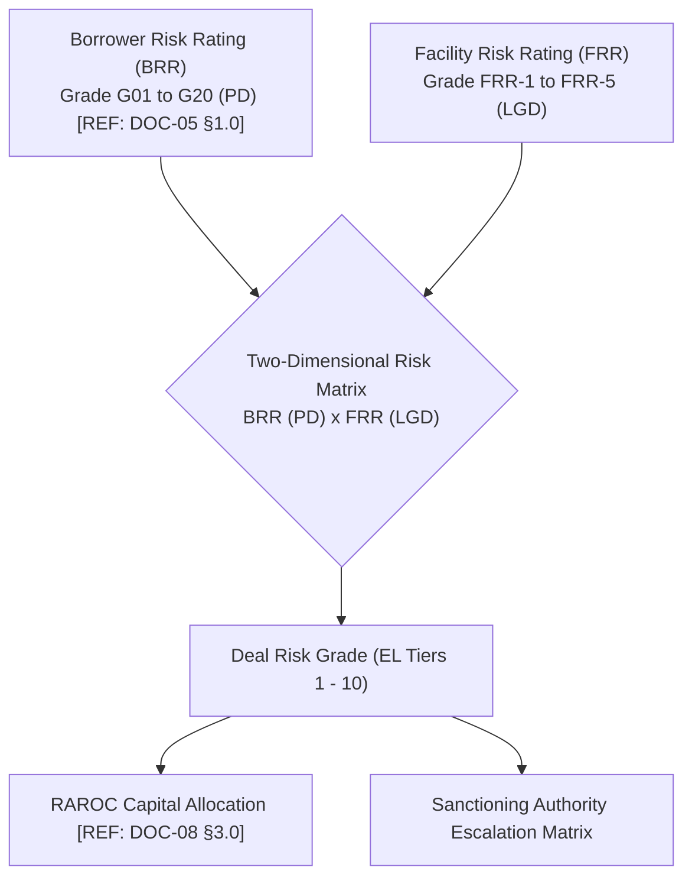
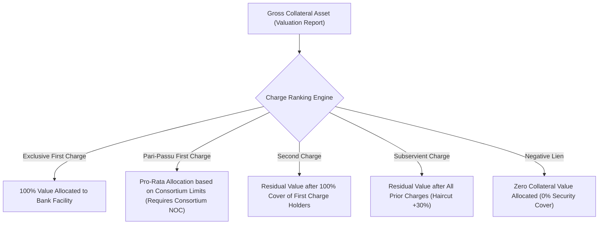

# DOC-06: FACILITY RISK RATING (FRR), COLLATERALS, SECURITY CHARGES & HAIRCUT ENGINE

**Document Reference:** `DOC-06`  
**System Name:** Next-Generation Internal Ratings Platform (IRP - Project ICON)  
**Parent Document:** `[REF: DOC-00 §3.0]`  
**Module Type:** Collateral Valuation & Loss Given Default (LGD) Microservice  
**Classification:** Confidential / System Architecture Specification  

---

## 1.0 BRR vs. FRR Duality & Two-Dimensional Deal Risk Matrix

In modern wholesale banking, credit risk is structurally two-dimensional:
- **Borrower Risk Rating (BRR):** Measures the legal entity's uncollateralized **Probability of Default (PD)** `[REF: DOC-04 §1.0]`. If an obligor defaults, it defaults on all obligations.
- **Facility Risk Rating (FRR):** Measures the facility-specific **Loss Given Default (LGD)**. A borrower may default, but a senior secured tranche backed by prime real estate will suffer negligible loss, whereas an unsecured subordinated line will face 100% loss.



### 1.1 Two-Dimensional Expected Loss (EL) Grid
Combining BRR (PD) and FRR (LGD) produces an automated Deal Expected Loss Grade:

| Borrower Grade (BRR) | FRR-1 (LGD < 20%) | FRR-2 (LGD 20-35%) | FRR-3 (LGD 35-50%) | FRR-4 (LGD 50-65%) | FRR-5 (LGD > 65% / Unsec) |
| :--- | :--- | :--- | :--- | :--- | :--- |
| **G01 - G04 (`AAA` to `AA-`)** | Deal Grade 1 (Minimal) | Deal Grade 1 (Minimal) | Deal Grade 2 (Very Low)| Deal Grade 3 (Low) | Deal Grade 4 (Moderate) |
| **G05 - G07 (`A+` to `A-`)** | Deal Grade 2 (Very Low)| Deal Grade 2 (Very Low)| Deal Grade 3 (Low) | Deal Grade 4 (Moderate)| Deal Grade 5 (Acceptable) |
| **G08 - G10 (`BBB+` to `BBB-`)**| Deal Grade 3 (Low) | Deal Grade 3 (Low) | Deal Grade 4 (Moderate)| Deal Grade 5 (Acceptable)| Deal Grade 6 (Elevated) |
| **G11 - G13 (`BB+` to `BB-`)** | Deal Grade 4 (Moderate)| Deal Grade 5 (Acceptable)| Deal Grade 6 (Elevated)| Deal Grade 7 (High Risk)| Deal Grade 8 (Severe Risk) |
| **G14 - G16 (`B+` to `B-`)** | Deal Grade 6 (Elevated)| Deal Grade 7 (High Risk)| Deal Grade 8 (Severe Risk)| Deal Grade 9 (Very High)| Deal Grade 10 (Critical) |
| **G17 - G20 (`CCC` to `D`)** | Deal Grade 8 (Severe Risk)| Deal Grade 9 (Very High)| Deal Grade 10 (Critical)| Deal Grade 10 (Critical)| Deal Grade 10 (Unacceptable)|

---

## 2.0 Collateral & Security Management Architecture

### 2.1 Primary vs. Collateral Security Distinction
The system maintains strict categorization between security types:
1. **Primary Security:** Assets created directly out of the loan proceeds or core working capital assets hypothecated to the facility:
   - Stocks of Raw Materials, Semi-Finished Goods, Finished Goods.
   - Trade Book Debts and Receivables.
   - Plant, Machinery, and Equipment purchased via Term Loan.
2. **Collateral (Secondary) Security:** Supplemental assets pledged to bolster recovery:
   - Equitable Mortgage on Industrial Land, Commercial Office, Residential Real Estate.
   - Corporate or Personal Guarantees `[REF: DOC-07 §2.0]`.
   - Lien on Fixed Deposits or Pledged Listed Securities.

### 2.2 Charge Types & Seniority Ranking Engine
Security value is heavily discounted depending on legal enforceability and charge ranking under Indian law (Transfer of Property Act 1882 & Companies Act 2013):



| Charge Code | Charge Classification | Legal Enforceability & CERSAI / ROC Mandate | Haircut Multiplier Adjustment |
| :--- | :--- | :--- | :--- |
| `CHG_FIRST_EXCL` | First Exclusive Charge | Sole charge registered with ROC / CERSAI. No other claimants. | `1.00` (Standard Haircut applied) |
| `CHG_FIRST_PARI` | First Pari-Passu Charge | Shared pro-rata with consortium lenders. **Mandatory Inter-creditor Agreement (ICA) & Consortium NOC**. | Allocates: $\text{Value} \times \frac{\text{Bank Limit}}{\sum \text{Consortium Limits}}$ |
| `CHG_SECOND` | Second Charge | Cessions behind first charge holders. | Eligible only if First Charge cover is $< 100\%$ of property value. |
| `CHG_SUBSERVIENT`| Subservient Charge | Ranked behind general creditors. High litigation recovery friction. | Base Haircut $+ 30\%$ penalty haircut. |
| `CHG_NEG_LIEN` | Negative Lien | Borrower undertakes not to encumber asset. No mortgage created. | **Ineligible for LGD reduction (0% value)** |

---

## 3.0 Granular Valuation Governance & Haircut Engine

### 3.1 Valuation Triad: FMV, RV, and DSV
Valuation reports submitted by IBBI-registered empaneled independent valuers contain three values:
1. **Fair Market Value (FMV):** The price an asset would realize in an open and competitive market between willing parties.
2. **Realizable Value (RV):** The price achievable under ordinary commercial sale conditions within a normal realization window (typically 3 to 6 months).
3. **Distress Sale Value (DSV):** The liquidation price achievable under forced sale, SARFAESI auction, or NCLT liquidation (typically 15% to 30% discount to RV).
*System Policy:* The platform uses **Realizable Value (RV)** as the calculation baseline for haircut application.

### 3.2 Granular Haircut Schedule
Haircuts reflect asset illiquidity, price volatility, depreciation, and enforcement costs under SARFAESI / IBC:

$$\text{Net Realizable Value (NRV)}_i = \text{RV}_i \times (1 - H_{\text{Asset}}) \times (1 - H_{\text{Age}}) \times (1 - C_{\text{Legal Enforcement}})$$

| Asset Class Code | Asset Description | Baseline Haircut ($H_{\text{Asset}}$) | Valuation Validity | Aging Penalty ($H_{\text{Age}}$) | Enforcement / Legal Cost ($C_{\text{Legal}}$) |
| :--- | :--- | :--- | :--- | :--- | :--- |
| `COL_CASH_FD` | Bank Fixed Deposit (Lien marked) | `0.0%` | Continuous | `0%` | `0%` |
| `COL_GOV_SEC` | Sovereign G-Sec / T-Bills | `2.0%` | Daily MTM | `0%` | `0.5%` |
| `COL_LISTED_EQ` | Listed Shares (NSE Top 500) | `45.0%` | Daily MTM | `0%` | `1.0%` |
| `COL_RES_PROP` | Residential Property (Metro / Tier 1)| `25.0%` | 36 Months | $+10\%$ if $> 3$ years | `5.0%` |
| `COL_COMM_PROP`| Commercial Office / Retail Mall | `35.0%` | 36 Months | $+15\%$ if $> 3$ years | `7.0%` |
| `COL_IND_LAND` | Industrial Land & Factory Shed | `40.0%` | 36 Months | $+15\%$ if $> 3$ years | `8.0%` |
| `COL_PLANT_MACH`| Plant, Machinery & Heavy Equipment | `55.0%` | 24 Months | $+20\%$ if $> 2$ years | `10.0%` |
| `COL_BOOK_DEBT_90`| Receivables ($\le 90$ Days) | `30.0%` | Monthly Audit | $+20\%$ if audit $> 60$ d | `5.0%` |
| `COL_STOCK_RM` | Raw Material Inventory | `30.0%` | Monthly Audit | $+20\%$ if audit $> 60$ d | `5.0%` |

---

## 4.0 Facility LGD Derivation Algorithm & FRR Mapping

### 4.1 Step-by-Step Mathematical Derivation
Let:
- $E_{\text{Fac}}$ be the facility exposure (Outstanding Drawn Balance + Undrawn Commitment $\times$ CCF) `[REF: DOC-08 §2.0]`.
- $NRV_{\text{Total}} = \sum_{i} NRV_i$ be the aggregate Net Realizable Value of eligible collateral allocated to this facility.

$$\text{Collateral Coverage Ratio (CCR)} = \frac{NRV_{\text{Total}}}{E_{\text{Fac}}}$$

The Facility Loss Given Default ($\text{LGD}_{\text{Fac}}$) is computed as:

$$\text{LGD}_{\text{Fac}} = \max \left( \text{LGD}_{\text{Floor}}, \left( 1 - \min(1.0, \text{CCR}) \times R_{\text{Secured}} \right) \right)$$

Where:
- $R_{\text{Secured}}$ is the empirical secured recovery rate (calibrated at $90\%$ accounting for residual legal slippage).
- $\text{LGD}_{\text{Floor}}$ is the regulatory minimum LGD under Basel III IRB (typically $10\%$ for senior secured exposures).
- If the facility is uncollateralized ($\text{CCR} = 0$), the standard unsecured corporate LGD is applied: $\text{LGD}_{\text{Unsecured}} = 65.0\% \text{ to } 75.0\%$.

### 4.2 Mapping to FRR Grade Scale
The calculated facility LGD is mapped into the bank's 5-grade Facility Risk Rating (FRR) scale:

| FRR Grade | LGD Range | Recovery Expectation | Typical Facility Structure |
| :--- | :--- | :--- | :--- |
| **FRR-1** | $\text{LGD} \le 20.0\%$ | Exceptional Recovery ($> 80\%$) | Cash / FD backed, or prime residential/commercial property with CCR $> 1.50\text{x}$. |
| **FRR-2** | $20.0\% < \text{LGD} \le 35.0\%$ | High Recovery ($65\% - 80\%$) | First charge on core fixed assets + working capital with CCR $1.10\text{x} - 1.50\text{x}$. |
| **FRR-3** | $35.0\% < \text{LGD} \le 50.0\%$ | Moderate Recovery ($50\% - 65\%$) | First pari-passu charge with CCR $0.75\text{x} - 1.10\text{x}$. |
| **FRR-4** | $50.0\% < \text{LGD} \le 65.0\%$ | Substandard Recovery ($35\% - 50\%$)| Second charge or low collateral cover (CCR $0.25\text{x} - 0.75\text{x}$). |
| **FRR-5** | $\text{LGD} > 65.0\%$ | Negligible Recovery ($< 35\%$) | Unsecured clean lending, negative lien, or subservient charge (CCR $< 0.25\text{x}$). |

---

## 5.0 Facility LGD Calculation JSON API Contract

- **Endpoint:** `POST /api/v1/facilities/{facility_id}/calculate-lgd`

```json
{
  "facility_id": "fac-term-2026-0012",
  "facility_type": "FB_TERM_LOAN",
  "sanctioned_amount_inr": 1000000000.00,
  "drawn_amount_inr": 800000000.00,
  "undrawn_amount_inr": 200000000.00,
  "ccf_pct": 50.0,
  "exposure_at_default_inr": 900000000.00,
  "collaterals": [
    {
      "collateral_id": "col-prop-098",
      "asset_class": "COL_COMM_PROP",
      "realizable_value_inr": 850000000.00,
      "charge_type": "CHG_FIRST_EXCL",
      "consortium_bank_share_pct": 100.0,
      "valuation_date": "2023-11-15",
      "valuation_age_months": 15,
      "empaneled_valuer_id": "VAL-IBBI-DEL-441"
    },
    {
      "collateral_id": "col-fd-112",
      "asset_class": "COL_CASH_FD",
      "realizable_value_inr": 100000000.00,
      "charge_type": "CHG_FIRST_EXCL",
      "consortium_bank_share_pct": 100.0,
      "valuation_date": "2024-03-31",
      "valuation_age_months": 0,
      "empaneled_valuer_id": "CORE_BANKING_LIEN"
    }
  ]
}
```

#### Output Calculated LGD & FRR Grade
```json
{
  "status": "CALCULATION_SUCCESS",
  "facility_id": "fac-term-2026-0012",
  "ead_inr": 900000000.00,
  "collateral_breakdown": [
    {
      "collateral_id": "col-prop-098",
      "gross_rv_inr": 850000000.00,
      "asset_haircut_pct": 35.0,
      "aging_penalty_pct": 0.0,
      "legal_cost_pct": 7.0,
      "net_realizable_value_inr": 513825000.00
    },
    {
      "collateral_id": "col-fd-112",
      "gross_rv_inr": 100000000.00,
      "asset_haircut_pct": 0.0,
      "aging_penalty_pct": 0.0,
      "legal_cost_pct": 0.0,
      "net_realizable_value_inr": 100000000.00
    }
  ],
  "total_net_realizable_collateral_inr": 613825000.00,
  "collateral_coverage_ratio": 0.6820,
  "derived_facility_lgd_pct": 38.62,
  "facility_risk_rating_grade": "FRR-3",
  "frr_description": "Moderate Recovery Expectation (50% - 65%)"
}
```
