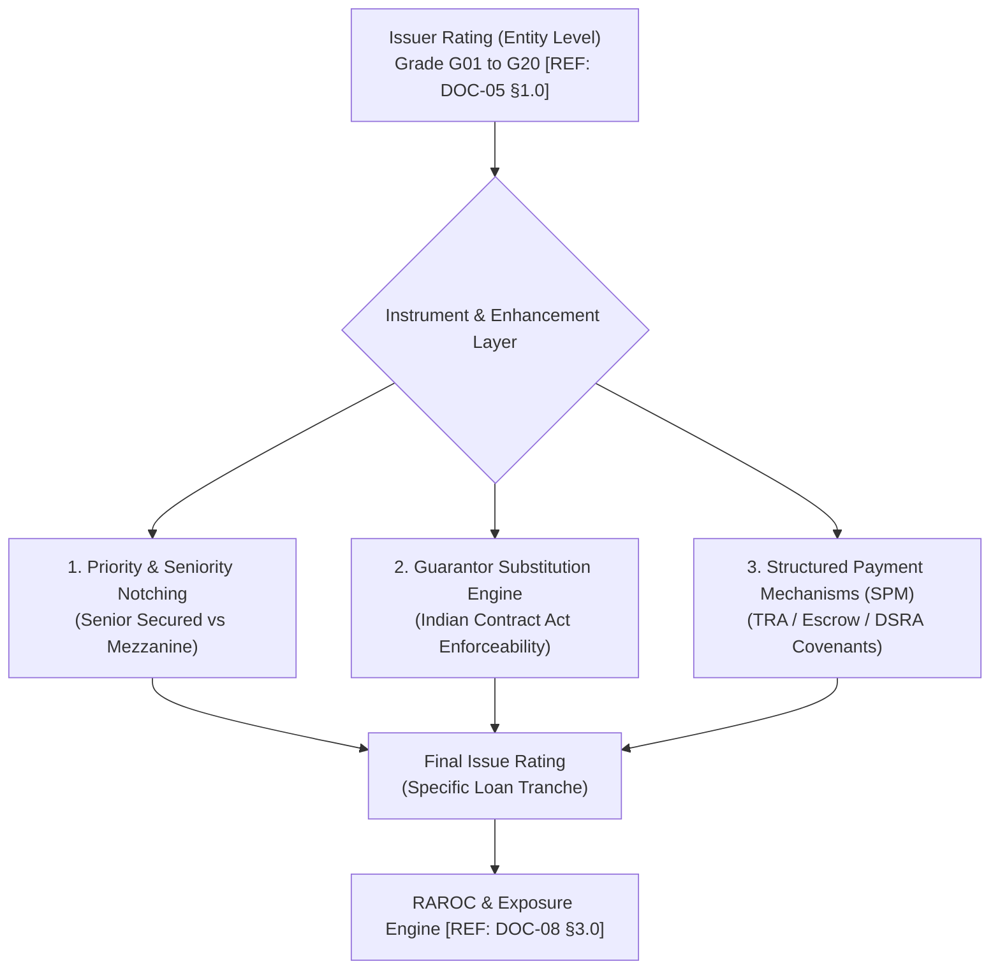
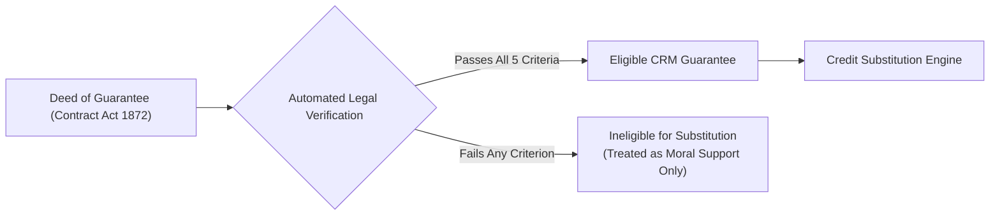
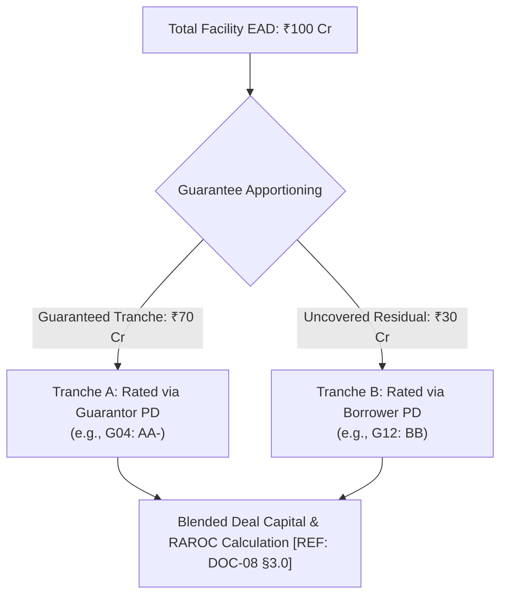
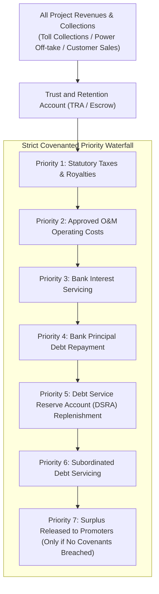

# DOC-07: ISSUER RATING VS. ISSUE RATING, GUARANTORS & CREDIT ENHANCEMENT FRAMEWORK

**Document Reference:** `DOC-07`  
**System Name:** Next-Generation Internal Ratings Platform (IRP - Project ICON)  
**Parent Document:** `[REF: DOC-00 §3.0]`  
**Module Type:** Instrument Notching & Credit Enhancement Microservice  
**Classification:** Confidential / System Architecture Specification  

---

## 1.0 Issuer Rating vs. Issue Rating Duality

A critical shortcoming of legacy banking systems is conflating entity-level default risk with specific debt instrument default risk. Project ICON establishes a rigorous structural distinction:

- **Issuer Rating (Entity Level):** Reflects the fundamental capacity of the legal borrower to honor its senior unsecured financial commitments `[REF: DOC-05 §1.0]`. It represents an unenhanced, entity-wide assessment of creditworthiness.
- **Issue Rating (Instrument / Tranche Level):** Reflects the risk of default and ultimate loss of a *specific* credit facility, loan tranche, bond issue, or non-fund line. An Issue Rating incorporates:
  1. Priority of claim and structural subordination (Senior Secured vs. Mezzanine).
  2. Legal credit enhancements (Corporate / Sovereign Guarantees, SBLCs).
  3. Structured Payment Mechanisms (Escrow, TRA, DSRA, Cash-sweep waterfalls).



---

## 2.0 Structural Subordination & Seniority Notching Matrix

Where an obligor issues multiple tranches of debt, their recovery and default timing diverge based on legal priority in resolution under the Insolvency and Bankruptcy Code (IBC) 2016 Section 53 (Waterfall Mechanism):

| Tranche Seniority Code | Tranche Classification | Statutory IBC Ranking (§53) | Notch Adjustment from Issuer Rating | Typical Facility Types |
| :--- | :--- | :--- | :--- | :--- |
| `TRANCHE_SNR_SEC` | Senior Secured | Priority 2 (Pari-passu with Workmen dues for 24M) | **0 to +1 Notch Uplift** (if FRR-1 or FRR-2) | Term Loans against Land/Machinery, Working Capital against Inventory |
| `TRANCHE_SNR_UNSEC` | Senior Unsecured | Priority 4 (Unsecured financial creditors) | **Baseline (0 Notches = Issuer Rating)** | Clean OD limits, Unsecured short-term bridge lines |
| `TRANCHE_SUB_MEZZ` | Subordinated / Mezzanine | Subordinated to all senior financial debt | **-1 to -2 Notches Downward** | Promoter Mezzanine Debt, Subordinated Debentures |
| `TRANCHE_JNR_TIER2` | Regulatory Capital (Tier-2/AT1)| Subordinated to depositors and general creditors | **-2 to -4 Notches Downward** | Basel III compliant Additional Tier-1 (AT1) or Tier-2 Bonds |

---

## 3.0 Guarantor Evaluation & Credit Substitution Framework

### 3.1 Guarantor Eligibility & Legal Enforceability Standards
A guarantee can elevate an Issue Rating above the Issuer Rating only if it satisfies the Basel III and Indian Contract Act 1872 criteria for **Credit Risk Mitigation (CRM)**:



The system verifies five mandatory legal covenants:
1. **Absolute & Irrevocable:** Cannot be unilaterally revoked or modified by guarantor without bank consent.
2. **Unconditional:** Not contingent on bank first exhausting legal remedies against the primary borrower.
3. **Payable on First Demand:** Enforceable within a defined invocation window (e.g., $T + 2$ business days upon default notice).
4. **Continuing Guarantee:** Covers all present and future liabilities, renewals, and interest accruals.
5. **No Negative Covenants Breached:** Approved by guarantor's Board of Directors under Section 186 of Companies Act 2013 (Loan and guarantee limits).

---

### 3.2 Credit Substitution Principle & Mathematical Formulation
If the guarantee is eligible, and the Guarantor's internal rating is superior to the Borrower's rating ($G_{\text{Guar}} < G_{\text{Borrower}}$), the platform executes the **Credit Substitution Algorithm**:

#### Full Unconditional Guarantee (100% Coverage)
The Borrower Probability of Default ($PD_{\text{Borrower}}$) is replaced by the adjusted Guarantor Probability of Default ($PD_{\text{Guar}}^{\text{adj}}$) accounting for joint default correlation $\rho_{\text{corr}}$:

$$PD_{\text{Issue}} = PD_{\text{Guar}} + \left( PD_{\text{Borrower}} \times PD_{\text{Guar}} \times (1 - \rho_{\text{corr}}) \right)$$

*Practical Banking Scale Mapping:*
$$\text{Grade}_{\text{Issue}} = \min \left( \text{Grade}_{\text{Guar}} + \text{Floor}(\rho_{\text{friction}}), \text{Grade}_{\text{Borrower}} \right)$$
*(Typically, the Issue Rating is equated directly to the Guarantor's rating or set 1 notch below if cross-border/cross-sector friction exists).*

#### Partial Guarantees & First Loss Default Guarantees (FLDG)
When a guarantee covers only a specified portion of the exposure ($E_{\text{Covered}}$):



For First Loss Default Guarantees (FLDG) common in co-lending and fintech partnerships:
- The FLDG absorbs initial losses up to $X\%$ (e.g., 5% of portfolio).
- The system models FLDG as a direct deduction from Expected Loss (EL) before computing regulatory capital.

---

## 4.0 Structured Payment Mechanisms (SPM)

### 4.1 Trust and Retention Account (TRA) & Escrow Waterfall
For infrastructure concessions and real estate projects, debt servicing is ring-fenced through a dedicated Trust and Retention Account (TRA) established with an independent Escrow Agent:



### 4.2 Debt Service Reserve Account (DSRA) Mechanism
- **Requirement:** Maintenance of 1 to 2 quarters of upcoming principal and interest obligations.
- **Form of DSRA:** Liquid Cash Deposit lien-marked to the bank, or an unconditional Bank Guarantee from an `AAA`-rated financial institution.
- **Rating Uplift Impact:** The presence of a covenanted and funded DSRA combined with an independent TRA escrow allows an upward notching of **+1 to +2 notches** above the unenhanced project SACP:
  $$\text{SPM Uplift} = \begin{cases} +2 \text{ Notches} & \text{if Funded DSRA } \ge 2 \text{ Qtrs} \text{ and Escrow Agent has direct debit mandate} \\ +1 \text{ Notch} & \text{if Funded DSRA } \ge 1 \text{ Qtr} \text{ and Escrow Agent active} \\ 0 \text{ Notches} & \text{if DSRA un-funded or breach active} \end{cases}$$

---

## 5.0 Credit Enhancement & Issue Rating JSON API Contract

- **Endpoint:** `POST /api/v1/facilities/{facility_id}/evaluate-enhancements`

```json
{
  "facility_id": "fac-term-2026-0012",
  "issuer_rating_grade": "G12",
  "issuer_rating_alpha": "BB",
  "seniority": "TRANCHE_SNR_SEC",
  "frr_grade": "FRR-2",
  "credit_enhancements": [
    {
      "enhancement_type": "CORPORATE_GUARANTEE",
      "guarantor_entity_id": "c92d34f5-6789-4a01-cdef-234567890def",
      "guarantor_name": "BHARAT HOLDINGS LTD",
      "guarantor_internal_grade": "G04",
      "guarantor_alpha": "AA-",
      "guarantee_nature": "UNCONDITIONAL_IRREVOCABLE_FIRST_DEMAND",
      "coverage_percentage": 100.0,
      "board_resolution_verified": true,
      "sec_186_compliance": true
    },
    {
      "enhancement_type": "STRUCTURED_PAYMENT_MECHANISM",
      "spm_type": "TRA_ESCROW_WITH_DSRA",
      "escrow_bank": "STATE_BANK_OF_INDIA",
      "dsra_quarters_funded": 2,
      "dsra_form": "FIXED_DEPOSIT_LIEN",
      "independent_waterfall_monitored": true
    }
  ]
}
```

#### Output Calculated Issue Rating
```json
{
  "status": "ENHANCEMENT_EVALUATION_SUCCESS",
  "facility_id": "fac-term-2026-0012",
  "issuer_base_grade": "G12",
  "issuer_base_alpha": "BB",
  "enhancement_results": {
    "guarantor_substitution_eligible": true,
    "substituted_pd_grade": "G04",
    "spm_uplift_notches": 1,
    "seniority_adjustment_notches": 0
  },
  "final_issue_rating_grade": "G04",
  "final_issue_rating_alpha": "AA-",
  "issue_rating_rationale": "Credit substitution applied based on 100% unconditional corporate guarantee from Bharat Holdings Ltd (G04 / AA-). Structured payment waterfall with 2 quarters DSRA validates investment grade execution.",
  "regulatory_rwa_impact": {
    "pre_enhancement_risk_weight": 1.50,
    "post_enhancement_risk_weight": 0.30,
    "rwa_savings_pct": 80.0
  }
}
```
