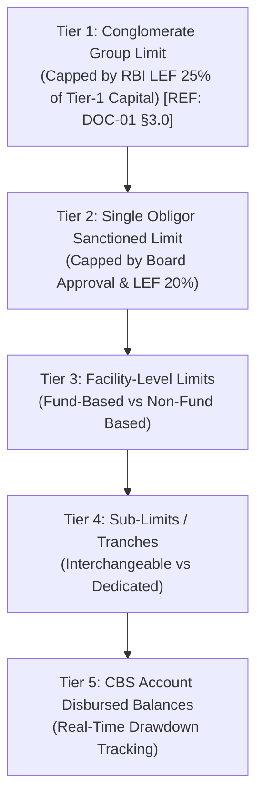
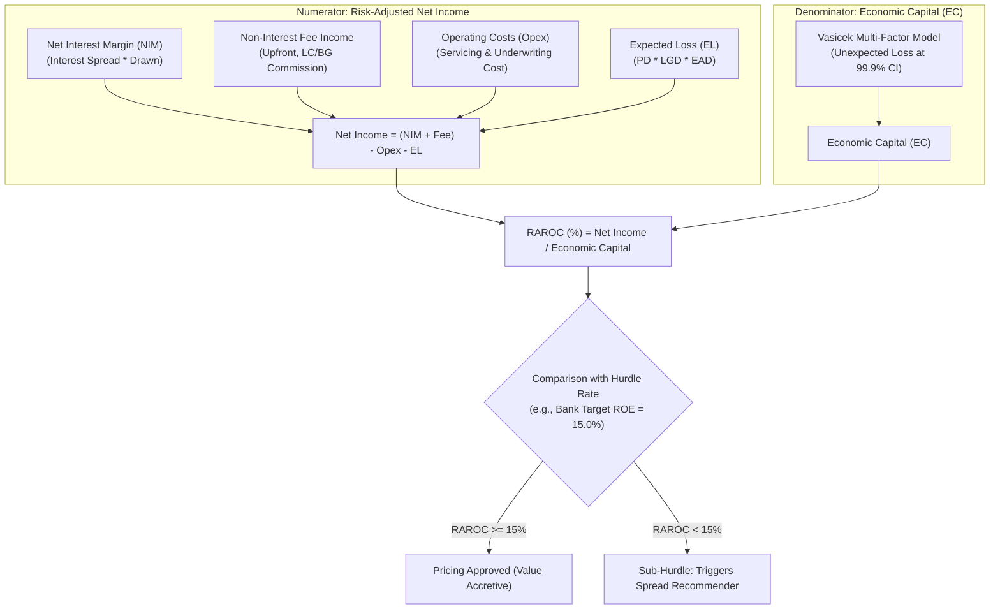

# DOC-08: LIMIT, EXPOSURE ARCHITECTURE, CREDIT CONVERSION FACTORS (CCF) & RAROC ENGINE

**Document Reference:** `DOC-08`  
**System Name:** Next-Generation Internal Ratings Platform (IRP - Project ICON)  
**Parent Document:** `[REF: DOC-00 §3.0]`  
**Module Type:** Limit Management & Capital Pricing Microservice  
**Classification:** Confidential / System Architecture Specification  

---

## 1.0 Limit & Exposure Hierarchy Engine

Wholesale lending demands rigorous limit containment to prevent unauthorized credit accumulation across complex multi-borrower groups. Project ICON enforces an immutable five-tier limit hierarchy:



### 1.1 Facility Types & Limit Sub-division Rules
Limits are strictly partitioned into Fund-Based (FB) and Non-Fund-Based (NFB):
1. **Fund-Based Limits:** Involve direct cash outflow from the bank. Examples:
   - Term Loans (TL), Cash Credit (CC), Working Capital Demand Loans (WCDL), Inland Bills Discounting (IBD).
2. **Non-Fund-Based Limits:** Contingent off-balance sheet liabilities where the bank provides financial backstops. Examples:
   - Financial Bank Guarantees (FBG), Performance Bank Guarantees (PBG), Documentary Letters of Credit (LC).
3. **Interchangeability & One-Way Fungibility:**
   - The platform supports dynamic interchangeability (e.g., borrower can carve out up to ₹50 Cr of FB Cash Credit into NFB Letter of Credit).
   - Non-interchangeable lines (e.g., Capex Term Loans) are locked against fungible transfers to prevent asset-liability mismatch (ALM) leakage.

---

## 2.0 Exposure at Default (EAD) & Credit Conversion Factors (CCF)

### 2.1 EAD Mathematical Formulation
Under the Basel III Foundation and Advanced Internal Ratings Based (IRB) approaches, credit risk is measured not on current ledger balances, but on the expected drawn exposure at the moment of default:

$$\text{EAD} = \text{Drawn Balance} + \left( \text{Undrawn Sanctioned Commitment} \times \text{CCF} \right) + \text{Potential Future Exposure (PFE for Derivatives)}$$

### 2.2 Standardized Credit Conversion Factor (CCF) Master Schedule
Per RBI Master Directions on Basel III Capital Regulations:

| Facility Type Code | Facility Description | CCF (%) | Regulatory Condition & Cancellation Clause |
| :--- | :--- | :--- | :--- |
| `FB_CC_REVOCABLE` | Working Capital Cash Credit (Unconditionally Cancellable) | `20%` | Revolving line, cancellable at bank discretion upon credit deterioration. |
| `FB_TL_IRREVOCABLE`| Rupee Term Loan - Undrawn Capex Line | `75%` | Irrevocable commitment with scheduled project milestone drawdown. |
| `FB_TL_SHORT_TERM` | Undrawn Loan with Original Maturity $\le 1$ Year | `50%` | Short-term committed line. |
| `NFB_FIN_GUARANTEE`| Financial Bank Guarantee (FBG) | `100%` | Direct credit substitute guaranteeing loan/statutory payment. |
| `NFB_PERF_GUARANTEE`| Performance Bank Guarantee (PBG) | `50%` | Transaction-related guarantee backing performance of contract/bid bond. |
| `NFB_DOC_LC_SIGHT` | Documentary LC (Sight) backed by commercial goods | `20%` | Self-liquidating short-term trade letter of credit. |
| `NFB_DOC_LC_USANCE`| Documentary LC (Usance / Acceptance) | `50%` | Deferred payment trade letter of credit. |
| `FX_DERIVATIVE_IRS`| Interest Rate Swap / FX Forward | CEM / SA-CCR | Current Exposure Method (MTM + Add-on factor based on tenure). |

---

## 3.0 RAROC (Risk-Adjusted Return on Capital) Calculation Engine

### 3.1 Foundational Financial & Risk Formulation
The platform evaluates the economic profitability of every credit facility using **Risk-Adjusted Return on Capital (RAROC)**:

$$\text{RAROC} = \frac{\text{Net Revenues} - \text{Operating Costs} - \text{Expected Loss (EL)}}{\text{Economic Capital (EC)}}$$



---

### 3.2 Granular Component Mathematical Derivations

#### 1. Expected Loss (EL)
$$\text{EL} = \text{PD}_{\text{Obligor}} \times \text{LGD}_{\text{Facility}} \times \text{EAD}_{\text{Facility}}$$
- $\text{PD}_{\text{Obligor}}$: 1-Year Probability of Default derived from Issuer Rating `[REF: DOC-02 §3.0]` or Guarantor substituted rating `[REF: DOC-07 §3.0]`.
- $\text{LGD}_{\text{Facility}}$: Facility Loss Given Default derived from collateral haircut engine `[REF: DOC-06 §4.0]`.
- $\text{EAD}_{\text{Facility}}$: Exposure at Default derived in Section 2.1 above.

#### 2. Economic Capital (EC) via Vasicek Model (99.9% Confidence Interval)
Economic Capital measures the **Unexpected Loss (UL)** that the bank must buffer with equity capital over a 1-year horizon:

$$\text{Capital Requirement } (K) = \left[ \text{LGD} \times N\left( \frac{G(\text{PD}) + \sqrt{R} \times G(0.999)}{\sqrt{1 - R}} \right) - (\text{PD} \times \text{LGD}) \right] \times \text{Maturity Adjustment}(M)$$

Where:
- $N(x)$ is the cumulative standard normal distribution function.
- $G(x) = N^{-1}(x)$ is the inverse cumulative standard normal distribution function.
- $R$ is the asset correlation coefficient per Basel III Corporate rules:
  $$R = 0.12 \times \left( \frac{1 - e^{-50 \times \text{PD}}}{1 - e^{-50}} \right) + 0.24 \times \left[ 1 - \left( \frac{1 - e^{-50 \times \text{PD}}}{1 - e^{-50}} \right) \right] - 0.04 \times \left( 1 - \frac{\min(\max(S, 5), 50) - 5}{45} \right)$$
  *(where $S$ is annual obligor turnover in € Millions or ₹ Equivalent).*
- $\text{Maturity Adjustment } (M) = \frac{1 + (M - 2.5) \times b}{1 - 1.5 \times b}$, where $b = (0.11852 - 0.05478 \times \ln(\text{PD}))^2$.
- **Economic Capital Amount:**
  $$\text{EC} = K \times \text{EAD}$$

---

### 3.3 Dynamic Risk-Based Pricing Recommender
If the facility's proposed lending spread fails to achieve the Bank Hurdle Rate (e.g., $\text{Hurdle} = 15.0\%$), the engine automatically calculates the exact required lending spread over benchmark (Repo / MCLR):

$$\text{Required NIM} = \frac{(\text{Hurdle Rate} \times \text{EC}) + \text{EL} + \text{Opex} - \text{Fee Income}}{\text{Average Drawn EAD}}$$

$$\text{Required Lending Rate (\%)} = \text{Marginal Cost of Funds (MCOF)} + \text{Required NIM}$$

$$\text{Minimum Risk Spread} = \text{Required Lending Rate} - \text{Benchmark Rate (RBI Repo / 1Y MCLR)}$$

---

## 4.0 RAROC Calculation JSON API Contract

- **Endpoint:** `POST /api/v1/pricing/raroc/calculate`

```json
{
  "facility_id": "fac-term-2026-0012",
  "obligor_pan": "AABCS1234K",
  "issuer_rating_grade": "G07",
  "issuer_rating_alpha": "A-",
  "pd_pct": 0.45,
  "frr_grade": "FRR-3",
  "lgd_pct": 38.62,
  "effective_tenor_years": 4.5,
  "facility_pricing_terms": {
    "sanctioned_limit_inr": 1000000000.00,
    "expected_drawn_balance_inr": 800000000.00,
    "expected_undrawn_balance_inr": 200000000.00,
    "ccf_pct": 50.0,
    "benchmark_rate_type": "RBI_REPO",
    "benchmark_rate_pct": 6.50,
    "proposed_spread_bps": 225,
    "proposed_interest_rate_pct": 8.75,
    "upfront_processing_fee_inr": 5000000.00,
    "annual_servicing_fee_inr": 1000000.00
  },
  "bank_cost_assumptions": {
    "cost_of_funds_pct": 6.10,
    "operating_cost_bps": 45,
    "hurdle_rate_roe_pct": 15.00
  }
}
```

#### Output Calculated RAROC & Recommended Spread
```json
{
  "status": "CALCULATION_SUCCESS",
  "facility_id": "fac-term-2026-0012",
  "exposure_metrics": {
    "drawn_balance_inr": 800000000.00,
    "undrawn_ead_inr": 100000000.00,
    "total_ead_inr": 900000000.00
  },
  "risk_capital_metrics": {
    "expected_loss_inr": 1564110.00,
    "expected_loss_pct": 0.1738,
    "vasicek_capital_k_pct": 6.842,
    "economic_capital_inr": 61578000.00
  },
  "profitability_breakdown": {
    "net_interest_income_inr": 21200000.00,
    "fee_income_inr": 2250000.00,
    "operating_costs_inr": 3600000.00,
    "expected_loss_deduction_inr": 1564110.00,
    "net_risk_adjusted_income_inr": 18285890.00
  },
  "raroc_result": {
    "calculated_raroc_pct": 29.69,
    "bank_hurdle_rate_pct": 15.00,
    "hurdle_exceeded": true,
    "excess_return_over_hurdle_pct": 14.69,
    "pricing_recommendation": "APPROVED_PREMIUM_PRICING",
    "minimum_hurdle_spread_bps": 122,
    "actual_proposed_spread_bps": 225
  }
}
```
