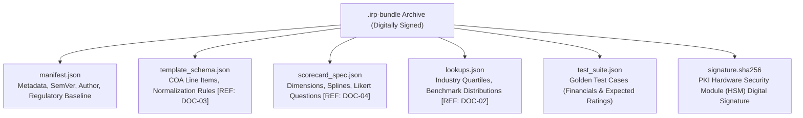
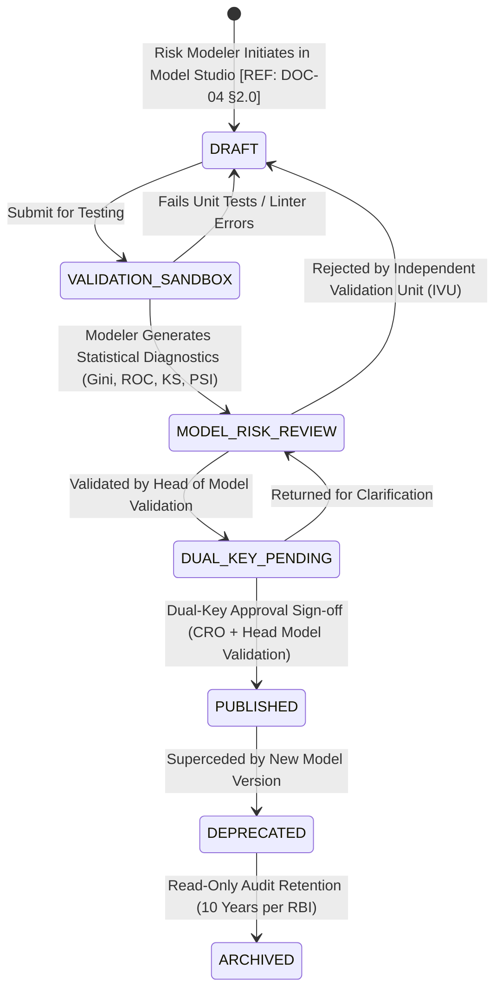

# DOC-09: MODEL VERSIONING, ARTIFACT PACKAGING, RELEASE CI/CD & DEPLOYMENT PIPELINE

**Document Reference:** `DOC-09`  
**System Name:** Next-Generation Internal Ratings Platform (IRP - Project ICON)  
**Parent Document:** `[REF: DOC-00 §3.0]`  
**Module Type:** Model Risk Governance & CI/CD Deployment Specification  
**Classification:** Confidential / System Architecture Specification  

---

## 1.0 Semantic Versioning Protocol & Immutability Rules

Credit rating models are legally and statistically binding instruments subject to scrutiny by internal audit and the Reserve Bank of India (RBI Annual Financial Inspection - AFI). A change in a single ratio weighting can shift billions of rupees in risk-weighted assets (RWA). Project ICON enforces strict versioning and release hygiene.

### 1.1 Semantic Versioning Syntax
All rating models and scorecard artifacts follow strict SemVer 2.0 notation:

$$\text{Syntax: } \mathbf{MODEL\_<SEGMENT>\_<REGIME>\_V<MAJOR>.<MINOR>.<PATCH>}$$
*(e.g., `MODEL_CORP_INDAS_V2.1.0`)*

- **`MAJOR` (Incompatible Structural Changes):** Adding/removing scoring dimensions, rewriting the mathematical aggregation algorithm (e.g., switching from linear roll-up to logistic regression), or altering the master rating scale.
- **`MINOR` (Methodology & Parameter Refinements):** Re-calibrating ratio spline cut-offs `[REF: DOC-04 §1.1]`, modifying qualitative questionnaire weights, or updating industry quartile lookups `[REF: DOC-02 §6.0]`. Backward compatible with existing active rating cases.
- **`PATCH` (Bug Fixes & Corrections):** Rectifying typos in question text, fixing UI label mappings, or adjusting non-analytical display parameters without impacting score calculation.

### 1.2 The Production Immutability Principle
1. **Cryptographically Sealed:** Once a model transitions to the `PUBLISHED` state, its configuration, formulas, parameters, and lookup weights are permanently sealed with an SHA-256 digital signature.
2. **Zero In-Place Edits:** Direct modification of a published model in the database is physically prohibited. Any alteration requires cloning the model into a new `DRAFT` with an incremented version number.
3. **In-Flight Rating Pinning:** When a credit analyst initiates a rating memo, the system binds that rating session to the exact `model_version_id` active at that timestamp. If a new model version is published while the credit memo is pending sanction, the in-flight memo remains pinned to its original version, unless explicitly upgraded by the maker with logged re-calculation audit notes `[REF: DOC-11 §1.0]`.

---

## 2.0 Standardized Declarative Model Artifact Bundle

Models are packaged as self-contained, declarative archives (`.irp-bundle` or `.tar.gz`) enabling seamless export and import between development, validation sandbox, and production environments:



### 2.1 Artifact Bundle Manifest Specification (`manifest.json`)
```json
{
  "manifest_version": "1.0.0",
  "model_unique_id": "MOD-CORP-INDAS-V2-1-0",
  "model_name": "Standard Large Corporate Ind-AS Scorecard",
  "semver": "2.1.0",
  "target_lending_segment": "SEG-LC",
  "applicable_nic_codes": ["24101", "24102", "21001", "13111"],
  "regulatory_baseline": [
    "RBI Master Direction - IRB Approach for Credit Risk",
    "Basel III Capital Regulations July 2015"
  ],
  "author": {
    "modeler_name": "Dr. Arvind Sharma",
    "role": "Lead Quantitative Risk Architect",
    "unit": "Model Risk & Analytics Group"
  },
  "effective_from": "2026-04-01T00:00:00Z",
  "effective_to": "9999-12-31T23:59:59Z",
  "statistical_validation": {
    "gini_coefficient": 0.684,
    "roc_auc": 0.842,
    "ks_statistic_pct": 42.1,
    "psi_against_development": 0.048,
    "validation_report_hash": "e3b0c44298fc1c149afbf4c8996fb92427ae41e4649b934ca495991b7852b855"
  }
}
```

### 2.2 Golden Test Suite Specification (`test_suite.json`)
Every bundle MUST embed at least 5 synthetic golden benchmark test cases. Upon importing a model into any environment, the platform automatically executes these test cases; if any case fails to reproduce the exact expected score and rating grade within a tolerance of $\pm 0.001\%$, the import is aborted:

```json
{
  "test_cases": [
    {
      "test_case_id": "GOLDEN-STEEL-001",
      "description": "High-leverage steel producer with moderate EBITDA and clean conduct",
      "inputs": {
        "financial_ratios": {
          "RATIO_TOL_ATNW": 2.45,
          "RATIO_DSCR": 1.42,
          "RATIO_ISCR": 2.85,
          "RATIO_OP_MARGIN": 12.50,
          "RATIO_CURR_RATIO": 1.15,
          "RATIO_ROCE": 11.20
        },
        "qualitative_scores": {
          "BIZ_MKT_POSITION": "TOP_3",
          "BIZ_REV_DIVERS": "CONC_MODERATE",
          "GOV_PROMOTER_TRACK": "CLEAN_TRACK",
          "GOV_AUDITOR_REP": "BIG_10_CLEAN"
        },
        "ews_penalties": []
      },
      "expected_outputs": {
        "raw_quantitative_score": 54.25,
        "raw_qualitative_score": 72.50,
        "raw_governance_score": 85.00,
        "final_weighted_score": 64.96,
        "assigned_grade": "G06",
        "assigned_alpha": "A",
        "tolerance": 0.001
      }
    }
  ]
}
```

---

## 3.0 Model Promotion & Release State Machine

The progression of a model from initial draft conception to live production deployment is governed by an automated BPMN state machine enforcing strict segregation of duties (SoD) between Model Builders, Model Validators, and Approvers:



### 3.1 State Definitions & Gatekeeper Roles

| State Name | Allowed Actions & Operations | Mandatory Gatekeeper / Actor | Automated System Verification Gates |
| :--- | :--- | :--- | :--- |
| **`DRAFT`** | Edit formulas, adjust weights, create parameters in Studio. | Quantitative Risk Modeler | Syntax linting, type boundary validation, weight sum = 100%. |
| **`VALIDATION_SANDBOX`**| Run batch cohort simulations on historical obligor data `[REF: DOC-04 §3.0]`. | Independent Model Validation Unit (IVU) | Golden test execution (100% pass rate); Automated Gini $\ge 0.60$ and $\text{PSI} < 0.10$. |
| **`MODEL_RISK_REVIEW`** | Review sensitivity analysis, stress test curves, and regulatory compliance. | Head - Model Risk Management | Independent validation sign-off report attached. |
| **`DUAL_KEY_PENDING`** | Final pre-production staging. Ready for executive sign-off. | Chief Risk Officer (CRO) & Head of Model Validation | Two distinct cryptographic keys required (Dual-Key). No single user can self-approve. |
| **`PUBLISHED`** | Live in Production. Actively assigns legal credit ratings to obligors. | Platform Deployment Engine | SHA-256 digital signature sealed in Hardware Security Module (HSM). Read-only. |
| **`DEPRECATED`** | No new rating memos can initiate with this version. In-flight memos permitted to finish. | Automated by System upon new model release | Active in-flight memo tracking. |
| **`ARCHIVED`** | Permanently sealed for historical audit time-travel queries `[REF: DOC-10 §1.0]`. | Platform System Service | Immutable WORM storage retention for minimum 10 years per RBI rules. |

---

## 4.0 Model Promotion JSON Audit Contract

- **Endpoint:** `POST /api/v1/models/{model_id}/promote-to-production`

```json
{
  "model_id": "MOD-CORP-INDAS-V2-1-0",
  "promotion_request": {
    "source_environment": "UAT_VALIDATION_SANDBOX",
    "target_environment": "PRODUCTION",
    "bundle_sha256": "4a5e1e8d9b2c3f4a5b6c7d8e9f0a1b2c3d4e5f6a7b8c9d0e1f2a3b4c5d6e7f8a",
    "golden_tests_executed": 15,
    "golden_tests_passed": 15,
    "approvals": [
      {
        "role": "HEAD_MODEL_VALIDATION",
        "officer_name": "Rajesh Kumar Nair",
        "officer_emp_id": "EMP-RISK-00412",
        "approval_timestamp": "2026-03-25T14:30:15Z",
        "pki_signature": "SIG_RSA4096_VALIDATOR_987162534"
      },
      {
        "role": "CHIEF_RISK_OFFICER",
        "officer_name": "Siddharth Sen",
        "officer_emp_id": "EMP-EXEC-00008",
        "approval_timestamp": "2026-03-26T09:15:00Z",
        "pki_signature": "SIG_RSA4096_CRO_0001928374"
      }
    ]
  }
}
```

#### Output Confirmation Payload
```json
{
  "status": "PROMOTION_SUCCESSFUL",
  "model_id": "MOD-CORP-INDAS-V2-1-0",
  "active_status": "PUBLISHED",
  "published_at": "2026-03-26T09:15:02Z",
  "hsm_certificate_id": "HSM-KEY-IRP-PROD-2026-01",
  "routing_status": {
    "default_for_segments": ["SEG-LC"],
    "supersedes_model_id": "MOD-CORP-INDAS-V2-0-0",
    "deprecated_model_status": "DEPRECATED_ACTIVE_RUNS_DRAINED"
  }
}
```
