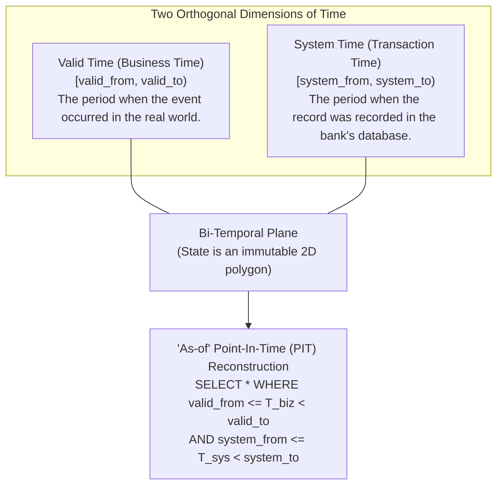
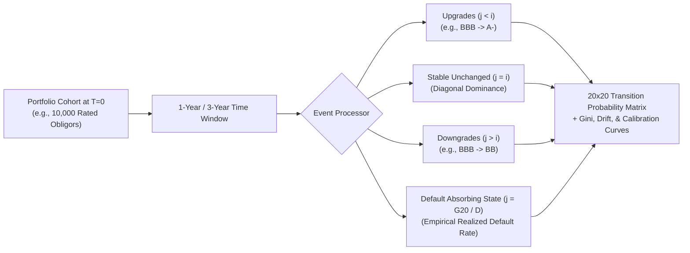

# DOC-10: BI-TEMPORAL DATA ARCHITECTURE, TIME-SERIES LOOKUPS & RATING MIGRATION ANALYTICS

**Document Reference:** `DOC-10`  
**System Name:** Next-Generation Internal Ratings Platform (IRP - Project ICON)  
**Parent Document:** `[REF: DOC-00 §3.0]`  
**Module Type:** Temporal Data Persistence & Migration Analytics Engine  
**Classification:** Confidential / System Architecture Specification  

---

## 1.0 Bi-Temporal Data Architecture (Time-Travel Capabilities)

### 1.1 The Core Problem in Legacy Systems
In conventional credit rating platforms, when a corporate borrower restates its FY23 audited financials in FY25 (e.g., due to an auditor qualification or MCA reconciliation), the database record is updated in-place or overwritten. This destruction of historical transaction state makes it impossible to reproduce the exact state of the bank's knowledge during a past regulatory audit or credit committee sanction.

Project ICON natively implements a **Bi-Temporal Data Architecture** (ISO SQL:2011 standard) across all entities, financials, ratings, collateral valuations, and facility limits.



---

### 1.2 Bi-Temporal State Evolution Example
Consider the following chronological scenario for Obligor *Bharat Industrial Corp*:
1. **Event 1 (Recorded on 2024-05-15 10:00):** Obligor submits FY24 provisional financials showing Net Worth = ₹500 Cr. Valid for business year $2024-04-01$ to $2025-03-31$. System assigns Grade `G06` (`A`).
2. **Event 2 (Recorded on 2024-09-30 16:30):** Statutory auditor signs audited balance sheet showing Net Worth was actually ₹420 Cr (due to disputed tax provisions).
3. **Legacy Result:** The ₹500 Cr record is deleted/overwritten. Historical audit can no longer prove why the bank approved a loan at `G06` pricing in June 2024.
4. **ICON Bi-Temporal Result:** The original record is retained forever. Its `system_to` is closed at `2024-09-30 16:30`, and a new system-time slice is inserted.

```mermaid
gantt
    title Bi-Temporal Record Lifetime Evolution (System Time vs Valid Time)
    dateFormat YYYY-MM-DD
    section Slice 1 (Initial Provisional)
    Slice 1 (Active in Sys Time: May 15 to Sep 30) :done, s1, 2024-05-15, 2024-09-30
    section Slice 2 (Audited Restatement)
    Slice 2 (Active in Sys Time: Sep 30 onwards)   :active, s2, 2024-09-30, 2025-05-15
```

---

### 1.3 Bi-Temporal DDL Specification (PostgreSQL)

```sql
-- Schema: bitemporal_rating_store
CREATE TABLE rating_assessment_bitemporal (
    record_id UUID PRIMARY KEY DEFAULT gen_random_uuid(),
    assessment_id UUID NOT NULL,
    obligor_id UUID NOT NULL,
    model_version_id VARCHAR(50) NOT NULL,
    standalone_sacp_grade VARCHAR(4) NOT NULL,
    notched_issuer_grade VARCHAR(4) NOT NULL,
    pd_midpoint_pct NUMERIC(6,4) NOT NULL,
    atnw_inr_cr NUMERIC(15,2) NOT NULL,
    tol_atnw NUMERIC(6,2) NOT NULL,
    dscr NUMERIC(6,2) NOT NULL,
    
    -- Bi-Temporal Timestamps
    valid_from DATE NOT NULL,
    valid_to DATE NOT NULL,
    system_from TIMESTAMPTZ NOT NULL DEFAULT CURRENT_TIMESTAMP,
    system_to TIMESTAMPTZ NOT NULL DEFAULT '9999-12-31 23:59:59+00',
    
    created_by_user_id VARCHAR(100) NOT NULL,
    change_reason_code VARCHAR(50) NOT NULL,
    
    CONSTRAINT valid_range_check CHECK (valid_from < valid_to),
    CONSTRAINT system_range_check CHECK (system_from < system_to)
);

CREATE INDEX idx_rating_bitemporal_lookup 
ON rating_assessment_bitemporal (obligor_id, valid_from, valid_to, system_from, system_to);
```

### 1.4 "As-of" Point-In-Time (PIT) Query Implementation
To reconstruct the exact state of an obligor or entire portfolio as known to the bank at any historical moment:

```sql
-- Query: "What was the rating and financial health of Obligor X as known to the bank on June 20, 2024 at 14:00?"
SELECT 
    obligor_id,
    model_version_id,
    standalone_sacp_grade,
    notched_issuer_grade,
    pd_midpoint_pct,
    atnw_inr_cr,
    tol_atnw,
    dscr
FROM rating_assessment_bitemporal
WHERE obligor_id = '8f1a23e4-5678-4b90-bcde-123456789abc'
  -- Valid Time Filter (The business period in question, e.g., FY24)
  AND valid_from <= '2024-03-31' AND valid_to > '2024-03-31'
  -- System Time Filter (The transaction time the bank knew about it)
  AND system_from <= '2024-06-20 14:00:00+05:30' 
  AND system_to > '2024-06-20 14:00:00+05:30';
```

---

## 2.0 Rating Transitions & Migration Matrix Analytics

### 2.1 Markov Transition Probabilities & Cohort Methodology
To satisfy RBI Master Directions on the Internal Ratings Based (IRB) approach and Basel III backtesting mandates, the platform generates multi-period rating transition matrices:

$$P_{ij} = P\left( R_{t+1} = j \mid R_t = i \right) = \frac{N_{ij}}{\sum_{k=1}^{K} N_{ik}}$$

Where:
- $N_{ij}$ is the number of obligors in rating grade $i$ at start of year $t$ that migrated to grade $j$ at end of year $t+1$.
- $K = 20$ represents the 20 internal rating grades `[REF: DOC-02 §3.0]`, with Grade 20 (`D`) functioning as an **absorbing default state** ($P_{20, 20} = 1.0$).



---

### 2.2 Standard 1-Year Portfolio Rating Migration Matrix (Illustrative Benchmark)
The table below illustrates a typical empirical 1-year migration matrix across consolidated grade bands:

| Initial Grade Band | AAA (`G01`) | AA (`G02-G04`) | A (`G05-G07`) | BBB (`G08-G10`)| BB (`G11-G13`) | B (`G14-G16`) | CCC-C (`G17-G19`)| Default D (`G20`) | Total Count |
| :--- | :--- | :--- | :--- | :--- | :--- | :--- | :--- | :--- | :--- |
| **AAA** | `91.50%` | `7.80%` | `0.60%` | `0.10%` | `0.00%` | `0.00%` | `0.00%` | `0.00%` | 100.0% |
| **AA** | `1.80%` | `88.40%` | `8.70%` | `0.90%` | `0.15%` | `0.05%` | `0.00%` | `0.00%` | 100.0% |
| **A** | `0.10%` | `3.20%` | `87.10%` | `8.20%` | `1.10%` | `0.20%` | `0.05%` | `0.05%` | 100.0% |
| **BBB** | `0.00%` | `0.25%` | `4.85%` | `83.20%` | `9.40%` | `1.60%` | `0.30%` | `0.40%` | 100.0% |
| **BB** | `0.00%` | `0.05%` | `0.45%` | `6.20%` | `77.80%` | `11.80%` | `2.10%` | `1.60%` | 100.0% |
| **B** | `0.00%` | `0.00%` | `0.10%` | `0.60%` | `7.10%` | `74.20%` | `12.20%` | `5.80%` | 100.0% |
| **CCC-C** | `0.00%` | `0.00%` | `0.00%` | `0.20%` | `1.40%` | `9.50%` | `61.40%` | `27.50%` | 100.0% |
| **D (Default)**| `0.00%` | `0.00%` | `0.00%` | `0.00%` | `0.00%` | `0.00%` | `0.00%` | `100.00%` | 100.0% |

---

### 2.3 Rating Migration Analytics & Diagnostic Metrics

#### 1. Rating Drift
Measures the directional tendency of portfolio credit quality over time:
$$\text{Rating Drift} = \frac{\sum \text{Upgrades} - \sum \text{Downgrades}}{\text{Total Active Portfolio Cohort}}$$
- Negative drift indicates systemic portfolio deterioration (e.g., industry downcycle).

#### 2. Upgrade / Downgrade Ratio
$$\text{U / D Ratio} = \frac{\text{Number of Upgraded Obligors}}{\text{Number of Downgraded Obligors}}$$

#### 3. Default Realization Curve vs. Master Scale PD Calibration
The analytics engine tests whether empirical 1-year default rates stay within the statistical 95% confidence intervals of the master scale PD midpoints `[REF: DOC-02 §3.0]`. If empirical default rates consistently breach predicted PD caps for two consecutive annual cycles, the engine triggers an **Automated Model Re-calibration Flag** to the Model Risk Management Committee.

---

## 3.0 Real-Time Surveillance & Automated Migration Triggers

The Bi-Temporal event store is continuously monitored by an asynchronous surveillance worker. Any external event ingestion immediately checks for rating re-assessment triggers:
- **CRILC SMA-2 Ingestion:** If an obligor is reported as SMA-2 by any lender in the RBI CRILC network, the platform flags the file for mandatory mid-term surveillance review within 7 business days `[REF: DOC-05 §4.1]`.
- **CRA External Downgrade:** An external CRA downgrade $> 2$ notches automatically generates an ad-hoc surveillance task assigned to the primary underwriter `[REF: DOC-11 §3.0]`.
- **Stock Audit Deficit:** A stock audit reporting drawing power deficit $> 15\%$ triggers an automated FRR re-calculation `[REF: DOC-06 §4.0]`.
