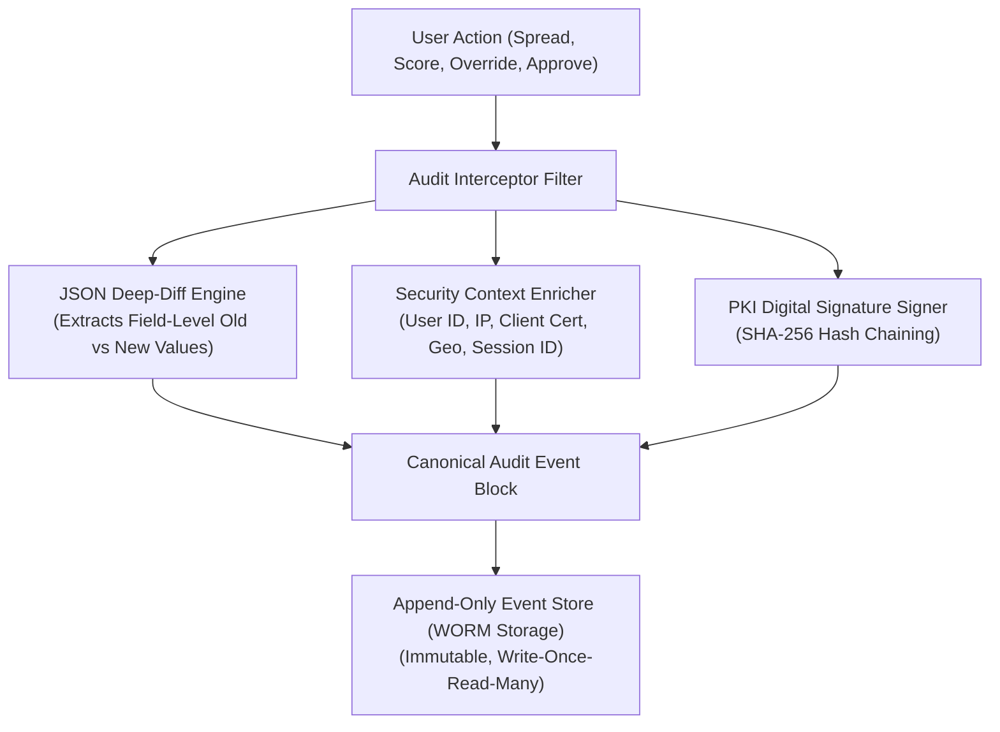
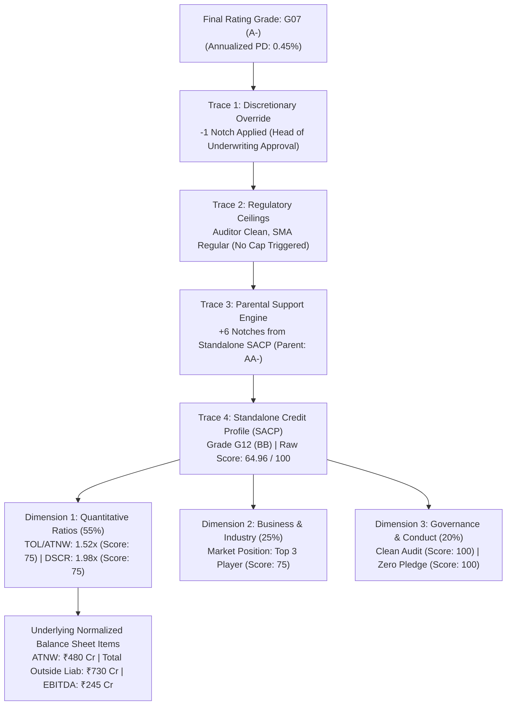
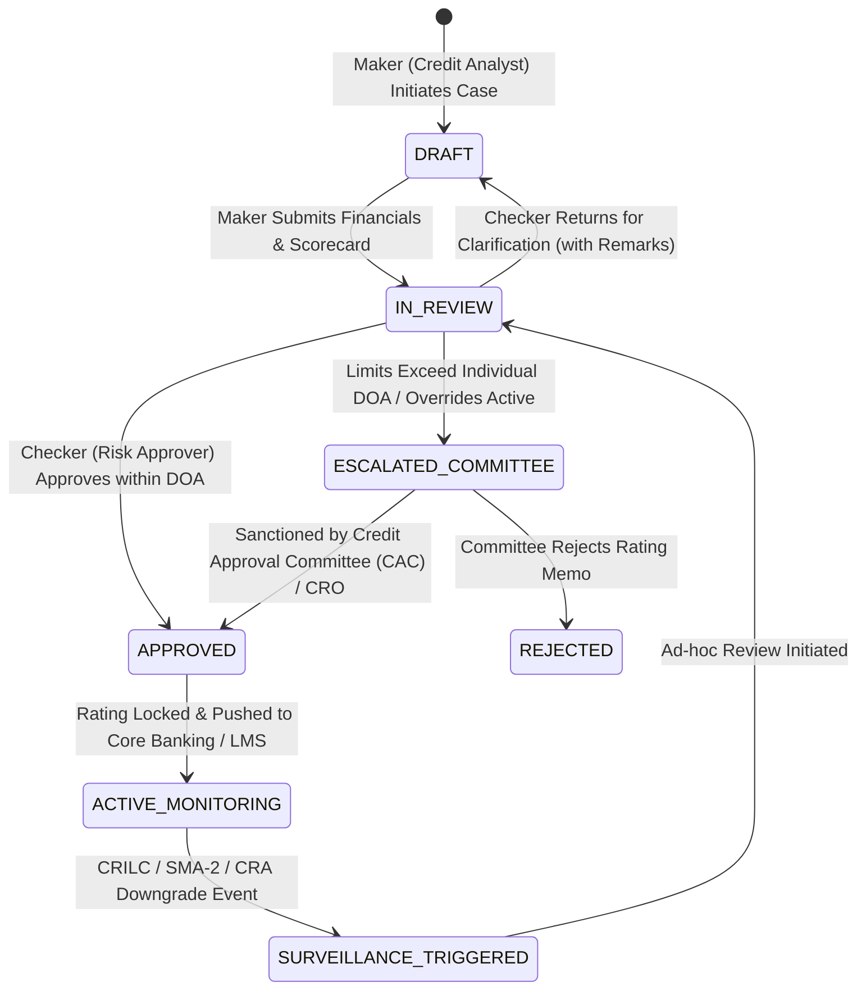

# DOC-11: AUDIT TRAIL, DATA LINEAGE, FOUR-EYES GOVERNANCE & WORKFLOW STATE MACHINE

**Document Reference:** `DOC-11`  
**System Name:** Next-Generation Internal Ratings Platform (IRP - Project ICON)  
**Parent Document:** `[REF: DOC-00 §3.0]`  
**Module Type:** Audit Fabric & Governance Workflow Specification  
**Classification:** Confidential / System Architecture Specification  

---

## 1.0 Immutable Audit Trail & Event-Sourcing Architecture

In corporate lending, accountability must be total and tamper-proof. During Reserve Bank of India (RBI) supervisory inspections or forensic investigations under the Insolvency and Bankruptcy Code (IBC), the bank must prove exactly who changed a ratio, who applied a rating override, when it occurred, and the precise evidentiary justification provided.



### 1.1 Field-Level Audit Payload Schema
Every database modification across the platform generates an immutable audit record containing explicit before-and-after values:

```json
{
  "event_id": "evt-771829-4410-bcae",
  "correlation_id": "req-2026-03-26-00912",
  "timestamp_utc": "2026-03-26T11:42:15.128Z",
  "user_context": {
    "user_id": "EMP-CR-44019",
    "user_name": "Pooja Deshmukh",
    "role": "SENIOR_CREDIT_UNDERWRITER",
    "branch_sol_id": "SOL-0012-MUMBAI-MAIN",
    "client_ip_address": "10.14.88.24",
    "session_id": "sess-jwt-9812739182374",
    "device_fingerprint": "fp-mac-a4:b2:39:11:c8:04"
  },
  "entity_context": {
    "entity_type": "FINANCIAL_SPREADING_LINE_ITEM",
    "entity_id": "sp-2026-ind-9871",
    "obligor_pan": "AABCS1234K",
    "fiscal_period": "2024"
  },
  "action_type": "FIELD_VALUE_UPDATE",
  "change_detail": {
    "field_name": "BS_DT_PROMOTER_SUB",
    "field_description": "Promoter Subordinated Quasi-Equity Loans",
    "old_value": 0.00,
    "new_value": 80000000.00,
    "value_unit": "INR"
  },
  "justification": {
    "reason_code": "QUASI_EQUITY_SUBORDINATION_VERIFIED",
    "analyst_remarks": "Subordination deed and non-withdrawal covenant verified as per Board resolution dated 2024-04-10.",
    "document_evidence_attachment_id": "DOC-LEGAL-DEED-44109.pdf"
  },
  "hash_chain": {
    "previous_block_hash": "b2c3d4e5f6a7b8c9d0e1f2a3b4c5d6e7f8a9b0c1d2e3f4a5b6c7d8e9f0a1b2c3",
    "current_block_hash": "c3d4e5f6a7b8c9d0e1f2a3b4c5d6e7f8a9b0c1d2e3f4a5b6c7d8e9f0a1b2c3d4",
    "pki_signature": "SIG_PKI_CLIENT_RSA_4096_VERIFIED"
  }
}
```

---

## 2.0 Formula Calculation Explainability & Proof Engine

A frequent failure of automated risk platforms is the "black-box problem," where sanctioning committee members or regulators cannot trace how an obligor ended up with a specific grade. Project ICON includes an automated **Step-by-Step Mathematical Derivation Generator** for every finalized rating.



### 2.1 Generated Explainability Memo Snippet
Upon rating finalization, the system renders a cryptographically signed HTML/PDF derivation annexure:
> **MATHEMATICAL PROOF OF RATING ASSIGNMENT**  
> **Obligor:** Steel Fabricators Bharat Limited (`AABCS1234K`)  
> **Final Approved Issuer Grade:** `G07` (`A-`) | **PD:** `0.45%`  
> 
> 1. *Quantitative Financial Roll-Up:*  
>    $$\text{Score}_{\text{Quant}} = (0.25 \times 74.2) + (0.20 \times 82.5) + (0.15 \times 70.0) + (0.15 \times 65.0) + (0.15 \times 62.0) + (0.10 \times 78.0) = \mathbf{72.31 / 100}$$  
> 2. *Business & Governance Roll-Up:*  
>    $$\text{Score}_{\text{Biz}} = \mathbf{75.00 / 100} \quad | \quad \text{Score}_{\text{Gov}} = \mathbf{85.00 / 100}$$  
> 3. *Standalone Raw Score:*  
>    $$\text{Raw Score} = (0.55 \times 72.31) + (0.25 \times 75.00) + (0.20 \times 85.00) = \mathbf{75.52 / 100} \implies \text{Grade G12 (BB)}$$  
> 4. *Parental Support Uplift:*  
>    $$\Delta_{\text{Gap}} = G12 - G04 = 8 \text{ Notches} \times 0.75 = +6 \text{ Notches} \implies \mathbf{G06 (A)}$$  
> 5. *Discretionary Overlay:*  
>    $$\text{Manual Override: } -1 \text{ Notch (Commodity Cycle Risk)} \implies \mathbf{G07 (A-)}$$  
> **Derivation Verified:** Zero calculation variance detected against production engine.

---

## 3.0 Maker-Checker-Approver Workflow State Machine

Credit rating decisions are governed under strict four-eyes and six-eyes principles to eliminate unilateral credit granting or conflicts of interest:



### 3.1 Delegation of Authority (DOA) Matrix Integration
The workflow engine evaluates the required approval level dynamically based on three criteria:
1. Aggregate Group Exposure (`[REF: DOC-01 §3.0]`).
2. Proposed Final Issuer Rating Grade (`[REF: DOC-05 §1.0]`).
3. Presence of Discretionary Overrides or Policy Deviations (`[REF: DOC-05 §4.2]`).

| Exposure Range (INR) | Final Internal Grade | Overrides Present? | Mandatory Approval Level & Authority |
| :--- | :--- | :--- | :--- |
| Up to ₹25 Crore | Investment Grade (`G01` to `G10`)| No Overrides | **Level 1:** Senior Credit Manager & Unit Risk Head |
| ₹25 Cr to ₹100 Crore | Investment Grade (`G01` to `G10`)| No Overrides | **Level 2:** Regional Credit Committee (RCC) |
| Any Exposure | High Yield (`G11` to `G16`) | No Overrides | **Level 3:** Executive Credit Committee (ECC) / Head of Wholesale Risk |
| Any Exposure | Any Grade | **Yes ($\pm 1$ or $\pm 2$ Notches)** | **Level 4:** Chief Risk Officer (CRO) Personal Sign-off |
| Exceeding ₹250 Crore | Any Grade | Any Status | **Level 5:** Board Credit Committee (BCC) / Whole Time Director |

---

## 4.0 Workflow State Transition JSON Payload Contract

- **Endpoint:** `POST /api/v1/workflow/cases/{case_id}/transition`

```json
{
  "case_id": "case-rtg-2026-9812",
  "current_state": "IN_REVIEW",
  "requested_action": "APPROVE_AND_SEAL",
  "actor": {
    "user_id": "EMP-RISK-00192",
    "role": "CHIEF_RISK_OFFICER",
    "delegation_of_authority_tier": "LEVEL_4_CRO"
  },
  "action_payload": {
    "approved_issuer_grade": "G07",
    "approved_issuer_alpha": "A-",
    "override_approved": true,
    "override_rationale_accepted": true,
    "conditions_precedent_to_disbursement": [
      "Registration of First Exclusive Charge with CERSAI within 30 days.",
      "Execution of irrevocable corporate guarantee deed from Bharat Holdings Ltd."
    ],
    "approver_comments": "Approved based on strong group support and healthy debt service coverage post-restructuring.",
    "pki_signature": "SIG_RSA4096_CRO_APPROVAL_TOKEN_881923"
  }
}
```

#### Output Transition Result
```json
{
  "status": "TRANSITION_SUCCESSFUL",
  "case_id": "case-rtg-2026-9812",
  "previous_state": "IN_REVIEW",
  "new_state": "APPROVED",
  "sealed_at": "2026-03-26T12:05:10Z",
  "downstream_events_published": [
    {
      "topic": "irp.ratings.finalized",
      "event_key": "AABCS1234K",
      "payload_summary": "Rating G07 (A-) published to CBS and LMS."
    }
  ],
  "audit_block_hash": "f4a5b6c7d8e9f0a1b2c3d4e5f6a7b8c9d0e1f2a3b4c5d6e7f8a9b0c1d2e3f4a5"
}
```
