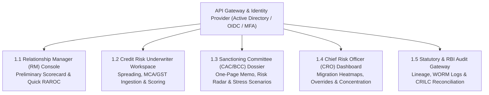

# DOC-12: STAKEHOLDER PORTALS, REGULATORY MIS & MANDATORY BANKING NON-FUNCTIONAL REQUIREMENTS (NFRs)

**Document Reference:** `DOC-12`  
**System Name:** Next-Generation Internal Ratings Platform (IRP - Project ICON)  
**Parent Document:** `[REF: DOC-00 §3.0]`  
**Module Type:** Presentation Layer, Regulatory Gateway & System NFRs  
**Classification:** Confidential / System Architecture Specification  

---

## 1.0 Stakeholder Portals & User Consoles

Project ICON replaces fragmented departmental software with unified, role-tailored workspaces built on high-performance React / WebAssembly architecture:



---

### 1.1 Relationship Manager (RM) Console
- **Objective:** Enable front-line corporate bankers to originate deals without submitting unviable credit proposals to risk.
- **Key Features:**
  - **Preliminary Pre-Screen Scorecard:** Quick calculation of indicative rating in $< 5$ minutes using basic topline, debt, and industry selection.
  - **Indicative RAROC Pricing Calculator:** Real-time loan spread recommendation over Repo/MCLR `[REF: DOC-08 §3.3]`.
  - **LEF Capital Headroom Check:** Instant verification of single obligor and economic group exposure headroom `[REF: DOC-01 §3.0]` prior to issuing preliminary term sheets.

---

### 1.2 Credit Risk Underwriter Workspace
- **Objective:** Primary analytical workbench for credit analysts and underwriters.
- **Key Features:**
  - **Dual-Pane Spreading Console:** Side-by-side view of scanned PDF / XBRL financial statements alongside dynamic COA spreading grids `[REF: DOC-03 §1.0]`.
  - **Automated MCA & GST Reconciliation:** Automated flags for sales variance ($> 15\%$) between GSTR-3B filings and audited P&L.
  - **Interactive Qualitative Scoring Sheet:** Likert-scale questionnaire with inline document upload, evidence tagging, and mandatory remark fields `[REF: DOC-04 §1.2]`.
  - **One-Click Derivation Inspector:** Live drill-down into every ratio calculation formula.

---

### 1.3 Sanctioning Committee / Board Credit Committee (CAC / BCC) Executive Dossier
- **Objective:** iPad and desktop executive briefing for credit committee members, Executive Directors, and MD/CEO.
- **Key Features:**
  - **Executive One-Page Rating Memo:** High-impact visual summary containing SACP, Notched Issuer Rating, FRR, Collateral Coverage, and RAROC.
  - **Risk Radar Chart:** Multi-axial spider chart benchmarking the obligor across 6 dimensions (Leverage, Debt Coverage, Profitability, Liquidity, Governance, Industry Outlook) against industry quartiles `[REF: DOC-02 §6.0]`.
  - **Dynamic "What-If" Stress Simulation:** Real-time sliders allowing committee members to test resilience during meeting deliberations (e.g., *"What happens to DSCR and Rating if raw material costs rise by 15%?"*).

---

### 1.4 Chief Risk Officer (CRO) Portfolio Risk Dashboard
- **Objective:** Macro risk oversight and early warning surveillance.
- **Key Features:**
  - **Portfolio Rating Distribution Heatmap:** Sector-wise and rating-wise exposure distribution across the ₹1,00,000+ Crore book.
  - **Transition Matrix & Rating Drift Tracker:** Real-time 1-year Markov migration matrices and upgrade/downgrade ratio trends `[REF: DOC-10 §2.0]`.
  - **Override Surveillance Console:** Real-time tracking of subjective notch overrides by underwriter, branch, and sector `[REF: DOC-05 §4.2]`.
  - **Concentration Risk Monitor:** Herfindahl-Hirschman Index (HHI) tracking across industries, conglomerate groups, and ratings.

---

### 1.5 Statutory & Regulatory Audit Portal
- **Objective:** Dedicated, read-only supervisory console for RBI Annual Financial Inspection (AFI) teams and Statutory Auditors.
- **Key Features:**
  - **Time-Travel Query Console:** Instant extraction of historical portfolio state as of any past balance sheet date `[REF: DOC-10 §1.4]`.
  - **CRILC / SMA Reconciliation Hub:** Automated variance reporting between internal delinquency and external CRILC SMA classifications.
  - **WORM Audit Trail Inspector:** Export of cryptographically signed SHA-256 event chains `[REF: DOC-11 §1.1]`.

---

## 2.0 User Experience (UX) Blueprint & Interface Wireframes

### 2.1 Spreading Workspace Wireframe Layout

```
+---------------------------------------------------------------------------------------------------+
|  PROJECT ICON | Credit Spreading Workspace | Case: SP-2026-IND-9871 | Obligor: STEEL FABRICATORS LTD  |
+---------------------------------------------------------------------------------------------------+
| [Source Document: FY24_Audited.pdf]        | [Canonical Spreading Grid: Ind-AS Standard Corporate]   |
|                                            | Period: [ FY22 Aud ] [ FY23 Aud ] [ FY24 Aud*] [ CMA25]  |
| +----------------------------------------+ | +------------------------------------------------------+ |
| | Page 42: Balance Sheet as on 31-Mar-24 | | | Financial Line Item      | FY23    | FY24*   | YoY %   | |
| | Equity Share Capital ....... ₹50.00 Cr | | |--------------------------+---------+---------+---------| |
| | Other Equity ............... ₹450.0 Cr | | | Share Capital            | 50.00   | 50.00   |   0.0%  | |
| | Long-term Borrowings ....... ₹320.0 Cr | | | Reserves & Surplus       | 380.00  | 450.00  | +18.4%  | |
| | Short-term Borrowings ...... ₹210.0 Cr | | | (-) Reval Reserves [?]   |  25.00  |  30.00  | +20.0%  | |
| | Trade Payables ............. ₹110.0 Cr | | | (+) Promoter Quasi-Debt  |   0.00  |  80.00  |  NEW    | |
| |                                        | | |==========================+=========+=========+=========| |
| | [ OCR Auto-Extracted - Confidence: 99%]| | | Adjusted Net Worth (ATNW)| 385.00  | 480.00  | +24.6%  | |
| |                                        | | | Total Debt / ATNW        |  1.82x  |  1.52x  | -16.4%  | |
| | [Pin Line to Field] [Flag Anomaly]     | | | Analytical EBITDA        | 195.00  | 245.00  | +25.6%  | |
| +----------------------------------------+ | | DSCR                     |  1.65x  |  1.98x  | +20.0%  | |
|                                            | +------------------------------------------------------+ |
| Normalization Adjustments:                 | Analytical Validation Checks:                            |
| [X] Subordinate Promoter Loans (₹80 Cr)    | [OK] Balance Sheet Equation Balanced (Assets == Liab)    |
| [X] Deduct Disputed Tax Demand (₹12 Cr)    | [OK] GSTR-3B Sales Variance vs P&L: 2.1% (Within 5% Tol) |
| [ ] Haircut Intangibles (₹20 Cr)           | [WARN] Trade Debtor Days Expanded by 18 Days             |
+---------------------------------------------------------------------------------------------------+
| Actions: [ Save Draft ]  [ Run Validation Rules ]  [ Generate Ratios & Proceed to Scorecard -> ]     |
+---------------------------------------------------------------------------------------------------+
```

---

### 2.2 Model Studio Low-Code Builder Wireframe Layout

```
+---------------------------------------------------------------------------------------------------+
|  MODEL STUDIO | Scorecard Builder | Model: MODEL_CORP_INDAS_V2.1.0 | Status: DRAFT (Editing)      |
+---------------------------------------------------------------------------------------------------+
| [Component Palette]     | [Visual Scorecard Hierarchy & Canvas]       | [Parameter Inspector]     |
|                         |                                             |                           |
| (+) New Dimension       |  [-] Dimension: Quantitative Profile (55%)  | Parameter: TOL / ATNW     |
| (+) Financial Ratio     |      |-- [*] Ratio: TOL / ATNW (25%)        | Ratio Code: RATIO_TOL_ATNW|
| (+) Qualitative Likert  |      |-- [*] Ratio: DSCR (20%)              | Weight: [ 25.0 % ]        |
| (+) EWS Modifier        |      |-- [*] Ratio: ISCR (15%)              | Spline: Piecewise Linear  |
| (+) Hard Regulatory Cap |      |-- [*] Ratio: EBITDA Margin (15%)     |                           |
|                         |      |-- [*] Ratio: Current Ratio (15%)     | Cutoff Spline Curve:      |
| Formulas & Logic:       |      +-- [*] Ratio: ROCE (10%)              | 100 pts -> val <= 0.75x   |
| [CEL Expression Editor] |                                             |  75 pts -> val == 1.50x   |
| [Quartile Benchmarks]   |  [+] Dimension: Business & Industry (25%)   |  40 pts -> val == 2.50x   |
| [Golden Test Cases (5)] |                                             |   0 pts -> val >= 4.50x   |
|                         |  [+] Dimension: Governance & Conduct (20%)  |                           |
| Weight Integrity:       |                                             | Boundary Checks:          |
| [================] 100% |  [-] EWS & Conduct Deductions               | Min Val: 0.0x             |
| Total Weight Validated  |      |-- [!] SMA-2 Hard Cap: BB- (G13)      | Max Val: 10.0x            |
|                         |      +-- [!] Wilful Defaulter Floor: D (G20)| Floor Score: 0 pts        |
+---------------------------------------------------------------------------------------------------+
| Sandbox Actions: [ Run Syntax Linter ]  [ Execute 5 Golden Tests ]  [ Submit for Model Validation ]|
+---------------------------------------------------------------------------------------------------+
```

---

## 3.0 Mandatory Banking Non-Functional Requirements (NFRs) per RBI Regulations

### 3.1 Data Residency & Localization Mandate
- **RBI Mandate:** 100% of data—including entity records, financial statements, ratings, collateral valuations, and audit logs—must reside exclusively within the geographic borders of the Republic of India.
- **Architectural Implementation:** Primary Data Center (PDC) located in Mumbai/Navi Mumbai; Disaster Recovery Site (DRS) located in Chennai/Hyderabad in separate seismic zones. Cloud providers must utilize MeitY-empaneled Indian cloud regions (e.g., AWS Mumbai / Azure Central India). Zero outbound replication outside India.

### 3.2 High Availability (HA) & Disaster Recovery (DR) SLAs
- **Availability SLA:** 99.99% uptime (maximum permitted unplanned downtime $< 52.56\text{ minutes/year}$).
- **Recovery Point Objective (RPO):** $\text{RPO} = 0$ for all committed rating memos and audit records (enforced via synchronous database replication between Availability Zones).
- **Recovery Time Objective (RTO):** $\text{RTO} \le 15\text{ minutes}$ in the event of complete PDC loss (automated DNS failover to DRS).

### 3.3 Security, Cryptography & CERT-In Compliance
- **Data at Rest Encryption:** AES-256 with keys managed in FIPS 140-2 Level 3 certified Hardware Security Modules (HSM).
- **Data in Transit Encryption:** TLS 1.3 mandatory with Forward Secrecy across all internal microservice gRPC calls and external client HTTPS connections. Deprecation of TLS 1.0, 1.1, and 1.2.
- **Vulnerability Management:** Zero High or Critical vulnerabilities under OWASP Top-10 / SANS-25. Annual mandatory sign-off from CERT-In empaneled VAPT auditors.

### 3.4 Identity, Access Control & Privileged Access Management (PAM)
- **Authentication:** Single Sign-On (SSO) integration via SAML 2.0 / OpenID Connect (OIDC) with Bank Enterprise Active Directory (Azure AD / Okta).
- **Multi-Factor Authentication (MFA):** Mandatory hardware security token (FIDO2 / WebAuthn) or time-based OTP for all approvals, overrides, and Model Studio updates.
- **Access Architecture:** Hybrid Role-Based (RBAC) and Attribute-Based Access Control (ABAC) enforcing branch-level and DOA limits `[REF: DOC-11 §3.1]`. Privileged administrative access routed exclusively through a session-recorded PAM bastion.

### 3.5 Audit Storage & Non-Repudiation (WORM Compliance)
- **Immutable Log Storage:** Audit events streamed to Write-Once-Read-Many (WORM) compliant S3 object storage with Object Lock in Compliance Mode.
- **Cryptographic Hash Chains:** Every audit event links to the preceding event hash using SHA-256, forming an immutable Merkel tree structure preventing retroactive alteration `[REF: DOC-11 §1.1]`.
- **Retention Period:** Minimum 10 years online retention per RBI Master Directions.

### 3.6 Performance & Throughput SLAs
- **Single Obligor Rating Calculation:** $\le 500\text{ milliseconds}$ end-to-end response time (including quantitative spline calculation, qualitative scoring, and parental support).
- **Batch Portfolio Recalculation:** $\ge 50,000\text{ facilities/hour}$ during scheduled quarterly stress-testing and CRILC refresh runs.
- **Financial Spreading Recalculation:** Instant client-side UI recalculation $< 100\text{ ms}$ upon modifying any balance sheet line item.
