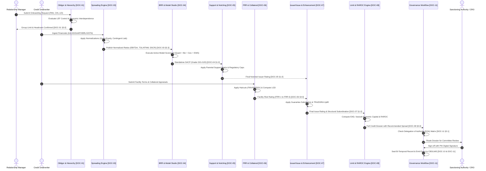

# NEXT-GENERATION INTERNAL RATINGS PLATFORM (PROJECT ICON)
## Enterprise Product Requirements Document & System Functional Architecture Suite

**Classification:** Confidential / Tier-1 Indian Banking Architecture Specification  
**Regulatory Baseline:** Reserve Bank of India (RBI) Master Directions (IRB Approach, LEF, IRACP, June 7 Circular, Basel III)  
**System Target:** Non-Retail / Wholesale Credit Underwriting, Surveillance, Capital & RAROC Pricing  

---

## 1. Executive Suite Navigation

This document suite serves as the complete, implementation-ready architectural and functional blueprint for **Project ICON (Internal Credit Origin & Notching)**—an institutional ratings platform engineered to supersede **Moody's Analytics CreditLens** across Indian Scheduled Commercial Banks (SCBs).

The documentation is organized into 13 inter-linked modules:

| Document ID | Module Title | Primary Focus & Domain | Link |
| :--- | :--- | :--- | :--- |
| **`DOC-00`** | **Executive Summary & Enterprise Architecture Blueprint** | Platform Vision, Target Lending Segments, Microservices Architecture Diagram, Cross-Module Traceability Matrix | [DOC-00.md](file:///c:/Users/user/icon-ba/icon-documentation/DOC-00_Executive_Summary_and_Enterprise_Architecture.md) |
| **`DOC-01`** | **Obligor, Conglomerate Group & Corporate Hierarchy Engine** | Multi-Identifier Resolution (PAN, CIN, LEI, GSTIN), RBI LEF Control & Economic Interdependence Graph, Headroom Limits | [DOC-01.md](file:///c:/Users/user/icon-ba/icon-documentation/DOC-01_Obligor_Conglomerate_and_Corporate_Hierarchy.md) |
| **`DOC-02`** | **Master Data Architecture & Lookup Dictionary** | 20-Grade Master Scale, 5-Digit NIC Codes, PSL Categories, CRA Mapping, 50+ Ratio Quartiles, Collateral Haircut Masters | [DOC-02.md](file:///c:/Users/user/icon-ba/icon-documentation/DOC-02_Master_Data_Architecture_and_Lookup_Dictionary.md) |
| **`DOC-03`** | **Financial Spreading & Normalization Engine** | Multi-Template Spreading (Ind-AS/I-GAAP, NBFC SBR, CRE, Infra, MSME), Quasi-Equity, Off-BS Liabilities, Analytical EBITDA | [DOC-03.md](file:///c:/Users/user/icon-ba/icon-documentation/DOC-03_Financial_Spreading_and_Normalization_Engine.md) |
| **`DOC-03A`**| **Master Chart of Accounts (COA) Taxonomy & Cross-GAAP Mapping** | Detailed 4-Level Hierarchical Tree (BS, PL, CF), Ind-AS / I-GAAP / IFRS Canonical Mapping Matrix, Ambiguity Resolution Rules | [DOC-03A.md](file:///c:/Users/user/icon-ba/icon-documentation/DOC-03A_Master_Chart_of_Accounts_IndAS_IGAAP_IFRS_Taxonomy.md) |
| **`DOC-04`** | **Borrower Risk Rating (BRR) & Model Studio** | Standalone SACP Scorecard (Quantitative, Qualitative, Governance, EWS), Drag-and-Drop Studio, CEL Expressions, Sandbox | [DOC-04.md](file:///c:/Users/user/icon-ba/icon-documentation/DOC-04_Borrower_Risk_Rating_and_Model_Studio.md) |
| **`DOC-05`** | **Parental Support & External Notch Modifiers** | Strategic Importance Matrix, Notch Uplift Formula, Sovereign/GRE Support, Hard Regulatory Caps (Auditor, SMA-2, Overrides) | [DOC-05.md](file:///c:/Users/user/icon-ba/icon-documentation/DOC-05_Parental_Support_and_External_Notch_Modifiers.md) |
| **`DOC-06`** | **Facility Risk Rating (FRR) & Collateral Haircut Engine** | BRR vs FRR 2D Deal Grid, Primary vs Collateral Charges, Valuation Triad (FMV, RV, DSV), Haircut Schedule, Facility LGD | [DOC-06.md](file:///c:/Users/user/icon-ba/icon-documentation/DOC-06_Facility_Risk_Rating_and_Collateral_Haircut_Engine.md) |
| **`DOC-07`** | **Issuer vs. Issue Rating & Credit Enhancement Framework** | Entity vs Instrument Duality, Structural Subordination, Contract Act Guarantees, Credit Substitution, TRA/Escrow/DSRA | [DOC-07.md](file:///c:/Users/user/icon-ba/icon-documentation/DOC-07_Issuer_Rating_vs_Issue_Rating_and_Credit_Enhancement.md) |
| **`DOC-08`** | **Limit, Exposure Architecture, CCF & RAROC Engine** | 5-Tier Limit Hierarchy, Basel CCF Table, Vasicek Economic Capital (99.9% CI), RAROC Formula, Hurdle Spread Recommender | [DOC-08.md](file:///c:/Users/user/icon-ba/icon-documentation/DOC-08_Limit_Exposure_Architecture_CCF_and_RAROC.md) |
| **`DOC-09`** | **Model Versioning, Artifacts & Release CI/CD** | SemVer Rules, Declarative Model Bundle (`.irp-bundle`), Golden Test Suites, CRO & Validator Dual-Key State Machine | [DOC-09.md](file:///c:/Users/user/icon-ba/icon-documentation/DOC-09_Model_Versioning_and_Release_Pipeline.md) |
| **`DOC-10`** | **Bi-Temporal Data Architecture & Migration Analytics** | Valid-Time & System-Time Dimensions, SQL Point-In-Time (PIT) Queries, 1Y/3Y Markov Transition Matrices, Rating Drift | [DOC-10.md](file:///c:/Users/user/icon-ba/icon-documentation/DOC-10_Bi_Temporal_Data_Architecture_and_Migration_Analytics.md) |
| **`DOC-11`** | **Audit Trail, Lineage & Workflow Governance** | Append-only Event Sourcing, Step-by-Step Derivation Proofs, Maker-Checker BPMN State Machine, DOA Escalation Matrix | [DOC-11.md](file:///c:/Users/user/icon-ba/icon-documentation/DOC-11_Audit_Trail_Data_Lineage_and_Workflow_Governance.md) |
| **`DOC-12`** | **Stakeholder Portals & Banking NFRs** | RM, Underwriter, Committee, CRO & Audit Portals, Wireframe Layouts, 100% Indian Data Localization, 99.99% Availability | [DOC-12.md](file:///c:/Users/user/icon-ba/icon-documentation/DOC-12_Stakeholder_Portals_and_Banking_NFRs.md) |

---

## 2. Master System Data Flow & End-to-End Execution Sequence

---

## 3. Engineering & Deployment Quick Links

- **Repository Root:** `c:\Users\user\icon-ba\`
- **Documentation Suite Path:** `c:\Users\user\icon-ba\icon-documentation\`
- **Audit Logs Path:** `c:\Users\user\icon-ba\_\logs\`
